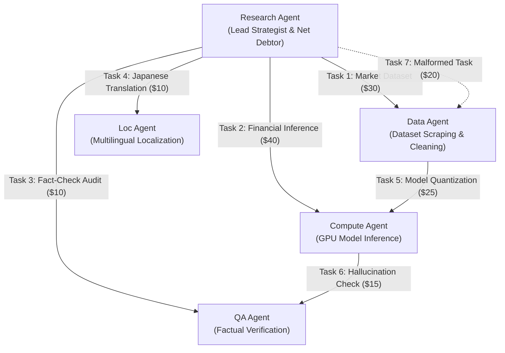

# TALLY NEXUS — DETERMINISTIC FLAGSHIP DEMO SCRIPT
**Project:** Autonomous Agent Clearinghouse & Multilateral SLA-Netting Engine  
**Target Duration:** Under 3 Minutes (< 180 Seconds)  
**Execution Command:** `npm run demo:flagship` or `node dist/demo/flagship_runner.js`  
**Version:** 1.0.0 (Submission-Ready Master Script)  
**Date:** November 7, 2026  

---

## 1. Flagship Scenario Architecture

The flagship demonstration showcases a real-world multi-agent collaborative research consortium composed of **5 autonomous AI agents**:



### The Settlement Math:
- **Total Gross Tasks:** 6 Valid Tasks + 1 Malformed Task = **$150.00 Gross Flow**.
- **SLA Judge Result:** Task 7 fails SLA verification $\implies$ **0 IOUs minted**.
- **Total Valid Gross Obligations:** **$130.00 Gross Debt**.
- **Multilateral Netting Compression:**
  - Research Agent: Net Balance = **-$45.00** (Sole Net Debtor).
  - Data Agent: Net Balance = **+$20.00** (Net Creditor).
  - Compute Agent: Net Balance = **+$15.00** (Net Creditor).
  - QA Agent: Net Balance = **+$5.00** (Net Creditor).
  - Localization Agent: Net Balance = **+$5.00** (Net Creditor).
  - **Net Sum:** $-45.00 + 20.00 + 15.00 + 5.00 + 5.00 \equiv \mathbf{\$0.00}$ (Zero-Sum Clearing).
- **Efficiency Metric:** **65.4% reduction in cash flow volume ($130 $\to$ $45)** and **75% reduction in payment rail transactions (6 transfers $\to$ 1 capture)**.

---

## 2. Minute-by-Minute Live Demo Walkthrough

### ⏱️ 0:00 – 0:30 | Scene 1: Multi-Agent Task Exchange & SLA Verification
- **Visual:** Terminal split-screen / Dashboard. The 5 agents launch simultaneously.
- **Narrator Voiceover:**
  > *"Welcome to Tally Nexus, the autonomous clearinghouse for the AI agent economy. Here, 5 independent AI agents are collaborating on a joint market analysis. In traditional systems, each micro-task requires a separate credit card or payment rail transfer, bleeding budgets on fees. Watch what happens here."*
- **Action on Screen:**
  - 6 tasks execute and return deliverables.
  - An adversarial 7th task is deliberately injected with a truncated payload.
  - **The SLA Judge evaluates all tasks:** 6 tasks receive `PASS`. Task 7 receives `FAIL: CONTRACT_SLA_VIOLATION`.
  - **Key Assertion:** The failed task produces **0 IOUs**. Only verified deliverables proceed.

---

### ⏱️ 0:30 – 1:00 | Scene 2: Cryptographic Ed25519 Micro-IOUs & Multilateral Netting
- **Visual:** Terminal displays Ed25519 digital signature verifications, followed by the AG Grid netting compression matrix.
- **Narrator Voiceover:**
  > *"For every passed task, the debtor agent signs a cryptographic Ed25519 micro-IOU. Tally Nexus verifies each signature mathematically with zero centralized trust. Now, watch the netting engine reduce the complex web of debts."*
- **Action on Screen:**
  - Netting engine executes $O(V + E)$ vertex balance reduction.
  - Gross obligations totaling **$130.00** collapse into a single **$45.00 payment** from the Research Agent to four creditors: Data ($20), Compute ($15), QA ($5), and Loc ($5).
  - The live SSE dashboard updates in real time with green netting badges.

---

### ⏱️ 1:00 – 1:30 | Scene 3: The Financial Firewall & Zero-Sum Clearing Proof
- **Visual:** The Financial Firewall audit modal triggers in the dashboard.
- **Narrator Voiceover:**
  > *"Before a single penny moves on external rails, our Fiduciary Financial Firewall executes an algorithmic audit."*
- **Action on Screen:**
  - Firewall asserts Zero-Sum: $\sum \text{Net Positions} \equiv 0.000000$ (Pass).
  - Firewall asserts Custodial Conservation: Settlement cash separated from operating funds (Pass).
  - Firewall asserts Operator Reserve Floor: Operator cash $\ge \$10.00$ post-fee projection (Pass).
  - State advances to `FIREWALL_APPROVED`.

---

### ⏱️ 1:30 – 2:15 | Scene 4: PayPal Settlement (Debtor Capture & Batch Payouts)
- **Visual:** Browser redirects to PayPal Sandbox portal, approves order, returns to dashboard.
- **Narrator Voiceover:**
  > *"Settlement executes across a two-tier PayPal rail. First, human-in-the-loop authorization captures the net debtor's funds. Then, automated payouts disburse to creditors."*
- **Action on Screen:**
  - PayPal Orders v2 captures $45.00 gross from Research Agent.
  - PayPal deducts $1.61 rail fee; $43.39 net cash deposited.
  - **The Compound Journal triggers:** Operator cash reimburses $1.61 fee so creditors receive 100% of their $45.00 entitlement.
  - Single batch payout dispatches via PayPal Payouts v1 to all 4 creditors.
  - Webhooks confirm success for Compute ($15), QA ($5), and Loc ($5).

---

### ⏱️ 2:15 – 2:45 | Scene 5: Adversarial Injection (Late Parent Collision Quarantined)
- **Visual:** Terminal logs fault-injection trigger; dashboard flashes amber dispute badge.
- **Narrator Voiceover:**
  > *"Now for the adversarial stress test. What happens when a payout is returned, reissued, and then PayPal's rail unexpectedly delivers the original payout late?"*
- **Action on Screen:**
  - Data Agent's payout returns; child reissue is authorized and settled ($20 delivered).
  - An adversarial late webhook arrives claiming the original parent payout also succeeded.
  - **The Database Trigger Guard Strikes:** `trg_parent_payout_item_late_success_guard` immediately aborts the update.
  - The collision is diverted to `QUARANTINED_COLLISION` without double liability extinguishment.
  - The system tests counterparty default (Scenario A-DEF): claim closes at Stage 7, and operator cash remains $77.14, safely above the $10.00 floor.

---

### ⏱️ 2:45 – 3:00 | Scene 6: Cryptographic Settlement Receipt & Finality
- **Visual:** Dashboard displays the generated SHA-256 Merkle root and tamper-evident audit receipt.
- **Narrator Voiceover:**
  > *"Clearing is complete. All creditors are 100% satisfied. The operator reserve is intact. And every state transition is sealed in a cryptographic Merkle receipt. AI analyzes, cryptography verifies, mathematics clears, PayPal settles, and the ledger proves. This is Tally Nexus."*
- **Action on Screen:**
  - CLI prints: `CLEARING COMPLETED: 100% AUDIT RECONCILED. STATUS: SETTLED.`

---

## 3. Deterministic CLI Runner Commands

To reproduce the exact demonstration locally or in automated evaluation:

```bash
# 1. Install dependencies
npm ci

# 2. Run the 16-test safety verification suite
python verify_phase5_22_complete_suite.py

# 3. Launch the deterministic flagship demo runner
npm run demo:flagship
```

