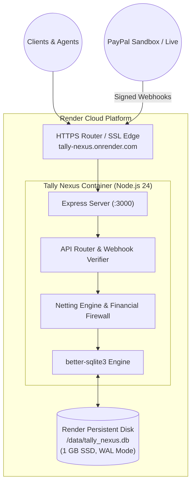

# TALLY NEXUS — DEPLOYMENT PLAN & CLOUD INFRASTRUCTURE SPECIFICATION
**Project:** Autonomous Agent Clearinghouse & Multilateral SLA-Netting Engine  
**Version:** 1.0.0 (Pre-Implementation Baseline)  
**Target Environments:** Local Developer Environment, Automated CI/CD, Render Cloud Web Service  
**Date:** November 7, 2026  
**Auditor:** Principal DevOps & Platform Engineer  

---

## 1. Deployment Philosophy & Target Architecture

Tally Nexus is designed as a **lean, single-container, self-contained financial engine**:
- **Zero External Database Daemons:** SQLite via `better-sqlite3` runs embedded in-process, eliminating PostgreSQL/MySQL connection pools and external network latency.
- **Persistent Disk Volume:** State is preserved across container restarts via a persistent SSD volume mount (`/data`).
- **Stateless Web Routing:** Express handles incoming REST APIs and SSE streaming with zero sticky-session dependencies.



---

## 2. Docker Containerization Standard

### 2.1 Multi-Stage Dockerfile (`Dockerfile`)
```dockerfile
# Stage 1: Build & Compile TypeScript
FROM node:24-alpine AS builder
WORKDIR /app
COPY package*.json tsconfig.json ./
RUN npm ci
COPY src/ ./src/
COPY public/ ./public/
RUN npm run build

# Stage 2: Minimal Production Runtime
FROM node:24-alpine AS runner
WORKDIR /app
ENV NODE_ENV=production
ENV PORT=3000
ENV DATABASE_PATH=/data/tally_nexus.db

# Install SQLite shared libraries if needed by better-sqlite3
RUN apk add --no-cache python3 make g++ sqlite

COPY package*.json ./
RUN npm ci --omit=dev

COPY --from=builder /app/dist ./dist
COPY --from=builder /app/public ./public

# Create data directory for persistent disk mount
RUN mkdir -p /data && chown -R node:node /data /app

USER node
EXPOSE 3000

HEALTHCHECK --interval=30s --timeout=5s --start-period=5s --retries=3 \
  CMD wget --no-verbose --tries=1 --spider http://localhost:3000/api/health || exit 1

CMD ["node", "dist/server.js"]
```

---

## 3. Render Cloud Deployment Configuration (`render.yaml`)

```yaml
services:
  - type: web
    name: tally-nexus
    env: node
    plan: starter
    region: oregon
    buildCommand: npm ci && npm run build
    startCommand: node dist/server.js
    healthCheckPath: /api/health
    disk:
      name: tally-nexus-data
      mountPath: /data
      sizeGB: 1
    envVars:
      - key: NODE_ENV
        value: production
      - key: PORT
        value: 3000
      - key: DATABASE_PATH
        value: /data/tally_nexus.db
      - key: PAYPAL_ENV
        value: sandbox
      - key: PAYPAL_CLIENT_ID
        sync: false # Set in Render Dashboard
      - key: PAYPAL_CLIENT_SECRET
        sync: false # Set in Render Dashboard
      - key: PAYPAL_WEBHOOK_ID
        sync: false # Set in Render Dashboard
      - key: OPERATOR_RESERVE_FLOOR
        value: "10.00"
```

---

## 4. Local Quick Start & Verification

To run and verify the complete application locally:

```bash
# 1. Clone repository
git clone https://github.com/your-org/tally-nexus.git
cd tally-nexus

# 2. Configure environment
cp .env.example .env

# 3. Install dependencies
npm ci

# 4. Verify financial invariants (16-test suite)
python verify_phase5_22_complete_suite.py

# 5. Start development server with live reload
npm run dev

# 6. Access Operator Dashboard
# Open http://localhost:3000 in your browser
```

---

## 5. Health Checks & Disaster Recovery

### 5.1 Health Check Endpoint (`GET /api/health`)
The server exposes `GET /api/health` providing real-time subsystem status:
```json
{
  "status": "HEALTHY",
  "uptimeSeconds": 14205,
  "database": {
    "status": "CONNECTED",
    "journalMode": "wal",
    "integrityCheck": "ok"
  },
  "paypal": {
    "status": "AUTHENTICATED",
    "tokenExpiresInSeconds": 28400
  },
  "fiduciary": {
    "settlementCashCents": 0,
    "operatorCashCents": 9839,
    "reserveFloorCents": 1000,
    "reserveHeadroomCents": 8839,
    "activeDisputeHolds": 0
  }
}
```

### 5.2 Backup & Archival Strategy
- **WAL Checkpointing:** Periodic `PRAGMA wal_checkpoint(TRUNCATE);` runs during low-activity intervals.
- **Snapshot Backup:** Automated daily SQLite online backup (`VACUUM INTO '/data/backups/tally_backup_' || strftime('%Y%m%d', 'now') || '.db';`) ensuring point-in-time recovery with zero application downtime.

