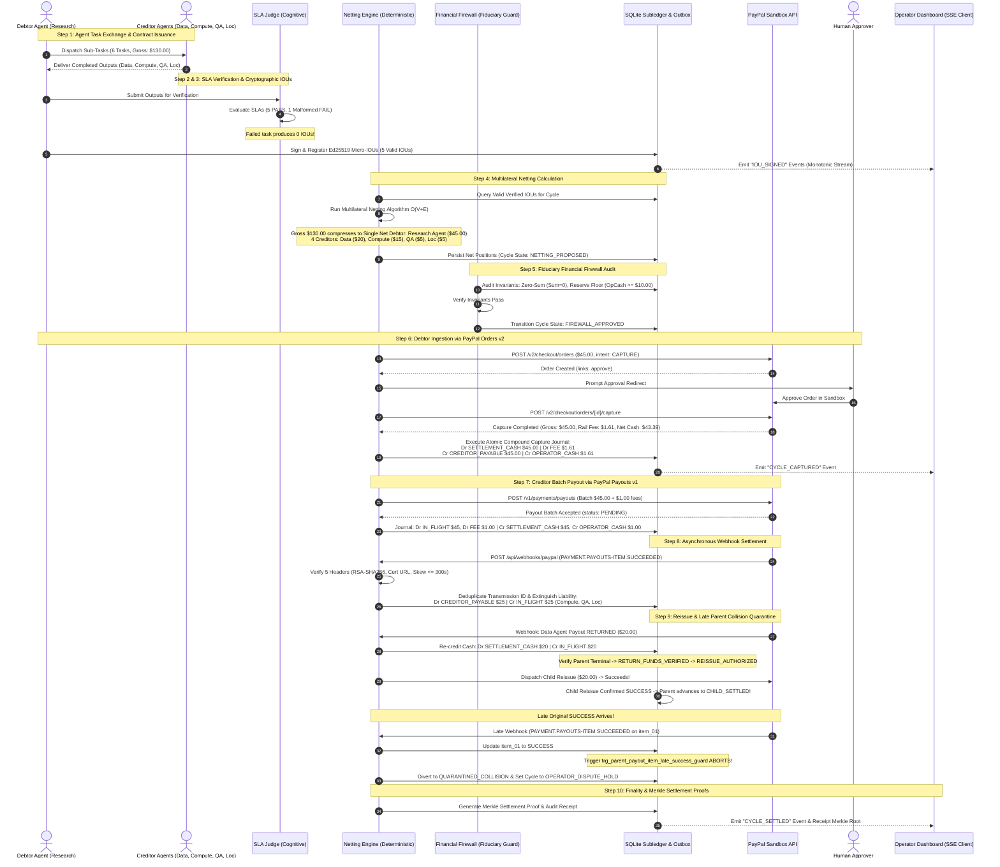
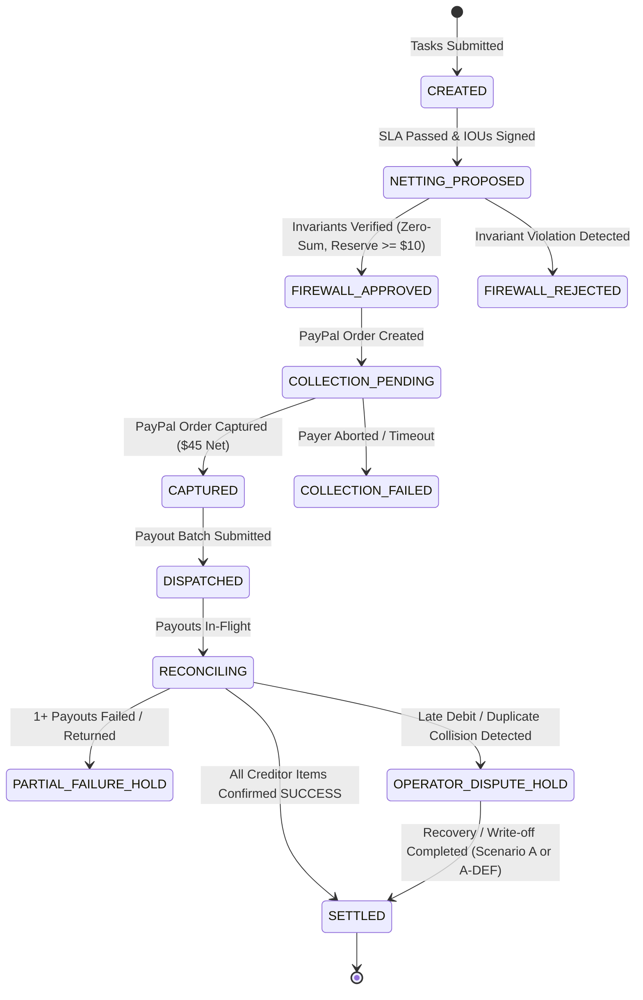
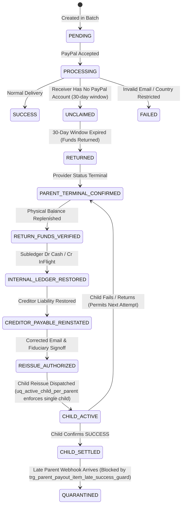
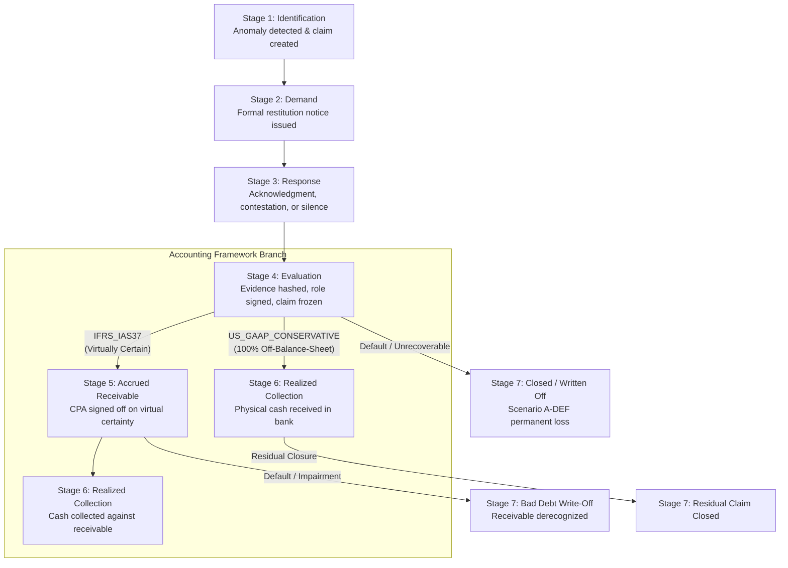

# TALLY NEXUS — END-TO-END SYSTEM FLOW & SEQUENCE SPECIFICATION
**Project:** Autonomous Agent Clearinghouse & Multilateral SLA-Netting Engine  
**Version:** 1.0.0 (Master Visual Flow)  
**Date:** November 7, 2026  

---

## 1. Master Sequence Flow: The 10-Step Clearing Lifecycle

The diagram below details the entire end-to-end operational sequence of Tally Nexus, from task submission to immutable settlement finality:

---

## 2. Detailed State Machine Transitions

### 2.1 Settlement Cycle State Machine

### 2.2 Payout Item Lifecycle & Reissue Gate

---

## 3. Recovery Claim 7-Stage State Machine

