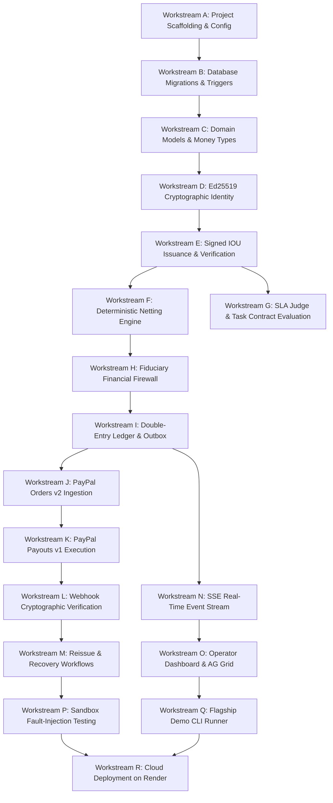

# TALLY NEXUS — IMPLEMENTATION ROADMAP & WORKSTREAM SPECIFICATION
**Project:** Autonomous Agent Clearinghouse & Multilateral SLA-Netting Engine  
**Version:** 1.0.0 (Implementation-Ready Blueprint)  
**Date:** November 7, 2026  
**Auditor:** Principal Software Architect & Delivery Lead  

---

## 1. Workstream Dependency Graph

---

## 2. Granular Workstream Specifications

### Workstream A: Repository Setup & Configuration
- **Dependencies:** Node.js 24 LTS, npm.
- **Scope:** Initialize `package.json`, `tsconfig.json` (strict mode, NodeNext), install production and dev dependencies.
- **Acceptance Criteria:** `npm run build` compiles TypeScript with zero errors; Vitest runs cleanly.
- **Security Concerns:** Verify package hashes and permissive MIT/BSD licenses.
- **Definition of Done:** Clean repository scaffold with automated linting and typecheck scripts.
- **Demo Impact:** Foundation for all runtime services.

### Workstream B: Database Migrations & Schema Enforcement
- **Dependencies:** Workstream A, `better-sqlite3`.
- **Scope:** Implement migration scripts creating all 18 tables, 10 declarative triggers, and partial unique index `uq_active_child_per_parent`.
- **Acceptance Criteria:** Real SQLite database mounts with WAL mode, foreign keys enabled, and all triggers firing as proven in Phase 5.22.
- **Security Concerns:** SQL injection prevention via prepared statements; zero cascading deletes (`ON DELETE RESTRICT`).
- **Definition of Done:** Database boots up idempotently and executes schema validation queries without warnings.
- **Demo Impact:** Underpins all persistence, state machines, and auditability.

### Workstream C: Core Financial Domain Models
- **Dependencies:** Workstreams A, B, `zod`.
- **Scope:** Define immutable TypeScript interfaces and Zod schemas for monetary units (integer minor cents), accounts, and state enums.
- **Acceptance Criteria:** Invalid amounts (negative, floating-point decimals) rejected at type and runtime boundaries.
- **Security Concerns:** Integer overflow bounds checking ($0 < \text{cents} < 2^{53} - 1$).
- **Definition of Done:** 100% typed domain models with accompanying Zod validation unit tests.
- **Demo Impact:** Ensures data integrity across API payloads.

### Workstream D: Ed25519 Cryptographic Identity
- **Dependencies:** Workstreams A, C, built-in `node:crypto`.
- **Scope:** Agent keypair generation, serialization, public key registration, and secure agent keystore.
- **Acceptance Criteria:** Fast keypair generation; 64-hex-character public key stored in `agents` table.
- **Security Concerns:** Private keys must never leak over API responses or log statements.
- **Definition of Done:** Cryptographic unit test validating keypair generation, public key derivation, and storage.
- **Demo Impact:** Provides mathematical proof of agent identity in demo scene 2.

### Workstream E: Signed Micro-IOU Issuance & Verification
- **Dependencies:** Workstreams C, D.
- **Scope:** Canonical JSON serialization of task obligations; Ed25519 digital signature signing and verification.
- **Acceptance Criteria:** `verifyIOU()` returns `true` for valid signatures; tampering with any byte returns `false`.
- **Security Concerns:** Non-repudiation, protection against signature malleability and replay.
- **Definition of Done:** Test suite asserting positive signing, signature verification, and negative tampering rejections.
- **Demo Impact:** Displays cryptographic digital IOU verification on screen.

### Workstream F: Deterministic Multilateral Netting Engine
- **Dependencies:** Workstream E.
- **Scope:** Implement vertex balance reduction algorithm: $B_i = \sum \text{Credits} - \sum \text{Debts}$.
- **Acceptance Criteria:** In 5-agent consortium, $130.00 gross debt compresses to $45.00 net debtor payment to 4 creditors.
- **Security Concerns:** Mathematical zero-sum invariant ($\sum \text{Net} \equiv 0$) must be proven on every calculation.
- **Definition of Done:** Property-based tests verifying zero-sum across 10,000 random obligation matrices.
- **Demo Impact:** Visualizes the 65.4% cash flow reduction in demo scene 2.

### Workstream G: SLA Judge & Task Contract Evaluation
- **Dependencies:** Workstreams C, E.
- **Scope:** Programmatic contract evaluator inspecting task deliverables under predefined SLA criteria.
- **Acceptance Criteria:** Valid deliverables return `PASS` (produce IOUs); malformed deliverables return `FAIL` (0 IOUs produced).
- **Security Concerns:** AI prompt injection defense; strict schema matching before verdict creation.
- **Definition of Done:** Unit test proving malformed tasks are blocked from generating IOUs.
- **Demo Impact:** Proves SLA enforcement in demo scene 1.

### Workstream H: Fiduciary Financial Firewall
- **Dependencies:** Workstreams F, G.
- **Scope:** Programmatic pre-settlement audit evaluating zero-sum invariant, custodial separation, and operator reserve floor.
- **Acceptance Criteria:** Cycle advances to `FIREWALL_APPROVED` only if all invariants pass; otherwise rolls back.
- **Security Concerns:** Fiduciary halt (`OPERATOR_RESERVE_HOLD`) triggered if operator cash drops below $10.00.
- **Definition of Done:** Unit and integration tests testing invariant approval and negative violation rejections.
- **Demo Impact:** Displays the firewall audit modal in demo scene 3.

### Workstream I: Double-Entry Ledger & Transactional Outbox
- **Dependencies:** Workstreams B, H.
- **Scope:** Implement balanced double-entry subledger service and append-only `system_events` outbox queue.
- **Acceptance Criteria:** All ledger entries balance ($\sum \text{Debits} \equiv \sum \text{Credits}$); compound capture fee journal supported.
- **Security Concerns:** Atomic database transaction wrapping both ledger entry and outbox insertion.
- **Definition of Done:** Invariant test proving zero unbalanced ledger states can be committed.
- **Demo Impact:** Real-time event streaming and live ledger updates.

### Workstream J: PayPal Orders v2 Debtor Collection
- **Dependencies:** Workstreams H, I.
- **Scope:** PayPal Orders v2 integration: `POST /v2/checkout/orders` and `POST /v2/checkout/orders/{id}/capture`.
- **Acceptance Criteria:** Capture records gross $45.00, fee $1.61, net cash $43.39, executing compound reimbursement entry.
- **Security Concerns:** Idempotency via `PayPal-Request-Id`; validation of `seller_receivable_breakdown`.
- **Definition of Done:** Mock and sandbox integration tests verifying capture and subledger allocation.
- **Demo Impact:** Live PayPal checkout redirect in demo scene 4.

### Workstream K: PayPal Payouts v1 Batch Execution
- **Dependencies:** Workstream J.
- **Scope:** PayPal Payouts v1 integration: `POST /v1/payments/payouts` with unique `sender_batch_id`.
- **Acceptance Criteria:** Single batch dispatches 4 creditor payouts; moves funds to `IN_FLIGHT`; deducts fees from operator cash.
- **Security Concerns:** HATEOAS re-anchoring; batch idempotency.
- **Definition of Done:** Integration test asserting payout item creation and in-flight asset accounting.
- **Demo Impact:** Payout batch dispatch in demo scene 4.

### Workstream L: Webhook Ingestion & Cryptographic Verification
- **Dependencies:** Workstream K.
- **Scope:** Express webhook endpoint `POST /api/webhooks/paypal` with raw byte preservation and 5-header RSA verification.
- **Acceptance Criteria:** Rejects forged signatures, stale webhooks (> 300s), and untrusted cert URLs; deduplicates nonces.
- **Security Concerns:** Replay attacks, MITM attacks, payload tampering.
- **Definition of Done:** Test suite validating header checks, domain whitelisting, and signature verification.
- **Demo Impact:** Real-time settlement confirmation badges.

### Workstream M: Recovery, Reissue & Collision Quarantine
- **Dependencies:** Workstream L.
- **Scope:** Unclaimed return handling, child reissue entitlement (`uq_active_child_per_parent`), late parent collision guard, Scenario A & A-DEF.
- **Acceptance Criteria:** Trigger `trg_parent_payout_item_late_success_guard` blocks late success; Scenario A-DEF preserves $10 floor ($77.14).
- **Security Concerns:** Double liability extinguishment; double payouts.
- **Definition of Done:** 16/16 adversarial verification tests pass.
- **Demo Impact:** Fault-injection collision test in demo scene 5.

### Workstream N: Server-Sent Events (SSE) Delivery Stream
- **Dependencies:** Workstreams I, L.
- **Scope:** Express SSE endpoint `GET /api/events/stream` tailing `system_events` by monotonic `sequence_id`.
- **Acceptance Criteria:** Browser reconnects seamlessly without message loss; sends heartbeat pings every 15s.
- **Security Concerns:** Client connection limits; backpressure management.
- **Definition of Done:** Integration test asserting client reconnect with `Last-Event-ID` receives all missed events.
- **Demo Impact:** Drives real-time dashboard UI animations.

### Workstream O: Operator Dashboard & AG Grid
- **Dependencies:** Workstreams N.
- **Scope:** Web interface featuring Netting Matrix (AG Grid), Live Balance Sheet, Anomaly Quarantine Modal, and Audit Log.
- **Acceptance Criteria:** Fast client-side rendering; responsive layout; zero external CDN dependencies.
- **Security Concerns:** XSS prevention via text content escaping; strict CSP headers.
- **Definition of Done:** Interactive dashboard rendering live clearing cycle transitions.
- **Demo Impact:** Primary visual centerpiece of the live demonstration.

### Workstream P: Sandbox Fault-Injection Testing
- **Dependencies:** Workstreams M, O.
- **Scope:** Automated test runner executing the 16 adversarial tests against live/mock PayPal rails.
- **Acceptance Criteria:** 100% pass across all 16 fault-injection scenarios.
- **Definition of Done:** Automated test script generating reproducible test report.
- **Demo Impact:** Proof of safety in demo scene 5.

### Workstream Q: Reproducible Flagship Demo CLI Runner
- **Dependencies:** Workstreams O, P.
- **Scope:** Single command runner (`npm run demo:flagship`) orchestrating the entire 5-agent consortium scenario under 180s.
- **Acceptance Criteria:** Runs end-to-end deterministically without human manual database manipulation.
- **Definition of Done:** Complete automated demo execution script with colorized console logs and dashboard synchronization.
- **Demo Impact:** The core competition submission artifact.

### Workstream R: Cloud Deployment & Final Packaging
- **Dependencies:** Workstream Q.
- **Scope:** Multi-stage Dockerfile, Render deployment blueprint (`render.yaml`), persistent disk mount, and final documentation sync.
- **Acceptance Criteria:** Application boots on Render with persistent SQLite storage and passes `/api/health`.
- **Definition of Done:** Deployed production URL and complete open-source GitHub repository package.
- **Demo Impact:** Publicly accessible live deployment for evaluators.

