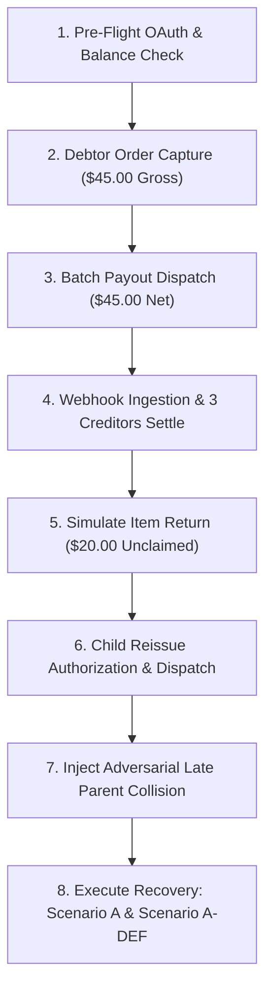

# TALLY NEXUS — PAYPAL SANDBOX EXECUTION PLAN
**Project:** Autonomous Agent Clearinghouse & Multilateral SLA-Netting Engine  
**Version:** 1.0.0 (Phase 7 Pre-Flight Execution Protocol)  
**Date:** November 7, 2026  
**Auditor:** Principal Integration Engineer & Payment Rail Specialist  

---

## 1. Sandbox Prerequisites & Account Entitlements

Prior to initiating Phase 7 live Sandbox testing, the following developer accounts and feature entitlements must be verified in the PayPal Developer Dashboard (`https://developer.paypal.com`):

### 1.1 Account Setup Requirements
1. **Sandbox Business Account (Clearinghouse Operator):**
   - **Account Type:** Business Account (Configured as India sandbox business account `sb-kmpmt53795647@business.example.com`, receiving USD collections; with US Personal creditor accounts `sb-qvovc...` and `sb-dlouv...` receiving payouts).
   - **Mandatory Feature Entitlement:** **PayPal Payouts Enabled**. (Under App Settings > Live/Sandbox Features > Check "Payouts"). If unapproved, Payouts API calls return `INSUFFICIENT_FUNDS` or `PERMISSION_DENIED`.
   - **Starting Balance:** Funded with at least **$200.00 USD** in sandbox balance (to cover operator capital and initial payouts).
2. **Sandbox Personal Account (Net Debtor / Research Agent):**
   - **Account Type:** Personal Buyer Account.
   - **Starting Balance:** Funded with at least **$100.00 USD** (to approve the $45.00 gross settlement order).
3. **Environment Configuration (`.env.sandbox`):**
   ```ini
   PORT=3000
   NODE_ENV=sandbox
   DATABASE_PATH=./data/tally_nexus_sandbox.db
   PAYPAL_ENV=sandbox
   PAYPAL_CLIENT_ID=AeA...sandbox_client_id...
   PAYPAL_CLIENT_SECRET=EP...sandbox_client_secret...
   PAYPAL_WEBHOOK_ID=4WH...registered_webhook_id...
   OPERATOR_RESERVE_FLOOR=10.00
   ```

---

## 2. Step-by-Step Sandbox Execution Protocol



### Step 1: Pre-Flight OAuth & Balance Check
- **API Call:** `POST /v1/oauth2/token` with HTTP Basic Auth (`client_id:client_secret`).
- **Expected Result:** HTTP 200, returns Bearer token with `expires_in: 32400`. Token cached in memory.
- **Reporting Balance Check:** `GET /v1/reporting/balances?currency_code=USD`. Asserts physical available balance $\ge \text{SETTLEMENT\_CASH} + \text{OPERATOR\_CASH}$.

### Step 2: Debtor Order Creation & Payer Approval
- **API Call:** `POST /v2/checkout/orders` with idempotency header `PayPal-Request-Id: nexus_order_cyc_01`.
  - Body: `{ intent: "CAPTURE", purchase_units: [{ amount: { currency_code: "USD", value: "45.00" } }] }`.
- **Operator Action:** Open `links[rel="payer-action"]` in browser, log in as Sandbox Personal Buyer, and click **Approve**.
- **Capture API Call:** `POST /v2/checkout/orders/{order_id}/capture`.
- **Expected Result:** HTTP 201, `status: "COMPLETED"`.
- **Database Verification:**
  - Evaluates `seller_receivable_breakdown`: Gross $45.00, Fee $1.61, Net Cash Deposited $43.39.
  - Commits compound capture journal entry:
    ```
    Dr ASSET:PAYPAL_SETTLEMENT_CASH          $45.00
    Dr EXPENSE:PAYPAL_TRANSACTION_FEE         $1.61
    Cr LIABILITY:CREDITOR_PAYABLE:agt_data   $20.00
    Cr LIABILITY:CREDITOR_PAYABLE:agt_compute$15.00
    Cr LIABILITY:CREDITOR_PAYABLE:agt_qa      $5.00
    Cr LIABILITY:CREDITOR_PAYABLE:agt_loc     $5.00
    Cr ASSET:OPERATOR_CASH                    $1.61
    ```
  - Emits SSE event: `CYCLE_CAPTURED`.

### Step 3: Creditor Batch Payout Dispatch
- **API Call:** `POST /v1/payments/payouts` with unique `sender_batch_id: nexus_batch_cyc_01`.
  - Items list: 4 items (Compute: $15.00, QA: $5.00, Loc: $5.00, Data: $20.00).
- **Expected Result:** HTTP 201, `batch_status: "PENDING"`.
- **Database Verification:** Subledger transfers $45.00 from `SETTLEMENT_CASH` to `PAYPAL_PAYOUTS_IN_FLIGHT`, debits $1.00 fees from `OPERATOR_CASH`. Cycle state advances to `DISPATCHED`.

### Step 4: Webhook Ingestion & 3 Creditors Settle
- **Incoming Webhooks:** PayPal sends `PAYMENT.PAYOUTS-ITEM.SUCCEEDED` for Compute, QA, and Loc.
- **Verification Engine:**
  - Validates 5 PayPal headers (`AUTH-ALGO`, `CERT-URL`, `TRANSMISSION-ID`, `TRANSMISSION-SIG`, `TRANSMISSION-TIME`).
  - Verifies transmission time within 300s.
  - Verifies RSA-SHA256 signature against cert from `api.sandbox.paypal.com`.
- **Database Verification:** Deduplicates transmission ID; updates items to `SUCCESS`; debits `CREDITOR_PAYABLE` $25.00 | credits `IN_FLIGHT` $25.00.

### Step 5: Simulate Unclaimed Return
- **Condition:** Data Agent's email has no active PayPal wallet or is intentionally unclaimed.
- **Webhook Received:** `PAYMENT.PAYOUTS-ITEM.RETURNED` for `item_01`.
- **Database Verification:** Compensating ledger restores:
  ```
  Dr ASSET:PAYPAL_SETTLEMENT_CASH $20.00
  Cr ASSET:PAYPAL_PAYOUTS_IN_FLIGHT $20.00
  ```
  Parent item advances to `status = 'RETURNED'`, `reissue_authorization_state = 'RETURN_FUNDS_VERIFIED'`.

### Step 6: Child Reissue Authorization & Dispatch
- **Operator Action:** Submit corrected receiver email for Data Agent (`POST /api/cycles/cyc_01/reissue/item_01`).
- **Database Trigger Gate:** `trg_reissue_entitlement_check` passes; `reissue_authorization_state` advances to `REISSUE_AUTHORIZED`.
- **API Call:** `POST /v1/payments/payouts` with single child item `reissue_1`.
- **Partial Unique Index Check:** `uq_active_child_per_parent` guarantees no second active reissue can be submitted.
- **Webhook Received:** `PAYMENT.PAYOUTS-ITEM.SUCCEEDED` on child reissue. Parent item advances to `CHILD_SETTLED`. Creditor liability for Data Agent extinguished in full.

### Step 7: Inject Adversarial Late Parent Collision
- **Adversarial Injection:** Inject late `PAYMENT.PAYOUTS-ITEM.SUCCEEDED` webhook on original parent `item_01`.
- **Expected Result:**
  - Webhook handler attempts `UPDATE paypal_payout_items SET status = 'SUCCESS' WHERE item_id = 'item_01'`.
  - Database trigger `trg_parent_payout_item_late_success_guard` **aborts the transaction immediately**.
  - Handler catches error and logs `status = 'QUARANTINED_COLLISION'`.
  - Cycle state transitions to `OPERATOR_DISPUTE_HOLD`.

### Step 8: Execute Recovery Scenarios (Scenario A & Scenario A-DEF)
1. **Scenario A (Cooperative Cash Refund):**
   - Counterparty returns $20.00 via PayPal.
   - Event `STAGE6_COLLECTED` inserted; trigger automatically sets `stage = 6`, `cash_recovered_cents = 2000`.
   - Cash recognized: `Dr ASSET:OPERATOR_CASH $20 | Cr REVENUE:RECOVERY_GAIN $20`.
   - Ending Operator Cash: **$97.14**, Retained Earnings: **-$2.86**.
2. **Scenario A-DEF (Permanent Counterparty Default):**
   - Counterparty defaults. Claim closed at Stage 7 (`STAGE7_CLOSED`).
   - Trigger sets `stage = 7`, `unrecognized_claim_closed_cents = 2000`. Zero duplicate expense recorded.
   - Ending Operator Cash: **$77.14**, Retained Earnings: **-$22.86**.
   - Verified: **$77.14 $\ge$ $10.00 reserve floor (+67.14 headroom)**.

---

## 3. Sandbox Validation Pass/Fail Criteria

A sandbox execution run is deemed successful if and only if:
1. Every ledger transaction balances perfectly ($\sum \text{Debits} \equiv \sum \text{Credits}$).
2. Zero custodial settlement cash is diverted to pay fees or absorb operator losses.
3. Operator reserve floor ($10.00) is preserved across all normal and default lifecycles.
4. Late parent collision is 100% prevented from causing duplicate liability extinguishment.
5. Merkle settlement receipt matches the SHA-256 root of all constituent database records.

