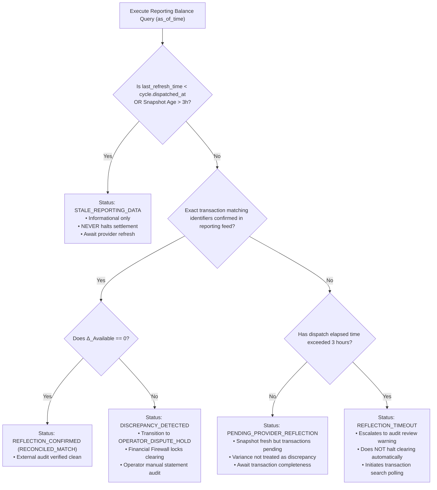

# PAYPAL_STATE_MACHINE.md — SETTLEMENT & RECONCILIATION STATE MACHINES

**Document Version:** 1.4.0 (Phase 5.5 Final Financial Lifecycle Specification)  
**System Name:** TALLY NEXUS  
**Scope:** Complete State Machines, In-Flight Escrow Accounting, Reissue Lifecycle, and Reconciliation Equations  
**Classification:** Core Financial State Machine Specification  

---

## 1. Global Settlement Lifecycle Machine

```
                              [PREPARED]
                                  │
                       Firewall Evaluates & Passes
                                  ▼
                         [FIREWALL_APPROVED]
                                  │
                     Create PayPal Sandbox Order
                                  ▼
                        [COLLECTION_PENDING]
                                  │
         ┌────────────────────────┴────────────────────────┐
         │ Operator Approves                               │ Payer Cancels /
         │ & Capture Confirmed                             │ Gateway Rejects
         ▼                                                 ▼
[COLLECTION_CAPTURED]                             [COLLECTION_FAILED]
         │                                                 │
   Assert Funds == Net Creditors Total                     │ (Cycle Aborted;
   AND Projected OpCash >= RESERVE_FLOOR ($10.00)          │  IOUs return to pool)
         │                                                 │
         ├────────────────────────────────┐                ▼
         │ Pass                           │ Fail       [ABORTED]
         ▼                                ▼
[PAYOUT_DISPATCHED]             [OPERATOR_RESERVE_HOLD]
         │                                │ (Operator Replenishes Working Capital
         │                                │  via BANK_TOPUP >= $10.00 Floor)
         │                                ▼
         │                      [COLLECTION_CAPTURED]
         │                                │
         ▼ ◄──────────────────────────────┘
   Batch Accepted by PayPal (Status: PENDING / PROCESSING)
         │ (If Dispatch Ambiguous/Timeout: -> [PAYOUT_AMBIGUOUS_HOLD])
         ▼
   [RECONCILING]
         │
         ├────────────────────────────────────────┬────────────────────────────────────────┐
         │ 100% Items == SUCCESS                  │ 1+ Items == FAILED, BLOCKED,          │ 1+ Items UNCLAIMED
         │ Outstanding Liability == 0             │ or unrecoverable error                 │ or ONHOLD (Zero Failed)
         ▼                                        ▼                                        ▼
     [SETTLED]                          [PARTIAL_FAILURE_HOLD]                   [RECONCILING (HELD)]
         │                                        │                                        │
         │ (Post-Settlement Reversal:             │ (Operator Manual                      │ (Awaiting Recipient
         │  RETURNED / REFUNDED / REVERSED)       │  Intervention / Reissue)               │  Claim or Review)
         ▼                                        ▼                                        ▼
[POST_SETTLEMENT_RECONCILING] ◄───────────────────┴────────────────────────────────────────┘
         │
         ▼ (Reissue Dispatched & Confirmed SUCCESS)
     [SETTLED]
```

---

## 2. Comprehensive 9-Status Payout Item Transition Matrix

The table below governs state transitions for `paypal_payout_items`. Every transition validates against exact predecessor states and executes balanced double-entry ledger mutations.

| Current State (`status`) | Trigger Event / Webhook | Target State | Predecessor Validation Predicate | Balanced Double-Entry Journal Entry |
| :--- | :--- | :--- | :--- | :--- |
| **`PENDING`** | `PAYOUTS-ITEM.SUCCEEDED` | **`SUCCESS`** | `WHERE item_id = :id AND status IN ('PENDING', 'UNCLAIMED', 'ONHOLD')` | Debit: `LIABILITY:CREDITOR_PAYABLE:{agent}`<br>Credit: `ASSET:PAYPAL_PAYOUTS_IN_FLIGHT`<br>*(Liability extinguished; in-flight cash cleared).* |
| **`PENDING`** | `PAYOUTS-ITEM.UNCLAIMED` | **`UNCLAIMED`** | `WHERE item_id = :id AND status IN ('PENDING', 'ONHOLD')` | *No entry.* Cash remains in `ASSET:PAYPAL_PAYOUTS_IN_FLIGHT`. Liability remains in `LIABILITY:CREDITOR_PAYABLE`. |
| **`PENDING`** | `PAYOUTS-ITEM.HELD` | **`ONHOLD`** | `WHERE item_id = :id AND status = 'PENDING'` | *No entry.* In-flight cash encumbered. Liability remains open. Alerts operator. |
| **`PENDING`** | `PAYOUTS-ITEM.FAILED` | **`FAILED`** | `WHERE item_id = :id AND status IN ('PENDING', 'ONHOLD')` | Debit: `ASSET:PAYPAL_SETTLEMENT_CASH`<br>Credit: `ASSET:PAYPAL_PAYOUTS_IN_FLIGHT`<br>*(Cash returned; liability open awaiting reissue).* |
| **`PENDING`** | `PAYOUTS-ITEM.BLOCKED` | **`BLOCKED`** | `WHERE item_id = :id AND status IN ('PENDING', 'ONHOLD')` | Debit: `ASSET:PAYPAL_SETTLEMENT_CASH`<br>Credit: `ASSET:PAYPAL_PAYOUTS_IN_FLIGHT`<br>*(Cash returned; liability frozen awaiting compliance).* |
| **`UNCLAIMED`**| `PAYOUTS-ITEM.SUCCEEDED` | **`SUCCESS`** | `WHERE item_id = :id AND status = 'UNCLAIMED'` | Debit: `LIABILITY:CREDITOR_PAYABLE:{agent}`<br>Credit: `ASSET:PAYPAL_PAYOUTS_IN_FLIGHT`<br>*(Recipient claimed funds; liability extinguished).* |
| **`UNCLAIMED`**| `PAYOUTS-ITEM.RETURNED` | **`RETURNED`** | `WHERE item_id = :id AND status = 'UNCLAIMED'` | Debit: `ASSET:PAYPAL_SETTLEMENT_CASH`<br>Credit: `ASSET:PAYPAL_PAYOUTS_IN_FLIGHT`<br>*(Cash returned to balance; liability was NEVER extinguished).* |
| **`SUCCESS`** | `PAYOUTS-ITEM.REFUNDED` | **`REFUNDED`** | `WHERE item_id = :id AND status = 'SUCCESS'` | Debit: `ASSET:PAYPAL_SETTLEMENT_CASH`<br>Credit: `LIABILITY:CREDITOR_PAYABLE:{agent}`<br>*(Recipient refunded; cash returned; liability reinstated).* |
| **`SUCCESS`** | `PAYOUTS-ITEM.REVERSED` | **`REVERSED`** | `WHERE item_id = :id AND status = 'SUCCESS'` | Debit: `ASSET:PAYPAL_SETTLEMENT_CASH`<br>Credit: `LIABILITY:CREDITOR_PAYABLE:{agent}`<br>*(PayPal chargeback; cash returned; liability reinstated).* |
| **`SUCCESS`** | `PAYOUTS-ITEM.SUCCEEDED`| `SUCCESS` | Idempotent duplicate | *No entry.* Duplicate acknowledgment returns HTTP 200 immediately. |
| **Terminal** | Any unexpected webhook | Current | Invalid transition | Throws `InconsistentEntityTransitionError`. Transaction rolls back. |

---

## 2.1 Formal Separation of UNCLAIMED vs ONHOLD Semantics

PayPal treats `UNCLAIMED` and `ONHOLD` as fundamentally distinct operational conditions with mutually exclusive merchant remediation paths:

| Dimension | `UNCLAIMED` Payout Item | `ONHOLD` Payout Item |
| :--- | :--- | :--- |
| **Operational Definition** | Recipient does not possess a confirmed PayPal account or has not accepted the sent funds. | PayPal internal Risk, Compliance, Anti-Money Laundering (AML), or Sanctions review hold. |
| **Provider Life Cycle SLA** | **Strict 30-calendar-day timer** enforced by PayPal core infrastructure. | **Indefinite / No guaranteed timer**. Can resolve in minutes, hours, or weeks depending on manual compliance adjudication. |
| **Merchant Cancellation / Clawback** | Sender cannot prematurely cancel via Payouts API v1; must await 30-day automatic return. | Sender **CANNOT** cancel, claw back, or return an on-hold payout under any circumstance. |
| **Resolution Webhook** | `PAYMENT.PAYOUTS-ITEM.SUCCEEDED` (if claimed) or `PAYMENT.PAYOUTS-ITEM.RETURNED` (if expired). | `PAYMENT.PAYOUTS-ITEM.SUCCEEDED` (if cleared) or `PAYMENT.PAYOUTS-ITEM.BLOCKED` / `FAILED` (if rejected). |
| **Funds Location During State** | Encumbered in `ASSET:PAYPAL_PAYOUTS_IN_FLIGHT`. | Encumbered in `ASSET:PAYPAL_PAYOUTS_IN_FLIGHT`. |
| **Creditor Liability State** | `LIABILITY:CREDITOR_PAYABLE` remains fully outstanding ($20.00). | `LIABILITY:CREDITOR_PAYABLE` remains fully outstanding ($20.00). |
| **Child Reissue Authorization** | **STRICTLY PROHIBITED** until confirmed `RETURNED`. Reissuing during `UNCLAIMED` risks dual disbursement if claimed. | **STRICTLY PROHIBITED AT ALL TIMES**. If PayPal compliance review clears, funds disburse immediately. Dispatching a reissue while `ONHOLD` guarantees duplicate payment! |
| **System Cycle Reaction** | Cycle holds in `RECONCILING` awaiting recipient claim or 30-day return. | Cycle holds in `RECONCILING` with high-severity compliance alert; alerts human operator. |

---

## 3. Payout Reissue & Recovery Lifecycle

When an item enters `RETURNED`, `REFUNDED`, or `FAILED`, the creditor's entitlement has not been delivered. Tally Nexus implements an explicit **Single-Reissue Entitlement & Atomic Return Verification Lifecycle** that guarantees an original payout item can never have multiple active or duplicate child reissues:

```
[Original Item: RETURNED / REFUNDED / FAILED]
                      │
                      ▼
        [1. PARENT_TERMINAL_CONFIRMED]
        • Provider terminal webhook received & verified
        • Original item status stamped RETURNED/REFUNDED/FAILED
                      │
                      ▼
          [2. RETURN_FUNDS_VERIFIED]
        • Return transaction ID confirmed via transaction search
        • Independent of 3h balance reporting latency
                      │
                      ▼
        [3. INTERNAL_LEDGER_RESTORED]
        • Double-entry journal: Dr SETTLEMENT_CASH $20 / Cr IN_FLIGHT $20
        • Custodial cash partition restored
                      │
                      ▼
      [4. CREDITOR_PAYABLE_REINSTATED]
        • Compensating ledger verifies liability remains open (>0)
                      │
                      ▼
          [5. REISSUE_AUTHORIZED]
        • Corrected receiver identity cryptographically validated
        • Dual fiduciary sign-off stamped
                      │
                      ▼
            [6. CHILD_DISPATCHED]
        • Insert into paypal_payout_reissues
        • Partial unique index uq_active_child_per_parent enforces exclusivity
        • Parent item advances to CHILD_ACTIVE
                      │
         ┌────────────┴────────────┐
         ▼                         ▼
  (ITEM.SUCCEEDED)          (ITEM.FAILED / RETURNED)
         │                         │
         ▼                         ▼
   [CHILD_SETTLED]        [PARENT_TERMINAL_CONFIRMED]
   • Liability extinguished • Active child cleared
   • Reissue permanently    • Must re-verify return
     closed                  before attempt #2
```

### 3.1 Single-Reissue Entitlement & Concurrency Protection Rules:
1. **Database-Enforced Exclusivity (Partial Unique Index):**
   ```sql
   CREATE UNIQUE INDEX uq_active_child_per_parent 
   ON paypal_payout_reissues(original_item_id) 
   WHERE status IN ('DRAFT', 'DISPATCHED', 'AMBIGUOUS_HOLD', 'SUCCESS');
   ```
   This storage-engine constraint guarantees that an original payout item can have **at most one** active or settled child reissue. Any concurrent or duplicate insert request is aborted immediately by SQLite with `UNIQUE constraint failed`.
2. **Persistent Authorization State Machine:** A child reissue can **ONLY** be inserted when the parent item has completed all return verification steps and reached `reissue_authorization_state = 'REISSUE_AUTHORIZED'`. Premature inserts on `NONE`, `PARENT_TERMINAL_CONFIRMED`, `RETURN_FUNDS_VERIFIED`, `INTERNAL_LEDGER_RESTORED`, or `CREDITOR_PAYABLE_REINSTATED` are aborted by `trg_reissue_entitlement_check`.
3. **Stale Reporting Protection:** Reissue authorization relies strictly on **transaction-level evidence** (`return_transaction_id` and cryptographically validated PayPal webhook `paypal_event_id`), **never** on coarse periodic reporting balance snapshots (`GET /v1/reporting/balances`), which exhibit up to 3 hours of provider latency.
4. **Retry Lifecycle for Failed Children:** If a child reissue itself enters `FAILED`, `RETURNED`, or `REFUNDED`, trigger `trg_reissue_child_failure_sync` clears `reissue_active_child_id` and resets `reissue_authorization_state` to `PARENT_TERMINAL_CONFIRMED`. A subsequent attempt (`reissue_attempt = 2`) is authorized only after the return verification sequence is executed afresh for the child return.
5. **Settled Immutability:** When a child reissue confirms `SUCCESS`, trigger `trg_reissue_child_terminal_sync` advances the parent to `CHILD_SETTLED`. The partial unique index locks permanently, preventing any subsequent reissue attempt for that obligation.
6. **Exceptional Dual-Disbursement Collision Guard:** If duplicate disbursement evidence arrives for an original item after a child reissue was dispatched:
   - If reissue is in `DRAFT`: Abort child reissue immediately; extinguish liability via original item.
   - If reissue is in `DISPATCHED` or `AMBIGUOUS_HOLD`: Halt processing immediately, flag `CRITICAL_DUAL_DISBURSEMENT_COLLISION`, transition cycle to `OPERATOR_DISPUTE_HOLD`, and prevent double liability extinction. Excess debit is quarantined to operator capital and registered as an off-balance-sheet recovery claim.

### 3.2 Comprehensive Reissue Authorization Matrix

| Parent Item Status | Reissue Permitted? | Required Preconditions | Safety Guarantee & Invariant Enforced |
| :--- | :--- | :--- | :--- |
| `PENDING` | ❌ **STRICTLY PROHIBITED** | None. Blocked unconditionally by trigger & API guard. | Prevents duplicate in-flight payouts while PayPal is actively processing. |
| `PROCESSING` | ❌ **STRICTLY PROHIBITED** | None. Blocked unconditionally by trigger & API guard. | Batch queue in progress at PayPal; disallowing reissue prevents double dispatch. |
| `ONHOLD` | ❌ **STRICTLY PROHIBITED** | None. Blocked unconditionally. Recipient under compliance/AML review. | If KYC/AML review passes, PayPal immediately pays recipient. Reissuing guarantees duplicate loss. |
| `UNCLAIMED` | ❌ **STRICTLY PROHIBITED** | None. Funds actively held by PayPal awaiting receiver acceptance (30 days). | Receiver can claim funds at any time. Reissue blocked until 30-day window expires or sender cancels. |
| `AMBIGUOUS_HOLD` / Timeout | ❌ **STRICTLY PROHIBITED** | None. Parent dispatch timed out; engine must poll PayPal via `sender_item_id`. | Ambiguity does not prove failure. Reissuing during timeout violates parent terminal-state rule. |
| `BLOCKED` | ❌ **STRICTLY PROHIBITED** | Recipient account blocked. Must resolve block or receive terminal failure event. | Prevents repetitive dispatch against blocked recipient. |
| `SUCCESS` | ❌ **STRICTLY PROHIBITED** | None. Creditor entitlement was delivered in full; liability extinguished. | Prevents double payment to already satisfied creditor. |
| `RETURNED` | ✅ **AUTHORIZATION PERMITTED** | 1. Parent item status is `RETURNED`.<br>2. Re-credit of principal ($20) to Available Balance confirmed.<br>3. Compensating ledger restores creditor payable.<br>4. Verified corrected recipient email provided. | Parent reached irreversible terminal return; funds returned to settlement pool; child reissue safe to dispatch. |
| `REFUNDED` | ✅ **AUTHORIZATION PERMITTED** | 1. Parent item status is `REFUNDED`.<br>2. Return of funds to Merchant Available Balance verified.<br>3. Creditor payable reinstated in compensating ledger.<br>4. Verified new receiver email provided. | Parent lifecycle terminated; funds confirmed returned; zero risk of provider duplicate processing. |
| `FAILED` | ✅ **AUTHORIZATION PERMITTED** | 1. Parent item status is `FAILED`.<br>2. Principal never debited or immediately restored.<br>3. Recipient account error remediated or new email supplied.<br>4. Creditor payable confirmed open. | Failure confirmed terminal by provider; no provider debit occurred; reissue dispatches safely. |

---

## 4. Double-Entry Accounting Chart of Accounts & External Balance Architecture

### 4.1 Internal Accounting Partitions vs External Provider Balances

To prevent conflation between internal ledger partitions and actual funds held by PayPal, Tally Nexus strictly distinguishes **external provider-reported numbers** from **internal double-entry asset accounts**:

1. **External Provider Balances (Authoritative PayPal State):**
   - $PP_{\text{Actual\_Available}}$: Balance reported by PayPal via `GET /v1/reporting/balances?as_of_time=...`. *Note on Provider Freshness:* As documented by PayPal, this reporting endpoint can take **up to three hours to appear** and reflects the `last_refresh_time`. It is used exclusively for periodic accounting reconciliation, **never** as a real-time settlement authorization gate.
   - $PP_{\text{Reported\_Pending}}$: Cumulative principal of payout items currently pending, processing, unclaimed, or held inside PayPal's processing pipeline, queried in real time via the Payouts API (`GET /v1/payments/payouts/{payout_batch_id}`).
2. **Internal Cash Partitions (Sub-divisions of Available Cash):**
   - `ASSET:OPERATOR_CASH`: Operator-owned working capital inside the PayPal account (used to fund rail fees, absorb operational discrepancies, and provide liquidity).
   - `ASSET:PAYPAL_SETTLEMENT_CASH`: Custodial debtor principal held inside the PayPal account, strictly ring-fenced for payout dispatch to creditors.
   - *Expected Available Cash:* $\text{Cash}_{\text{Expected}} \equiv \text{ASSET:OPERATOR\_CASH} + \text{ASSET:PAYPAL\_SETTLEMENT\_CASH}$.
3. **Internal Transit Asset (Custodial Accounting Asset):**
   - `ASSET:PAYPAL_PAYOUTS_IN_FLIGHT`: Internal accounting asset representing custodial debtor principal that has been dispatched and debited from PayPal's available balance, but not yet finalized by recipient delivery (`SUCCESS`) or return (`RETURNED`). *Note:* This is an internal accounting claim on in-transit money, **not** money physically sitting in PayPal's available balance.
4. **On-Balance-Sheet Recovery Claim:**
   - `ASSET:OPERATOR_DISPUTE_RECEIVABLE:{agent_id}`: **On-balance-sheet** legal recovery asset established when duplicate or erroneous disbursements occur. Owned by the operator, separate from custodial principal, not guaranteed to be recovered, subject to impairment/write-off (`EXPENSE:UNRECOVERABLE_DISBURSEMENT_LOSS`), and included in $\text{Assets} \equiv \text{Liabilities} + \text{Equity}$.

#### Authoritative Provider Reality vs Deterministic Funding Attribution Policy:
- **Single Fungible Balance Reality:** PayPal infrastructure maintains a single, fungible cash balance (`available_balance`). PayPal does not support native cryptographic sub-accounts or distinguish between clearinghouse custodial debtor principal and operator working capital.
- **Deterministic Funding Attribution Priority Rule:** To guarantee absolute fiduciary protection of creditor funds, Tally Nexus enforces an internal deterministic priority for attributing external debits:
  1. *Priority 1 (Operator Capital Absorption):* All anomalous, unmapped, or duplicate debits are attributed **first** to `ASSET:OPERATOR_CASH` up to its available balance.
  2. *Insulation Invariant:* If $\text{ASSET:OPERATOR\_CASH} \ge \text{DebitAmount}$, custodial settlement cash is 100% insulated (Scenario A).
  3. *Priority 2 (Custodial Shortfall Exposure):* If and only if $\text{ASSET:OPERATOR\_CASH} < \text{DebitAmount}$, the deficit breaches into `ASSET:PAYPAL_SETTLEMENT_CASH`. The system immediately recognizes an explicit, audited **Custodial Shortfall** and halts all clearing until the operator injects equity capital to cure the trust (Scenario B).

```
Physical PayPal Account (api-m.sandbox.paypal.com)
├── Available Balance (GET /v1/reporting/balances - Subject to 3h reporting refresh latency)
│   ├── ASSET:OPERATOR_CASH                         [Internal Partition: Operator capital & OpEx]
│   └── ASSET:PAYPAL_SETTLEMENT_CASH                [Internal Partition: Custodial debtor funds]
└── Dispatched Payout Pipeline (Deducted by PayPal upon batch acceptance - Real-time queryable)
    └── ASSET:PAYPAL_PAYOUTS_IN_FLIGHT              [Internal Accounting Asset: Tracking in-flight items]

On-Balance-Sheet Recovery Asset (Non-PayPal Legal Claim or Provider Dispute):
    ├── ASSET:OPERATOR_DISPUTE_RECEIVABLE:{agent_id} [Case 1: Operator claim against overpaid agent]
    └── ASSET:OPERATOR_DISPUTE_RECEIVABLE:paypal     [Case 2: Operator claim against PayPal for erroneous debit]
```

### 4.2 Complete Chart of Accounts

```
ASSETS:
 1. ASSET:OPERATOR_CASH                               (Operator-owned funds inside PayPal Available Balance)
 2. ASSET:PAYPAL_SETTLEMENT_CASH                      (Custodial debtor principal inside PayPal Available Balance)
 3. ASSET:PAYPAL_PAYOUTS_IN_FLIGHT                    (Custodial principal committed to provider payout processing)
 4. ASSET:OPERATOR_DISPUTE_RECEIVABLE:{counterparty}  (On-balance-sheet claim against overpaid agent or PayPal)
    • ASSET:OPERATOR_DISPUTE_RECEIVABLE:{agent_id}    (Counterparty = Overpaid recipient agent)
    • ASSET:OPERATOR_DISPUTE_RECEIVABLE:paypal         (Counterparty = PayPal provider for erroneous debit)

LIABILITIES:
 5. LIABILITY:CREDITOR_PAYABLE:{agent_id}             (Debt owed by clearinghouse to creditor agent)

EQUITY & EXPENSES:
 6. EQUITY:OPERATOR_CAPITAL                           (Contributed working capital from human operator)
 7. EQUITY:RETAINED_EARNINGS                          (Cumulative net earnings: -fees - losses)
 8. EXPENSE:PAYPAL_TRANSACTION_FEE                    (Payment rail operating fees: dynamically read from provider)
 9. EXPENSE:UNRECOVERABLE_DISBURSEMENT_LOSS           (Impairment/bad debt when duplicate payout/debit is unrecoverable)
10. EXPENSE:CUSTODIAL_SHORTFALL_LOSS                  (Loss recognized upon custodial shortfall breach)
11. REVENUE:DISPUTE_RECOVERY_RECOGNITION              (Conditional revenue recognized ONLY upon verified legal claim)
```

### 4.3 Normal Lifecycle Journal Entries (Flagship Scenario: 4 Creditors)

**Illustrative Scenario Baseline:** 4 creditors: Data ($20), Compute ($15), QA ($5), Localization ($5). Total principal: $45.00. 1 Debtor (Research Agent).  
*Fee Policy:* Pre-flight planning uses an illustrative estimate of $0.25/item (standard US domestic flat fee). In production, the clearinghouse parses `payout_item_fee.value` from the PayPal API and records the exact provider-reported fee. For this illustrative scenario: 4 original items × $0.25 = $1.00; 1 reissue × $0.25 = $0.25. Initial operator funding: $100.00.

| # | Lifecycle Event | Debit | Credit | Amount | Account Balances After Event | A = L + E | Int Avail Cash | Int In-Flt | PP Avail (Expected) | PP Pending Payouts | Δ In-Flt (Real-Time) |
| :---: | :--- | :--- | :--- | :---: | :--- | :---: | :---: | :---: | :---: | :---: | :---: |
| **1** | Operator Capital Contribution | `OPERATOR_CASH` | `EQUITY:OPERATOR_CAPITAL` | **$100.00** | OpCash=$100, SetCash=$0, InFlt=$0, Liab=$0, Eq=$100 | $100 = $0 + $100 ✓ | $100.00 | $0.00 | $100.00 | $0.00 | $0 |
| **2** | Debtor Order Captured | `SETTLEMENT_CASH` | `CRED_PAY:data` $20<br>`CRED_PAY:compute` $15<br>`CRED_PAY:qa` $5<br>`CRED_PAY:loc` $5 | **$45.00** | OpCash=$100, SetCash=$45, InFlt=$0, Liab=$45, Eq=$100 | $145 = $45 + $100 ✓ | $145.00 | $0.00 | $145.00 | $0.00 | $0 |
| **3** | Batch Dispatched (4 items × $0.25) | `IN_FLIGHT` $45<br>`EXPENSE:FEE` $1 | `SETTLEMENT_CASH` $45<br>`OPERATOR_CASH` $1 | **$45.00<br>+$1.00** | OpCash=$99, SetCash=$0, InFlt=$45, Liab=$45, Eq=$99 | $144 = $45 + $99 ✓ | $99.00 | $45.00 | $99.00 | $45.00 | $0 |
| **4** | 3 Payouts Succeed ($15+$5+$5=$25) | `CRED_PAY:{compute,qa,loc}` | `IN_FLIGHT` | **$25.00** | OpCash=$99, SetCash=$0, InFlt=$20, Liab=$20, Eq=$99 | $119 = $20 + $99 ✓ | $99.00 | $20.00 | $99.00 | $20.00 | $0 |
| **5** | Data Agent Payout `UNCLAIMED` | *(no entry)* | *(no entry)* | **$0.00** | *(unchanged; claim window open)* | $119 = $20 + $99 ✓ | $99.00 | $20.00 | $99.00 | $20.00 | $0 |
| **6** | Data Agent Payout `RETURNED` | `SETTLEMENT_CASH` $20 | `IN_FLIGHT` $20 | **$20.00** | OpCash=$99, SetCash=$20, InFlt=$0, Liab=$20, Eq=$99 | $119 = $20 + $99 ✓ | $119.00 | $0.00 | $119.00 | $0.00 | $0 |
| **7** | Reissue Dispatched ($20 + $0.25 fee) | `IN_FLIGHT` $20<br>`EXPENSE:FEE` $0.25 | `SETTLEMENT_CASH` $20<br>`OPERATOR_CASH` $0.25 | **$20.00<br>+$0.25** | OpCash=$98.75, SetCash=$0, InFlt=$20, Liab=$20, Eq=$98.75 | $118.75 = $20 + $98.75 ✓ | $98.75 | $20.00 | $98.75 | $20.00 | $0 |
| **8** | Reissue Confirmed `SUCCESS` | `CRED_PAY:data` $20 | `IN_FLIGHT` $20 | **$20.00** | OpCash=$98.75, SetCash=$0, InFlt=$0, Liab=$0, Eq=$98.75 | $98.75 = $0 + $98.75 ✓ | $98.75 | $0.00 | $98.75 | $0.00 | $0 |

*Fee Summary:* 4 original items ($1.00) + 1 reissue ($0.25) = **$1.25 total illustrative fees**. Operator cash: $100.00 − $1.25 = **$98.75**. Real-time in-flight variance $\Delta_{\text{InFlight}} \equiv 0$ across all steps.

---

### 4.4 Exceptional Duplicate-Disbursement Collision Architecture

*Classification Notice:* PayPal documentation defines `RETURNED` as a terminal funds restoration where principal is re-credited to the sender's available balance. A subsequent disbursement on a returned item does **not** exist as a documented provider state transition. Instead, it represents an **exceptional operational anomaly** (e.g. an offline dispute replay, external banking re-debit, or administrative adjustment by PayPal resulting in duplicate debit of the merchant account).

To maintain absolute accounting and custodial integrity, Tally Nexus models the duplicate debit against the **actual physical source of the debited PayPal funds**.

#### Explicit Cash Partition Definitions:
1. $PP_{\text{Physical\_Available}}$: Authoritative single physical cash balance held at PayPal (`GET /v1/reporting/balances`), representing the single external money pool.
2. `ASSET:OPERATOR_CASH`: Internal subledger operator partition of $PP_{\text{Physical\_Available}}$ (funds payment rail fees, absorbs operational discrepancies, and maintains the reserve floor).
3. `ASSET:PAYPAL_SETTLEMENT_CASH`: Internal subledger custodial partition of $PP_{\text{Physical\_Available}}$ (strictly ring-fenced for payout distribution to creditors).
4. `ASSET:PAYPAL_PAYOUTS_IN_FLIGHT`: Internal accounting transit asset representing custodial principal deducted by PayPal upon batch dispatch but pending recipient delivery (`SUCCESS`) or return (`RETURNED`).
5. `ASSET:OPERATOR_DISPUTE_RECEIVABLE:{counterparty}`: Off-balance-sheet recovery claim (Stages 1–4) or on-balance-sheet asset (Stage 5 under IFRS IAS 37; realized at Stage 6 under US GAAP ASC 450-30).
6. `LIABILITY:CREDITOR_PAYABLE:{agent_id}`: Custodial obligation owed to a creditor agent.

*Critical Accounting Distinction:* `ASSET:OPERATOR_CASH` and `ASSET:PAYPAL_SETTLEMENT_CASH` are **not separate physical bank accounts**. They are internal subledger partitions of the single physical PayPal available balance. Transfers between them represent internal subledger reclassifications, never physical banking transactions.

---

#### SCENARIO A: Complete Chronological Journal of Authorized Return, Child Reissue & Dual-Disbursement Collision ($20 Data Agent)

*Precondition / Baseline:*
- Operator Capital: $100.00
- Debtor Capture: Research Agent captured $45.00 gross (PayPal fee: $1.61; net credit: $43.39)
- Baseline Balances:
  - `ASSET:OPERATOR_CASH` = $100.00 - $1.61 = $98.39
  - `ASSET:PAYPAL_SETTLEMENT_CASH` = $45.00
  - `LIABILITY:CREDITOR_PAYABLE` = $45.00 ($20 Data Agent, $15 Compute Agent, $5 QA Agent, $5 Loc Agent)
  - `EQUITY:OPERATOR_CAPITAL` = $100.00
  - `EQUITY:RETAINED_EARNINGS` = -$1.61
  - *Identity:* $\text{Assets } (\$143.39) \equiv \text{Liabilities } (\$45.00) + \text{Equity } (\$98.39)$ ✓

---

##### Event A1: Original Payout Batch Dispatch (Data Agent $20 Component)
PayPal Payout batch is dispatched for all 4 items ($45 total principal). The Data Agent $20 component ($0.25 fee) is dispatched:
- **Ledger Entry:**
  - Debit: `ASSET:PAYPAL_PAYOUTS_IN_FLIGHT` $20.00
  - Debit: `EXPENSE:PAYPAL_TRANSACTION_FEE` $0.25
  - Credit: `ASSET:PAYPAL_SETTLEMENT_CASH` $20.00
  - Credit: `ASSET:OPERATOR_CASH` $0.25
- **Intermediate Balance (Post-Event A1):**
  - `ASSET:PAYPAL_SETTLEMENT_CASH`: $45.00 - $20.00 = $25.00 (remaining 3 creditors)
  - `ASSET:PAYPAL_PAYOUTS_IN_FLIGHT`: $20.00 (Data Agent in flight)
  - `ASSET:OPERATOR_CASH`: $98.39 - $0.25 = $98.14
  - `LIABILITY:CREDITOR_PAYABLE`: $45.00 (all 4 still pending confirmation)
  - `EQUITY:OPERATOR_CAPITAL`: $100.00
  - `EQUITY:RETAINED_EARNINGS`: -$1.61 - $0.25 = -$1.86
  - *Identity:* $\text{Assets } (\$143.14) \equiv \text{Liabilities } (\$45.00) + \text{Equity } (\$98.14)$ ✓

---

##### Event A2: Original Payout Item Enters Terminal `RETURNED` & Funds Re-credited
Data Agent original payout was UNCLAIMED / rejected by recipient bank and reaches confirmed terminal `RETURNED` status via webhook `PAYMENT.PAYOUTS-ITEM.RETURNED`. PayPal re-credits $20.00 principal back to merchant Available Balance (fee $0.25 retained by PayPal as provider charge). In-flight asset is cleared, and settlement cash is restored:
- **Ledger Entry:**
  - Debit: `ASSET:PAYPAL_SETTLEMENT_CASH` $20.00
  - Credit: `ASSET:PAYPAL_PAYOUTS_IN_FLIGHT` $20.00
- **Compensating Ledger / Status:**
  - `LIABILITY:CREDITOR_PAYABLE:data` remains $20.00 open (creditor entitlement unsatisfied).
  - Parent item status in `paypal_payout_items` transitions to terminal `RETURNED`.
- **Intermediate Balance (Post-Event A2):**
  - `ASSET:PAYPAL_SETTLEMENT_CASH`: $25.00 + $20.00 = $45.00
  - `ASSET:PAYPAL_PAYOUTS_IN_FLIGHT`: $0.00
  - `ASSET:OPERATOR_CASH`: $98.14
  - `LIABILITY:CREDITOR_PAYABLE`: $45.00 ($20 Data Agent, $15 Compute Agent, $5 QA Agent, $5 Loc Agent)
  - `EQUITY:OPERATOR_CAPITAL`: $100.00
  - `EQUITY:RETAINED_EARNINGS`: -$1.86
  - *Identity:* $\text{Assets } (\$143.14) \equiv \text{Liabilities } (\$45.00) + \text{Equity } (\$98.14)$ ✓

---

##### Event A3: Child Reissue Authorized & Dispatched to Updated Receiver Email
Preconditions verified: parent item status is confirmed terminal `RETURNED`, satisfying SQLite trigger `trg_reissue_parent_terminal_check` and API guard. Reissue attempt #1 is authorized and dispatched from restored settlement cash ($20.00 principal) with $0.25 payout fee funded from operator cash:
- **Ledger Entry:**
  - Debit: `ASSET:PAYPAL_PAYOUTS_IN_FLIGHT` $20.00
  - Debit: `EXPENSE:PAYPAL_TRANSACTION_FEE` $0.25
  - Credit: `ASSET:PAYPAL_SETTLEMENT_CASH` $20.00
  - Credit: `ASSET:OPERATOR_CASH` $0.25
- **Intermediate Balance (Post-Event A3):**
  - `ASSET:PAYPAL_SETTLEMENT_CASH`: $45.00 - $20.00 = $25.00
  - `ASSET:PAYPAL_PAYOUTS_IN_FLIGHT`: $20.00 (child reissue in flight)
  - `ASSET:OPERATOR_CASH`: $98.14 - $0.25 = $97.89 (strictly $\ge \$10.00$ reserve floor)
  - `LIABILITY:CREDITOR_PAYABLE`: $45.00
  - `EQUITY:OPERATOR_CAPITAL`: $100.00
  - `EQUITY:RETAINED_EARNINGS`: -$1.86 - $0.25 = -$2.11
  - *Identity:* $\text{Assets } (\$142.89) \equiv \text{Liabilities } (\$45.00) + \text{Equity } (\$97.89)$ ✓

---

##### Event A4: Child Reissue Confirmed `SUCCESS`
PayPal webhook delivers `PAYMENT.PAYOUTS-ITEM.SUCCEEDED` for child reissue. Data Agent creditor payable is extinguished in full:
- **Ledger Entry:**
  - Debit: `LIABILITY:CREDITOR_PAYABLE:data` $20.00
  - Credit: `ASSET:PAYPAL_PAYOUTS_IN_FLIGHT` $20.00
- **Intermediate Balance (Post-Event A4):**
  - `ASSET:PAYPAL_SETTLEMENT_CASH`: $25.00
  - `ASSET:PAYPAL_PAYOUTS_IN_FLIGHT`: $0.00
  - `ASSET:OPERATOR_CASH`: $97.89
  - `LIABILITY:CREDITOR_PAYABLE`: $45.00 - $20.00 = $25.00 (Data Agent extinguished in full; Compute $15, QA $5, Loc $5 remain)
  - `EQUITY:OPERATOR_CAPITAL`: $100.00
  - `EQUITY:RETAINED_EARNINGS`: -$2.11
  - *Identity:* $\text{Assets } (\$122.89) \equiv \text{Liabilities } (\$25.00) + \text{Equity } (\$97.89)$ ✓

---

##### Event A5: Late Original SUCCESS Arrives / Late Debit Anomaly (Adversarial Collision)
Adversarial anomaly arrives: PayPal unexpectedly processes a late debit of $20.00 from Available Balance (or clearinghouse reversal of the previous return). Because Data Agent's liability is already $0.00, double liability extinction is strictly prohibited!
Under deterministic Priority 1 (Operator Capital Absorption), the $20.00 duplicate debit is absorbed by Operator Cash, strictly insulating custodial settlement cash ($25.00 remaining for the other 3 creditors):
- **Ledger Entry (Collision Quarantine):**
  - Debit: `EXPENSE:CUSTODIAL_SHORTFALL_LOSS` $20.00
  - Credit: `ASSET:OPERATOR_CASH` $20.00
- **System Action & Operational Recoupment Policy (Platform Terms of Service):**
  - Cycle transitions to `OPERATOR_DISPUTE_HOLD`.
  - Claim registered in `recovery_claims` at Stage 4 with mandatory documentary evidence (`stage4_evidence_type`, `stage4_evidence_hash`, `authorization_role`, `authorizer_id`, `stage4_evaluated_at`).
  - Under `US_GAAP_CONSERVATIVE`: `claim_amount_cents = 2000`, `recognized_receivable_cents = 0` (100% off-balance-sheet).
  - *Operational Counterparty Attribution:*
    - **Branch A5-1 (Recipient Wallet Double-Credit):** Provider logs prove Data Agent's wallet received $20.00 from child reissue PLUS $20.00 from the late-cleared original payout ($40.00 total for a $20.00 entitlement). Data Agent holds $20.00 in excess disbursement under Tally Nexus Platform Terms of Service — Operational Recoupment Policy. Because the Operator absorbed the $20.00 loss from operator working capital, internal loss attribution and on-platform recoupment rights assign exclusively to the **Operator** (`claim_owner = 'OPERATOR'`, `counterparty_type = 'AGENT'`).
    - **Branch A5-2 (PayPal Rail Billing Error):** If PayPal debited the merchant account $20.00 without delivering funds to Data Agent's wallet, Data Agent owes $0.00. The claim counterparty is strictly **PAYPAL** (`counterparty_type = 'PAYPAL'`, `counterparty_id = 'paypal_rail'`) under PayPal Merchant Agreement Section 12. Pursuing Data Agent is strictly prohibited.
- **Intermediate Balance (Post-Event A5):**
  - `ASSET:PAYPAL_SETTLEMENT_CASH`: $25.00 (100% intact for remaining 3 creditors!)
  - `ASSET:PAYPAL_PAYOUTS_IN_FLIGHT`: $0.00
  - `ASSET:OPERATOR_CASH`: $97.89 - $20.00 = $77.89 (strictly $\ge \$10.00$ reserve floor!)
  - `LIABILITY:CREDITOR_PAYABLE`: $25.00
  - `EQUITY:OPERATOR_CAPITAL`: $100.00
  - `EQUITY:RETAINED_EARNINGS`: -$2.11 - $20.00 = -$22.11
  - *Identity:* $\text{Assets } (\$102.89) \equiv \text{Liabilities } (\$25.00) + \text{Equity } (\$77.89)$ ✓

---

##### Event A6: Remaining 3 Creditors Cleared & Payout Completion
Compute Agent ($15), QA Agent ($5), and Loc Agent ($5) confirm SUCCESS. Fees ($0.75) debited from operator cash:
- **Ledger Entry:**
  - Debit: `LIABILITY:CREDITOR_PAYABLE` $25.00
  - Debit: `EXPENSE:PAYPAL_TRANSACTION_FEE` $0.75
  - Credit: `ASSET:PAYPAL_SETTLEMENT_CASH` $25.00
  - Credit: `ASSET:OPERATOR_CASH` $0.75
- **Intermediate Balance (Post-Event A6 — Pre-Recovery Baseline):**
  - `ASSET:PAYPAL_SETTLEMENT_CASH`: $0.00
  - `ASSET:PAYPAL_PAYOUTS_IN_FLIGHT`: $0.00
  - `ASSET:OPERATOR_CASH`: $77.89 - $0.75 = **$77.14** (safely above $10 floor)
  - `LIABILITY:CREDITOR_PAYABLE`: **$0.00** (all creditors 100% satisfied)
  - `EQUITY:OPERATOR_CAPITAL`: $100.00
  - `EQUITY:RETAINED_EARNINGS`: -$1.61 - $1.25 - $20.00 = **-$22.86**
  - *Identity:* $\text{Assets } (\$77.14) \equiv \text{Liabilities } (\$0.00) + \text{Equity } (\$77.14)$ ✓

---

##### Event A7: Stage 6 Cash Recovery (Data Agent Refunds $20.00 Cash — Cooperative Path)
Data Agent remits $20.00 cash to the PayPal merchant account. Under `US_GAAP_CONSERVATIVE`, recovery is recognized strictly upon physical cash collection:
- **Ledger Entry:**
  - Debit: `ASSET:OPERATOR_CASH` $20.00
  - Credit: `REVENUE:RECOVERY_GAIN` $20.00
- **Registry Update:**
  - Event `STAGE6_COLLECTED` appended to `recovery_claim_events` (sequence: 5).
  - Trigger `trg_recovery_claim_events_atomic_sync` automatically updates:
    - `recovery_claims.stage = 6`
    - `recovery_claims.cash_recovered_cents = 2000`
    - `recovery_claims.stage6_collected_at = datetime('now', 'utc')`
- **Final Balance (Post-Recovery):**
  - `ASSET:OPERATOR_CASH`: $77.14 + $20.00 = **$97.14**
  - `LIABILITY:CREDITOR_PAYABLE`: **$0.00**
  - `EQUITY:OPERATOR_CAPITAL`: $100.00
  - `EQUITY:RETAINED_EARNINGS`: -$22.86 + $20.00 = **-$2.86** (net expense = only transaction fees: $1.61 capture + $1.25 payout fees)
  - *Identity:* $\text{Assets } (\$97.14) \equiv \text{Liabilities } (\$0.00) + \text{Equity } (\$97.14)$ ✓

---

##### Event A7-DEF: Counterparty Default & Unrecovered Shortfall Write-Off (Scenario A-DEF)
*Adversarial Default Lifecycle:* If Data Agent defaults, shuts down, or refuses cooperation, collection fails:
- **Registry Update:**
  - Event `STAGE7_CLOSED` appended to `recovery_claim_events` (sequence: 5).
  - Trigger `trg_recovery_claim_events_atomic_sync` automatically updates:
    - `recovery_claims.stage = 7`
    - `recovery_claims.unrecognized_claim_closed_cents = 2000`
    - `recovery_claims.cash_recovered_cents = 0`
    - `recovery_claims.stage7_closed_at = datetime('now', 'utc')`
- **Ledger Entry:**
  - **Zero ledger entry** under `US_GAAP_CONSERVATIVE`. The $20.00 loss was already recognized in equity at Event A5 (`EXPENSE:CUSTODIAL_SHORTFALL_LOSS`). No duplicate loss is recorded.
- **Final Balance (Post-Default Write-Off):**
  - `ASSET:OPERATOR_CASH`: **$77.14**
  - `ASSET:PAYPAL_SETTLEMENT_CASH`: **$0.00**
  - `LIABILITY:CREDITOR_PAYABLE`: **$0.00**
  - `EQUITY:OPERATOR_CAPITAL`: **$100.00**
  - `EQUITY:RETAINED_EARNINGS`: **-$22.86** ($1.61 capture fee + $1.25 payout fees + $20.00 unrecovered loss)
  - *Identity:* $\text{Assets } (\$77.14) \equiv \text{Liabilities } (\$0.00) + \text{Equity } (\$77.14)$ ✓
  - *Operator Reserve Floor Verification:*
    $$\text{Ending Operator Cash } (\$77.14) \ge \text{OPERATOR\_RESERVE\_FLOOR } (\$10.00) \quad (\text{Headroom: } +\$67.14) \quad \checkmark$$

---

#### SCENARIO B: Duplicate Debit Consumes Custodial Settlement Principal (`SETTLEMENT_CASH`) — Custodial Shortfall & Mandatory Cure
*Precondition:* Data Agent's original $20.00 was `RETURNED` and sitting in `SETTLEMENT_CASH` = $20.00 prior to reissue dispatch. `OPERATOR_CASH` = $0.00.
- **Physical Provider Movement:** PayPal unexpectedly executes duplicate debit of $20.00 from Available Balance, physically consuming custodial cash. Available Balance drops to $0.00.
- **Physical Source Identification:** The funds debited were custodial debtor funds ring-fenced for creditors.
- **Step 1: Custodial Loss Recognition Entry:**
  - Debit: `EXPENSE:CUSTODIAL_SHORTFALL_LOSS` $20.00
  - Credit: `ASSET:PAYPAL_SETTLEMENT_CASH` $20.00
  - *Balance Sheet Audit:*
    - *Assets:* OpCash ($0.00) + SetCash ($0.00) + InFlt ($0.00) = **$0.00**
    - *Liabilities:* CredPay ($20.00) = **$20.00**
    - *Equity:* Retained Earnings (-$20.00) = **-$20.00**
    - *Identity:* $\text{Assets } (\$0.00) \equiv \text{Liabilities } (\$20.00) + \text{Equity } (-\$20.00)$ ✓
    - *Custodial Deficit:* Custodial Assets ($0.00) < Liabilities ($20.00). An explicit **Custodial Shortfall of $20.00** is recorded. Cycle is placed into `OPERATOR_DISPUTE_HOLD`.
- **Step 2: Mandatory Operator Capital Injection (Cure) & Asynchronous Funding Workflow:**
  A double-entry journal entry alone **never** manufactures liquidity or cures a shortfall. Furthermore, external payment rails and internal databases cannot execute an atomic two-phase commit. Therefore, Tally Nexus implements a **Crash-Resilient Asynchronous Funding & Cure Workflow** with distinct funding sources and evidence routes tracked in `cure_intents`:

  ##### Funding Source Classification & Subrogation Basis:
  Every cure intent mandates an explicit `funding_source` and `funding_subrogation_basis`:
  1. `OPERATOR_CAPITAL_CONTRIBUTION` (`funding_subrogation_basis = 'EQUITY_INJECTION'`):
     - *Subrogation & Recoupment Basis:* Under the **Tally Nexus Platform Terms of Service (Operational Recoupment & Shortfall Indemnification Policy)**:
       *"If the Clearinghouse Operator cures a custodial shortfall resulting from a payment rail operational anomaly or third-party error by contributing capital, internal loss attribution and all platform recoupment rights against the overpaid counterparty or payment rail provider assign exclusively to the Operator, up to the exact amount of capital contributed."*
     - *Accounting Effect:* Irrevocable owner equity injection. Credit `EQUITY:OPERATOR_CAPITAL`.
  2. `OPERATOR_CAPITAL_CONTRIBUTION` (`funding_subrogation_basis = 'SUBORDINATED_LOAN'`):
     - *Basis:* Subordinated debt facility advanced by operator; repayable strictly from recovery proceeds. Credit `LIABILITY:OPERATOR_SUBORDINATED_LOAN`.
  3. `DEBTOR_COLLECTION` (`funding_subrogation_basis = 'DEBTOR_DISCHARGE'`):
     - *Basis:* Contractual discharge of net debtor clearing obligation. Credit `LIABILITY:CREDITOR_PAYABLE`.
  4. `OTHER_APPROVED_SOURCE` (`funding_subrogation_basis = 'ESCROW_GUARANTEE'`):
     - *Basis:* Tripartite escrow agreement or institutional settlement guarantee.

  ##### Distinct Funding Evidence Routes:
  - **Route A: External Bank Top-Up (`BANK_TOPUP` via ACH / Wire / EFT):**
    - *Confirmation Source:* PayPal reporting transaction search (`GET /v1/reporting/transactions`) or balance deposit activity feed.
    - *Mandatory Event Code Filtering:* Must match documented PayPal bank top-up event codes:
      - `T0300`: Bank deposit to PayPal balance.
      - `T0301`: Balance Manager deposit.
      - `T0303`: Electronic Funds Transfer (EFT) deposit.
    - *Strict Rejection Rule:* Generic payment code **`T0000` is strictly rejected** as sole proof of bank top-up.
    - *Asynchronous Reporting Latency Handling:* Because balance reporting statements can take up to 3 hours to reflect external deposits, top-up intents remain in `PENDING_REPORTING_REFLECTION` until confirmed in transaction search.
    - *Provider Reference:* Bank transfer reference ID / PayPal transaction ID (`transaction_info.transaction_id`).
    - *Duplicate Handling:* Idempotent key `cure:<cycle_id>:BANK_TOPUP:<funding_source>:<seq>`.
    - *Ledger Entry (Operator Capital):* Debit `ASSET:PAYPAL_SETTLEMENT_CASH` $20.00 / Credit `EQUITY:OPERATOR_CAPITAL` $20.00.
  - **Route B: Orders v2 Collection Capture (`ORDERS_CAPTURE`):**
    - *Confirmation Source:* PayPal Orders v2 API (`GET /v2/checkout/orders/{id}`) and webhook `PAYMENT.CAPTURE.COMPLETED`.
    - *Provider Reference:* `capture_id` (e.g. `2GG78942A9123456B`).
    - *Physical vs Internal Breakdown:*
      - Gross debited from debtor payer: $20.00.
      - Payment rail fee deducted by PayPal: $0.88 (`seller_receivable_breakdown.paypal_fee`).
      - Physical cash deposited into PayPal balance: **+$19.12** (`seller_receivable_breakdown.net_amount`).
    - *Single Atomic Compound Journal Entry (Executed inside SQLite `BEGIN IMMEDIATE ... COMMIT`):*
      ```
      Debit:  ASSET:PAYPAL_SETTLEMENT_CASH          $20.00  [Internal allocation: $19.12 physical net + $0.88 operator reclassification]
      Debit:  EXPENSE:PAYPAL_TRANSACTION_FEE         $0.88  [Payment rail fee absorbed by operator]
      Credit: EQUITY:OPERATOR_CAPITAL               $20.00  [Gross operator equity capital injection]
      Credit: ASSET:OPERATOR_CASH                    $0.88  [Internal operator partition reclassification to fund rail fee]
      ```
      *Result:* Custodial cash allocation receives full $20.00 gross target; operator capital reflects $20.00 equity injection; zero intermediate deficit.

  ##### Crash-Resilient Asynchronous Funding & Cure Lifecycle:
  ```mermaid
  flowchart TD
      Init["1. PERSIST CURE INTENT<br>• Store cure_intents (INITIATED)<br>• Funding Source: OPERATOR_CAPITAL_CONTRIBUTION<br>• Amount: $20.00 | Route: BANK_TOPUP"] --> Exec["2. EXTERNAL FUNDING EXECUTION<br>• Operator initiates bank deposit or Order capture"]
      Exec --> Latency{"Is Route BANK_TOPUP?"}
      Latency -- Yes --> Reflect["3a. PENDING_REPORTING_REFLECTION<br>• Await T0300/T0301/T0303 in reporting feed"]
      Latency -- No --> Webhook["3b. PAYMENT.CAPTURE.COMPLETED<br>• Verify Orders capture_id"]
      Reflect --> Evid["4. PERSIST PHYSICAL EVIDENCE<br>• Verify provider ref & event code<br>• Update cure_intents to FUNDING_CONFIRMED"]
      Webhook --> Evid
      Evid --> Post["5. IDEMPOTENT JOURNAL POSTING<br>• Local SQLite atomic transaction:<br>  Dr SETTLEMENT_CASH $20 / Cr OPERATOR_CAPITAL $20<br>• Update cure_intents to LEDGER_POSTED"]
      Post --> Reconcile["6. RECONCILIATION PRECONDITION CHECK<br>• SETTLEMENT_CASH + IN_FLIGHT == Creditor Liabilities<br>• PP_Actual_Available >= SETTLEMENT_CASH + OPERATOR_CASH"]
      Reconcile -- All True --> Lift["7. LIFT OPERATOR_DISPUTE_HOLD<br>• Permit Reissue Dispatch"]
      Reconcile -- Any False --> Hold["MAINTAIN OPERATOR_DISPUTE_HOLD<br>• Cycle remains locked awaiting complete reconciliation"]
  ```

  - *Crash Recovery Protocol:* If a crash occurs after external funding succeeds but before internal journal posting: on system reboot, the reconciler scans `cure_intents` where status is `FUNDING_CONFIRMED`, verifies physical provider evidence, and idempotently replays journal posting.
  - *Accounting Invariant:* Pure equity capital contribution. **Zero revenue is recognized from owner equity injection.**
  - *Balance Sheet Verification (Post-Cure):*
    - *Assets:* OpCash ($0.00) + SetCash ($20.00) + InFlt ($0.00) = **$20.00**
    - *Liabilities:* CredPay ($20.00) = **$20.00**
    - *Equity:* Capital ($20.00) - Shortfall Loss ($20.00) = **$0.00**
    - *Identity:* $\text{Assets } (\$20.00) \equiv \text{Liabilities } (\$20.00) + \text{Equity } (\$0.00)$ ✓
    - *Custodial Trust Restored:* $\text{Custodial Assets } (\$20.00) \equiv \text{Creditor Liabilities } (\$20.00)$. Zero custodial shortfall.

- **Step 3: Formalized 7-Stage Recovery Asset Lifecycle & Counterparty Attribution:**
  An investigation confirmation or legal claim alone does **not** automatically constitute a recognized balance-sheet asset or guaranteed income. The clearinghouse enforces a strict **7-Stage Recovery Asset Discipline** complying with GAAP ASC 450-30 (Gain Contingencies) and IAS 37 (Contingent Assets):

  ```
  [Stage 1: Event Verified] ──► [Stage 2: Counterparty Attributed] ──► [Stage 3: Enforceable Claim Established]
                                                                                       │
                                                                   Stage 4 Recognition Threshold Evaluation
                                                                   (Written Debt Acknowledgment / Adjudication /
                                                                    Uncontested Notice + Fiduciary Authorization)
                                                                                       │
                                                        ┌──────────────────────────────┴──────────────────────────────┐
                                                        ▼ (No: Contested / Uncertain)                                 ▼ (Yes: Stage 4 Passed & Authorized)
                                            [STAGES 1-3 DISCLOSURE ONLY]                               [Stage 5: Balance Sheet Recognized]
                                            • Zero asset booked on balance sheet                       • Dr DISPUTE_RECEIVABLE $20
                                            • Loss stays in CUSTODIAL_SHORTFALL_LOSS                   • Cr REVENUE:DISPUTE_RECOVERY $20
                                            • Disclosed in audit notes only                                            │
                                                                                                      ┌────────────────┴────────────────┐
                                                                                                      ▼                                 ▼
                                                                                           [Stage 6: Collected]               [Stage 7: Impaired/Written Off]
                                                                                           • Dr OPERATOR_CASH $20             • Dr UNRECOVERABLE_LOSS $20
                                                                                           • Cr DISPUTE_RECEIVABLE $20        • Cr DISPUTE_RECEIVABLE $20
  ```

  - **Step 3.1: Stage 1 (Event Verification) & Stage 2 (Counterparty Attribution):**
    - PayPal reporting transaction search confirms duplicate debit of $20.00.
    - Audit investigation attributes counterparty:
      - `Case B-Agent`: Data Agent (`agt_data`) received duplicate $20.00 disbursement.
      - `Case B-PayPal`: PayPal system executed duplicate debit without recipient delivery.
  - **Step 3.2: Stage 3 (Enforceable Claim Established):**
    - Formal demand letter transmitted to agent or merchant dispute ticket opened with PayPal.
    - **Accounting Invariant (Stages 1–3):** **Zero asset booked on balance sheet; zero revenue recognized in P&L.** The full $20.00 remains expensed in `EXPENSE:CUSTODIAL_SHORTFALL_LOSS`.
  - **Step 3.3: Stage 4 (Objective Recognition Threshold Evaluation & Fiduciary Authorization Gate):**
    - A recovery claim is strictly ineligible for balance-sheet recognition until passing the **Mandatory Stage 4 Gate** evaluated via `POST /api/settlement/evaluate-recovery-claim`:
      1. *Objective Evidence:* Signed written debt acknowledgment from counterparty, OR binding dispute adjudication ruling in our favor, OR statutory notice period expired without dispute.
      2. *Solvency Assessment:* Counterparty verified active and solvent.
      3. *Dual Fiduciary Authorization:* Formal electronic sign-off by both `FIDUCIARY_CONTROLLER` and `COMPLIANCE_OFFICER` logged in `recovery_claims` with SHA-256 evidence hash.
    - *Conservative Fallback:* If contested, pending, or unacknowledged, **recognition is denied**. The claim remains in Stages 1–3 indefinitely in disclosure notes only.
  - **Step 3.4: Stage 5 (Balance-Sheet Asset Recognized & Recovery Revenue Recognition):**
    - *Economic Substance & Subrogation Rule:* In Step 2, the Operator cured the custodial shortfall by injecting $20.00 of personal capital (`EQUITY:OPERATOR_CAPITAL`). Therefore, the right of recovery subrogates to the **Operator** (`claim_owner = 'OPERATOR'`).
    - **Ledger Entry:**
      - Debit: `ASSET:OPERATOR_DISPUTE_RECEIVABLE:{counterparty}` $20.00
      - Credit: `REVENUE:DISPUTE_RECOVERY_RECOGNITION` $20.00
    - *Balance Sheet Audit (Post-Stage 5):*
      - *Assets:* OpCash ($0.00) + SetCash ($20.00) + InFlt ($0.00) + DispRecv ($20.00) = **$40.00**
      - *Liabilities:* CredPay ($20.00) = **$20.00**
      - *Equity:* Capital ($20.00) + Retained Earnings (-$20.00 loss + $20.00 recovery revenue = $0.00) = **$20.00**
      - *Identity:* $\text{Assets } (\$40.00) \equiv \text{Liabilities } (\$20.00) + \text{Equity } (\$20.00)$ ✓
    - *Uncured Shortfall Exception:* If the operator had NOT cured the shortfall, the claim would belong to the Custodial Trust (`claim_owner = 'CUSTODIAL_TRUST'`). Recovery would debit `SETTLEMENT_CASH` and credit `EXPENSE:CUSTODIAL_SHORTFALL_LOSS` to directly restore creditor funds.
  - **Step 3.5: Stage 6 (Claim Collected):**
    - Counterparty remits $20.00 cash to PayPal Available Balance:
    - Debit: `ASSET:OPERATOR_CASH` $20.00 | Credit: `ASSET:OPERATOR_DISPUTE_RECEIVABLE:{counterparty}` $20.00
    - *Result:* Operator cash is restored to $20.00; custodial cash remains 100% intact at $20.00.
  - **Step 3.6: Stage 7 (Bad-Debt Impairment / Write-Off):**
    - If counterparty defaults or dissolves after Stage 5 booking:
    - Debit: `EXPENSE:UNRECOVERABLE_DISBURSEMENT_LOSS` $20.00 | Credit: `ASSET:OPERATOR_DISPUTE_RECEIVABLE:{counterparty}` $20.00
    - *Result:* Net equity permanently returns to $0.00; custodial settlement funds are 100% protected.

---

#### SCENARIO C: Bad-Debt Impairment / Claim Closure ($20 Data Agent)

*Precondition:* Scenario A or B duplicate debit occurred and was quarantined. Data Agent subsequently becomes insolvent, dissolves, or the claim is legally abandoned.

##### Framework Branch C-GAAP: US_GAAP_CONSERVATIVE Write-Off (Stage 4 ──► Stage 7)
- **Accounting Principle:** Under `US_GAAP_CONSERVATIVE`, the duplicate disbursement was already 100% expensed at onset (`EXPENSE:CUSTODIAL_SHORTFALL_LOSS` $20.00). No receivable was ever recognized on the balance sheet.
- **Ledger Mutation:** **Zero ledger entry.**
  $$\text{No second loss is recognized. Fictitious double-expense is strictly prevented.}$$
- **Database Mutation (`recovery_claims`):**
  - `stage = 7`
  - `unrecognized_claim_closed_cents = 2000`
  - `stage7_closed_at = datetime('now', 'utc')`
- **Outbox Event Append (`recovery_claim_events`):**
  - Appends `STAGE7_CLOSED` event (sequence: 5)
  - `amount_cents = 2000`
  - `idempotency_key = "rec_evt:claim_01:STAGE7_CLOSED:1"`
- **Balance Sheet Verification (Post-Closure):**
  - `ASSET:OPERATOR_CASH`: **$77.14**
  - `LIABILITY:CREDITOR_PAYABLE`: **$0.00**
  - `EQUITY:OPERATOR_CAPITAL`: $100.00
  - `EQUITY:RETAINED_EARNINGS`: -$22.86 (net impact = $2.86 fees + $20.00 original shortfall loss)
  - *Identity:* $\text{Assets } (\$77.14) \equiv \text{Liabilities } (\$0.00) + \text{Equity } (\$77.14)$ ✓

---

##### Framework Branch C-IFRS: IFRS_IAS37 Bad-Debt Write-Off (Stage 5 ──► Stage 7)
- **Accounting Principle:** Under `IFRS_IAS37`, an on-balance-sheet receivable of $20.00 was previously recognized at Stage 5 (`ASSET:OPERATOR_DISPUTE_RECEIVABLE` $20.00 / `REVENUE:RECOVERY_GAIN` $20.00). When confirmed uncollectible, the recognized asset must be written off.
- **Double-Entry Journal Entry:**
  - Debit: `EXPENSE:BAD_DEBT_EXPENSE` $20.00
  - Credit: `ASSET:OPERATOR_DISPUTE_RECEIVABLE:data` $20.00
- **Database Mutation (`recovery_claims`):**
  - `stage = 7`
  - `recognized_receivable_written_off_cents = 2000`
  - `stage7_closed_at = datetime('now', 'utc')`
- **Outbox Event Append (`recovery_claim_events`):**
  - Appends `STAGE7_WRITTEN_OFF` event (sequence: 5)
  - `amount_cents = 2000`
  - `idempotency_key = "rec_evt:claim_01:STAGE7_WRITTEN_OFF:1"`
- **Balance Sheet Verification (Post-Write-Off):**
  - `ASSET:OPERATOR_CASH`: **$77.14**
  - `ASSET:OPERATOR_DISPUTE_RECEIVABLE`: **$0.00**
  - `LIABILITY:CREDITOR_PAYABLE`: **$0.00**
  - `EQUITY:OPERATOR_CAPITAL`: $100.00
  - `EQUITY:RETAINED_EARNINGS`: -$22.86 ($20.00 loss + $20.00 gain - $20.00 bad debt - $2.86 fees = -$22.86)
  - *Identity:* $\text{Assets } (\$77.14) \equiv \text{Liabilities } (\$0.00) + \text{Equity } (\$77.14)$ ✓

---

##### Framework Branch C-GAAP-PARTIAL: Partial Recovery Followed by Unrecognized Claim Closure (Stage 6 ──► Stage 7)
- **Context:** An off-balance-sheet claim of $20.00 was evaluated at Stage 4. Counterparty voluntarily refunds $10.00 cash (Stage 4 ──► Stage 6), but defaults or dissolves on the remaining $10.00 balance. The residual uncollected claim is administratively closed (Stage 6 ──► Stage 7).
- **Stage 6 Collection Event (Earlier):**
  - Cash received: $10.00
  - Journal: Dr `ASSET:OPERATOR_CASH` $10.00 | Cr `REVENUE:RECOVERY_GAIN` $10.00
  - Database: `cash_recovered_cents = 1000`, `stage = 6`
- **Stage 7 Closure Mutation (`recovery_claims`):**
  - Database asserts: `cash_recovered_cents (1000) + unrecognized_claim_closed_cents (1000) == claim_amount_cents (2000)`
  - `stage = 7`
  - `unrecognized_claim_closed_cents = 1000`
  - `stage7_closed_at = datetime('now', 'utc')`
- **Ledger Mutation at Stage 7:** **Zero ledger entry.** The uncollected $10.00 was never recognized on the balance sheet; therefore, no second expense or write-off entry is recorded.
- **Outbox Event Append (`recovery_claim_events`):**
  - Appends `STAGE7_CLOSED` event (sequence: 6, `from_stage = 6, to_stage = 7`)
  - `amount_cents = 1000`
  - `idempotency_key = "rec_evt:claim_01:STAGE7_CLOSED:partial_2"`
- **Balance Sheet Verification (Post-Partial-Closure):**
  - `ASSET:OPERATOR_CASH`: $77.14 + $10.00 = **$87.14**
  - `LIABILITY:CREDITOR_PAYABLE`: **$0.00**
  - `EQUITY:OPERATOR_CAPITAL`: $100.00
  - `EQUITY:RETAINED_EARNINGS`: -$22.86 + $10.00 = **-$12.86**
  - *Identity:* $\text{Assets } (\$87.14) \equiv \text{Liabilities } (\$0.00) + \text{Equity } (\$87.14)$ ✓

---

##### Framework Branch C-IFRS-PARTIAL: Partial Recovery Followed by Recognized Receivable Write-Off (Stage 6 ──► Stage 7)
- **Context:** A receivable of $20.00 was recognized at Stage 5. At Stage 6, $10.00 cash was collected (Dr `ASSET:OPERATOR_CASH` $10 | Cr `ASSET:OPERATOR_DISPUTE_RECEIVABLE` $10), leaving $10.00 on the balance sheet. Counterparty defaults on the remaining $10.00.
- **Stage 7 Write-Off Mutation (`recovery_claims`):**
  - Database asserts: `cash_recovered_cents (1000) + recognized_receivable_written_off_cents (1000) == recognized_receivable_cents (2000)`
  - `stage = 7`
  - `recognized_receivable_written_off_cents = 1000`
  - `stage7_closed_at = datetime('now', 'utc')`
- **Double-Entry Journal Entry at Stage 7:**
  - Debit: `EXPENSE:BAD_DEBT_EXPENSE` $10.00
  - Credit: `ASSET:OPERATOR_DISPUTE_RECEIVABLE:data` $10.00
- **Outbox Event Append (`recovery_claim_events`):**
  - Appends `STAGE7_WRITTEN_OFF` event (sequence: 6, `from_stage = 6, to_stage = 7`)
  - `amount_cents = 1000`
  - `idempotency_key = "rec_evt:claim_01:STAGE7_WRITTEN_OFF:partial_2"`
- **Balance Sheet Verification (Post-Partial-Write-Off):**
  - `ASSET:OPERATOR_CASH`: $77.14 + $10.00 = **$87.14**
  - `ASSET:OPERATOR_DISPUTE_RECEIVABLE`: $10.00 - $10.00 = **$0.00**
  - `LIABILITY:CREDITOR_PAYABLE`: **$0.00**
  - `EQUITY:OPERATOR_CAPITAL`: $100.00
  - `EQUITY:RETAINED_EARNINGS`: -$22.86 + $20.00 (recog) - $10.00 (bad debt) = **-$12.86**
  - *Identity:* $\text{Assets } (\$87.14) \equiv \text{Liabilities } (\$0.00) + \text{Equity } (\$87.14)$ ✓

---

#### SCENARIO D: Reissue Confirmed SUCCESS After Duplicate Disbursement Evidence
*Precondition:* Scenario C occurred. Reissue Attempt #1 reaches recipient wallet. Webhook `PAYMENT.PAYOUTS-ITEM.SUCCEEDED` arrives for `cyc_001_item_data_reissue_1`.
- **Physical Provider Movement:** PayPal delivers $20.00 to Data Agent's wallet.
- **Internal Ledger Entry (Universal Across All Recovery States):**
  - Debit: `LIABILITY:CREDITOR_PAYABLE:data` $20.00
  - Credit: `ASSET:PAYPAL_PAYOUTS_IN_FLIGHT` $20.00
  *(Creditor entitlement is fully satisfied exactly once. Payout in-flight asset is cleared).*

- **Fiduciary Attribution & Claim Governance:**
  - **Claim Counterparty:** Data Agent (`agt_data`) if recipient wallet received double payment, OR `paypal` if rail double-debited merchant account.
  - **Claim Owner:** **Human Operator** (`claim_owner = 'OPERATOR'`). Because the creditor liability was satisfied in full by the reissue and the original loss was absorbed by operator capital (Scenario A) or cured by operator equity (Scenario B), the legal right to recovery subrogates exclusively to the Operator.
  - **Custodial Trust Protection:** Custodial principal is 100% conserved ($\text{SETTLEMENT\_CASH } \$0 + \text{IN\_FLIGHT } \$0 \equiv \text{CREDITOR\_PAYABLE } \$0$). The recovery claim does not encumber custodial funds.
  - **Recovery Destination:** `ASSET:OPERATOR_CASH` (reimburses operator working capital).

- **Multi-State Balance Sheet Verification Across 7-Stage Recovery Lifecycle:**

  ##### Case D1: Claim Remains Unrecognized (Stages 1–3 — Default Conservative State):
  - *Context:* Initial duplicate debit was expensed to `EXPENSE:OPERATOR_ANOMALY_LOSS`. Counterparty has not yet formally acknowledged debt. Zero receivable booked on balance sheet.
  - *Assets:* OpCash ($78.75) + SetCash ($0.00) + InFlt ($0.00) = **$78.75**
  - *Liabilities:* CredPay ($0.00) = **$0.00**
  - *Equity:* Capital ($100.00) + Retained Earnings (-$1.25 fees - $20.00 anomaly loss = -$21.25) = **$78.75**
  - *Fundamental Identity:* $\text{Assets } (\$78.75) \equiv \text{Liabilities } (\$0.00) + \text{Equity } (\$78.75)$ ✓
  - *Reserve-Floor Compliance:* $\text{ASSET:OPERATOR\_CASH } (\$78.75) \ge \text{OPERATOR\_RESERVE\_FLOOR } (\$10.00)$ ✓

  ##### Case D2: Claim Meets Recognition Threshold (Stage 5 — Recognized Asset):
  - *Context:* Counterparty signs written acknowledgment of overpayment, or PayPal merchant dispute resolves in our favor. Evaluated and authorized by Fiduciary Controller via `/api/settlement/evaluate-recovery-claim`:
    - Debit: `ASSET:OPERATOR_DISPUTE_RECEIVABLE:data` $20.00 | Credit: `REVENUE:DISPUTE_RECOVERY_RECOGNITION` $20.00
  - *Assets:* OpCash ($78.75) + SetCash ($0.00) + InFlt ($0.00) + DispRecv ($20.00) = **$98.75**
  - *Liabilities:* CredPay ($0.00) = **$0.00**
  - *Equity:* Capital ($100.00) + Retained Earnings (-$1.25 fees - $20.00 loss + $20.00 revenue = -$1.25) = **$98.75**
  - *Fundamental Identity:* $\text{Assets } (\$98.75) \equiv \text{Liabilities } (\$0.00) + \text{Equity } (\$98.75)$ ✓

  ##### Case D3: Recovery Remitted / Collected (Stage 6):
  - *Context:* Counterparty remits $20.00 back to PayPal Available Balance:
    - Debit: `ASSET:OPERATOR_CASH` $20.00 | Credit: `ASSET:OPERATOR_DISPUTE_RECEIVABLE:data` $20.00
  - *Assets:* OpCash ($98.75) + SetCash ($0.00) + InFlt ($0.00) = **$98.75**
  - *Liabilities:* CredPay ($0.00) = **$0.00**
  - *Equity:* Capital ($100.00) - Fees ($1.25) = **$98.75**
  - *Fundamental Identity:* $\text{Assets } (\$98.75) \equiv \text{Liabilities } (\$0.00) + \text{Equity } (\$98.75)$ ✓

  ##### Case D4: Impaired / Unrecoverable Bad Debt (Stage 7):
  - *Context:* Counterparty refuses repayment or dissolves. Recognized claim is written off:
    - Debit: `EXPENSE:UNRECOVERABLE_DISBURSEMENT_LOSS` $20.00 | Credit: `ASSET:OPERATOR_DISPUTE_RECEIVABLE:data` $20.00
  - *Assets:* OpCash ($78.75) = **$78.75**
  - *Liabilities:* $0.00
  - *Equity:* Capital ($100.00) - Fees ($1.25) - Bad Debt ($20.00) = **$78.75**
  - *Fundamental Identity:* $\text{Assets } (\$78.75) \equiv \text{Liabilities } (\$0.00) + \text{Equity } (\$78.75)$ ✓

- **Summary of Invariants:** In all cases, creditor liability is extinguished exactly once, custodial principal is conserved, and operator equity absorbs the financial risk of the anomaly.

---

#### 4.4.1 Concurrency-Safe Operational Reserve Floor Enforcement (`OPERATOR_RESERVE_FLOOR = $10.00`)

To prevent payment rail transaction fees from depleting operating cash to zero or driving the PayPal balance into insolvency, Tally Nexus enforces a mandatory operational buffer:
$$\text{OPERATOR\_RESERVE\_FLOOR} = 1000 \text{ cents } (\$10.00)$$

##### 1. Concurrency Mutex & Atomic Reservation Gate (`GATE-RESERVE-FLOOR`):
Prior to dispatching any payout batch, the Financial Firewall executes inside an isolated SQLite `BEGIN IMMEDIATE` transaction asserting the following five preconditions:
1. **Active Cycle Serialization Mutex (`active_cycle_lock`):**
   $$\text{COUNT}(*) \equiv 0 \quad \text{FROM settlement\_cycles WHERE status IN ('PAYOUT\_DISPATCHED', 'RECONCILING')}$$
   Prevents concurrent clearing cycles from racing to encumber the same operator reserve. Any overlapping dispatch attempt is rejected with HTTP 409 Conflict.
2. **Current Reserve Check:**
   $$\text{ASSET:OPERATOR\_CASH} \ge \text{OPERATOR\_RESERVE\_FLOOR} \quad (\$10.00)$$
3. **Conservative Dynamic Fee Reservation:**
   $$\text{MAX\_ESTIMATED\_FEE} = \text{COUNT}(\text{items}) \times \text{MAX\_RAIL\_FEE\_CENTS} \quad (4 \times \$0.25 = \$1.00)$$
4. **Projected Post-Fee Reserve Check:**
   $$\text{ASSET:OPERATOR\_CASH} - \text{MAX\_ESTIMATED\_FEE} \ge \text{OPERATOR\_RESERVE\_FLOOR} \quad (\$10.00)$$
5. **Freshness-Aware Multi-Tier Balance Gate & Estimation Uncertainty Policy:**
   PayPal officially documents that `GET /v1/reporting/balances` can take **up to three hours to appear** and reflects the provider's `last_refresh_time`. A synchronous query immediately before dispatch does **not** provide a guaranteed real-time physical balance feed. Furthermore, if external debits, fees, or transactions occur outside the local system, the local estimate may diverge from actual provider balances. To handle this without unsafe assumptions:
   - *Freshness Tolerance (Not a Live Guarantee):* The 180-minute window (`MAX_REPORTING_DATA_AGE`) is strictly an *observability and reporting freshness tolerance*, not an authorization or guarantee of live physical solvency.
   - *Tier A (Freshness Age Verification):* The engine reads `last_refresh_time`. If `now - last_refresh_time > 180 minutes`, the snapshot is classified as `STALE_REPORTING_DATA`, and batch dispatch is blocked until a fresh snapshot is received.
   - *Tier B (Post-Refresh Delta Tracking & Uncertainty Exposure):* The internal engine computes an estimated physical balance tracking all dispatches and confirmed captures committed locally since `last_refresh_time`:
     $$PP_{\text{Est\_Physical\_Available}} = PP_{\text{Reported\_Available}} - \sum \text{Dispatches Since Refresh} + \sum \text{Confirmed Captures Since Refresh}$$
     The engine explicitly logs the `baseline_refresh_time`, `events_applied_count`, and reconciliation status. If an unknown provider movement, un-reflected transaction, or webhook variance is detected, an `uncertainty_flag` is set.
   - *Tier C (Disbursement Safety Gate & Hold-on-Uncertainty):* The Financial Firewall asserts:
     $$PP_{\text{Est\_Physical\_Available}} \ge \text{ASSET:PAYPAL\_SETTLEMENT\_CASH} + \text{ASSET:OPERATOR\_CASH}$$
     where $\text{ASSET:OPERATOR\_CASH} \ge \text{OPERATOR\_RESERVE\_FLOOR}$ ($10.00). If this condition fails, or if an `uncertainty_flag` is active, dispatch is **strictly held** (`OPERATOR_RESERVE_HOLD` or `OPERATOR_DISPUTE_HOLD`) rather than silently trusting the estimate.
   - *Separation of States:* Reporting staleness (`STALE_REPORTING_DATA`), provider reflection delay (`PENDING_PROVIDER_REFLECTION`), and reporting timeout (`REFLECTION_TIMEOUT`) are tracked as observability states, distinct from confirmed financial discrepancies (`DISCREPANCY_DETECTED`).

##### 2. Dynamic Fee Variance & Deficit Handling:
* **Under-Estimate / Fee Surge Handling:** If PayPal debits a fee exceeding the estimate (e.g. international surcharge) such that `ASSET:OPERATOR_CASH` drops below $\$10.00$:
  The fee is debited, the payout proceeds, but the cycle **immediately transitions to `OPERATOR_RESERVE_HOLD`** post-dispatch. All subsequent dispatches and reissues are hard-locked.
* **Dispatch Failure Rollback:** If PayPal rejects the batch submission (e.g. HTTP 400 / 500), the reserved fee is unencumbered atomically, and the cycle enters `PARTIAL_FAILURE_HOLD` without fee loss.

##### 3. Exact Threshold vs Buffer Policy:
* **Compliance Threshold:** The floor is strictly $\ge \$10.00$ ($1000$ cents minimum). An operator balance of exactly $\$10.00$ is legally compliant; $\$9.99$ is a violation.
* **Replenishment Standard:** When curing an `OPERATOR_RESERVE_HOLD`, the operator must contribute sufficient capital such that projected post-dispatch cash is $\ge \$10.00$ (operational best practice recommendation: replenish to $\$50.00$ or $\$100.00$).

##### 4. Aggregate Liquidity vs Fiduciary Attribution Control:
A provider balance check proving $PP_{\text{Actual\_Available}} \ge \sum \text{CREDITOR\_PAYABLE}$ establishes aggregate liquidity, but **not** fiduciary ownership or legal ring-fencing. Tally Nexus enforces dual-tier attribution constraints:
1. **Tier 1 (Fiduciary Conservation):** Internal custodial assets must exactly match creditor liabilities:
   $$\text{ASSET:PAYPAL\_SETTLEMENT\_CASH} + \text{ASSET:PAYPAL\_PAYOUTS\_IN\_FLIGHT} \equiv \sum_{a} \text{LIABILITY:CREDITOR\_PAYABLE}:a$$
2. **Tier 2 (Physical Solvency & Buffer Verification):** Authoritative physical PayPal Available Balance must cover both internal partitions and the reserve floor:
   $$PP_{\text{Actual\_Available}} \ge \text{ASSET:PAYPAL\_SETTLEMENT\_CASH} + \text{ASSET:OPERATOR\_CASH}$$
   where $\text{ASSET:OPERATOR\_CASH} \ge \text{OPERATOR\_RESERVE\_FLOOR}$ ($10.00 minimum operating buffer).

---

#### 4.4.2 Separate Accounting Framework Treatment & Conservative Recognition Policy

To eliminate conflation across accounting standards and avoid blanket compliance claims, Tally Nexus decouples legal claim ownership from financial recognition and establishes a conservative internal recognition baseline:

1. **Framework Divergence & Recognition Thresholds:**
   - **Internal Conservative Policy (`US_GAAP_CONSERVATIVE` — System Default):**
     * Principle: Aligned with the realization standard of US GAAP (ASC 450-30 gain contingencies), potential recovery claims are treated as unaccrued contingent items and remain **100% off-balance-sheet** through Stages 1 to 5.
     * Application: A potential recovery claim is not automatically a recognized receivable. While tracked immutably in `recovery_claims` and disclosed in audit records, zero receivable or recovery revenue is booked on the balance sheet prior to **actual cash realization (Stage 6 Collection)**. This is an internal recognition safety policy to prevent premature asset inflation, not a blanket statutory GAAP compliance declaration.
   - **IFRS Virtually Certain Route (`IFRS_IAS37`):**
     * Principle: Under IFRS (IAS 37.31/33), contingent assets are recognized only when realization ceases to be merely probable and becomes **virtually certain**.
     * Application: Stage 5 on-balance-sheet recognition is permitted **only** when supported by an irrevocable written debt acknowledgment, solvent counterparty, binding adjudication, and formal written sign-off by a qualified CPA/CA accountant.
2. **Decoupling of Operational Loss Ownership from Accounting Recognition:**
   - **Internal Claim Ownership (Platform Terms of Service — Operational Recoupment Policy):** Operational subrogation assigns internal claim attribution to the Operator (`claim_owner = 'OPERATOR'`) or Custodial Trust (`claim_owner = 'CUSTODIAL_TRUST'`).
   - **Accounting Treatment:** Internal claim attribution does **not** automatically trigger balance-sheet recognition. The claim remains off-balance-sheet until realization (under `US_GAAP_CONSERVATIVE`) or certified virtual certainty (under `IFRS_IAS37`).
3. **Mandatory Fiduciary Sign-Off & Audit Logging:**
   - Any Stage 5 recognition under IFRS requires electronic dual sign-off from `FIDUCIARY_CONTROLLER` and `COMPLIANCE_OFFICER` with document hash recorded in `recovery_claims` and an immutable event logged in `recovery_claim_events`.
4. **Cash Recovery Allocation:**
   - When cash is physically collected at Stage 6, it is deposited into `ASSET:OPERATOR_CASH` (if operator-funded) or `ASSET:PAYPAL_SETTLEMENT_CASH` (if uncured custodial loss), recognizing recovery revenue accurately upon physical realization.

---

#### 4.4.3 Distributed Systems Atomicity vs Local Database Atomicity

To avoid overstating system guarantees, Tally Nexus establishes clear boundaries between local database guarantees and external distributed reality:

1. **Local SQLite Atomicity (Strict Invariant):**
   Every internal state transition, double-entry journal, and subledger partition reclassification executes within a SQLite `BEGIN IMMEDIATE ... COMMIT` transaction. Local disk state is guaranteed never to contain an unbalanced journal, orphaned entry, or intermediate custodial deficit.
2. **External Payment Rail Asynchrony (Distributed Reality):**
   External PayPal execution, HTTP webhooks, bank transfers, and reporting refreshes are asynchronous and cannot execute an atomic two-phase commit with the internal SQLite database.
3. **Durable Intent & Idempotent Event Logs:**
   To guarantee crash-recovery and prevent double-execution, external actions are preceded by durable intent persistence (`cure_intents`, `orders`, `payout_batch`). Incoming webhooks and recovery actions are logged in append-only tables (`processed_webhooks`, `recovery_claim_events`) with unique idempotency keys.
4. **Accurate Architectural Guarantee:**
   $$\boxed{\text{\textbf{Authoritative Guarantee:}} \quad \parbox{11cm}{No committed internal ledger state exposes an unbalanced custodial allocation; external payment rail discrepancies and latency are safely handled through asynchronous polling, cryptographic webhook verification, and automated safety holds.}}$$

---

### 4.5 Additional Edge-Case Journal Entries

| # | Edge Case | Debit | Credit | Amount | Invariant Effect |
| :--- | :--- | :--- | :--- | :--- | :--- |
| **E1** | Dispatch rejected before funds leave | *(no entry)* | *(no entry)* | $0 | Cycle $\rightarrow$ `PARTIAL_FAILURE_HOLD`; funds remain in `SETTLEMENT_CASH` |
| **E2** | Dispatch accepted, local server crash | *(no entry on crash; reconciled on reboot)* | — | $0 | Startup reconciler polls `sender_batch_id`; adopts authoritative PayPal state |
| **E3** | Duplicate `SUCCESS` webhook | *(no entry; idempotent HTTP 200 OK)* | — | $0 | `processed_webhooks` deduplication; zero ledger mutation |
| **E4** | Insufficient PayPal balance for dispatch | *(no entry)* | *(no entry)* | $0 | PayPal returns HTTP 400 `INSUFFICIENT_FUNDS`; dispatch blocked |
| **E5** | Fee charged but payout item rejected | `EXPENSE:FEE` | `OPERATOR_CASH` | Dynamic | Actual reported fee debited from operator; principal preserved in `SETTLEMENT_CASH` |
| **E6** | Verified fresh reporting discrepancy | *(quarantined; no entry)* | — | $0 | Reporting discrepancy recorded; cycle moves to `OPERATOR_DISPUTE_HOLD` |

---

## 5. Settlement Authorization vs Periodic Reporting Reconciliation

To resolve reporting latency without compromising financial safety, Tally Nexus strictly decouples **Immediate Settlement Safety** from **Periodic External Accounting Reconciliation**:

```
┌────────────────────────────────────────────────────────────────────────────────────────┐
│ SYSTEM A: IMMEDIATE SETTLEMENT SAFETY ENGINE (Real-Time Authorization Gate)             │
├────────────────────────────────────────────────────────────────────────────────────────┤
│ • Authority: Real-time PayPal Orders v2 & Payouts v1 API endpoints.                    │
│ • Collection Gate: Captured funds verified via Orders v2 capture + webhook.            │
│ • Dispatch Gate: Financial Firewall asserts zero-sum, credit limits, idempotency.     │
│ • Item-Level Settlement Truth: Creditor liabilities extinguished strictly upon         │
│   individual item SUCCESS. Batch-level SUCCESS never settles liabilities.              │
│ • Real-Time In-Flight Check: Δ_InFlight == 0 verified against Payouts batch query.     │
│ • Ambiguity Protection: Timeouts transition to AMBIGUOUS_HOLD; zero duplicate payouts. │
└────────────────────────────────────────────────────────────────────────────────────────┘
                                            │
                                            ▼
┌────────────────────────────────────────────────────────────────────────────────────────┐
│ SYSTEM B: PERIODIC EXTERNAL ACCOUNTING RECONCILIATION (Asynchronous Audit Engine)      │
├────────────────────────────────────────────────────────────────────────────────────────┤
│ • Authority: Asynchronous PayPal Reporting API (GET /v1/reporting/balances).           │
│ • Documented Latency: Balance records can take UP TO THREE HOURS to appear.            │
│ • Freshness Enforcement: Tracks as_of_time and last_refresh_time (3h TTL).             │
│ • Reflection Completeness: Distinguishes snapshot freshness from transaction           │
│   reflection. Status PENDING_PROVIDER_REFLECTION prevents premature discrepancy holds.│
│ • Discrepancy Gate: Only verified fresh reporting data with confirmed transaction     │
│   reflection and non-zero Δ_Available triggers OPERATOR_DISPUTE_HOLD.                  │
└────────────────────────────────────────────────────────────────────────────────────────┘
```

### 5.1 Real-Time In-Flight Authorization Truth Table

| Provider Batch Status | Provider Item Status | Real-Time $\Delta_{\text{InFlight}}$ | Action Authorized | Liability Extinguished? | Cycle SETTLED Allowed? |
| :--- | :--- | :---: | :--- | :---: | :---: |
| `SUBMITTED` / `PROCESSING` | Any in `PENDING` | $\equiv 0$ | Record in-flight asset; transition cycle to `RECONCILING` | **NO** | **NO** |
| `SUCCESS` | `PENDING` / `PROCESSING` | $\equiv 0$ | Continue polling reconciler; await item confirmation | **NO** | **NO** |
| `SUCCESS` | `UNCLAIMED` | $\equiv 0$ | Encumber item in `IN_FLIGHT`; cycle holds in `RECONCILING` (30-day provider calendar window). Child reissue prohibited. | **NO** | **NO** |
| `SUCCESS` | `ONHOLD` | $\equiv 0$ | Encumber item in `IN_FLIGHT`; cycle holds in `RECONCILING`; trigger compliance alert. Child reissue STRICTLY PROHIBITED (risk of duplicate payment upon AML clearance). | **NO** | **NO** |
| `SUCCESS` | `SUCCESS` | $\equiv 0$ | Extinguish creditor liability; credit `IN_FLIGHT` | **YES** | If 100% items SUCCESS |
| `SUCCESS` | `RETURNED` | $\equiv 0$ | Restore cash to `SETTLEMENT_CASH`; authorize child reissue | **NO** (Open) | **NO** |
| `SUCCESS` | `FAILED` / `BLOCKED` | $\equiv 0$ | Transition cycle to `PARTIAL_FAILURE_HOLD` | **NO** (Open) | **NO** |
| Any | Any | $\neq 0$ | Halt dispatch; transition cycle to `PARTIAL_FAILURE_HOLD` | **NO** | **NO** |
| Network Timeout / 5xx | Unknown | N/A | Transition to `AMBIGUOUS_HOLD`; poll by `sender_item_id` | **NO** | **NO** |

**What $\Delta_{\text{InFlight}} \equiv 0$ Proves vs Does NOT Prove:**
- **PROVES:** Internal accounting asset `ASSET:PAYPAL_PAYOUTS_IN_FLIGHT` exactly matches the mathematical sum of active payout items returned by PayPal's real-time Payouts query.
- **DOES NOT PROVE:** Does not prove liquid cash availability in the sender's account. Does not prove the recipient has claimed or received funds. **Does NOT authorize creditor liability extinction or cycle closure.**

#### Item-Level Lifecycle Authority vs Reporting Evidence Separation:
PayPal's architecture defines three distinct identifiers across its APIs:
1. `payout_item_id`: The batch line-item identifier created upon batch dispatch (e.g. `85P67412V4246694L`).
2. `transaction_id`: The monetary ledger movement identifier assigned upon execution (e.g. `05708892A2000041H`).
3. `activity_id`: The internal linking identifier connecting sender-side debit and recipient-side credit.

**Fiduciary Separation Principle:**
- **Primary Settlement Authority:** Creditor liability is extinguished strictly upon item-level `SUCCESS` confirmed via real-time Payouts API query or validated webhook (`PAYMENT.PAYOUTS-ITEM.SUCCEEDED`).
- **Secondary Audit Feed:** Asynchronous reporting transaction matches from `GET /v1/reporting/transactions` serve exclusively to verify external balance consistency. A reporting match alone **never** extinguishes creditor liability, and a temporary reporting delay **never** invalidates a verified item-level `SUCCESS`.

---

### 5.2 Reporting Transaction Reflection Completeness Model

PayPal's List Balances documentation confirms that balance records take up to three hours to appear. A snapshot refreshed after cycle dispatch does **not** guarantee that the cycle's payout transactions are reflected.



#### Five-State Reporting Taxonomy:
1. **`STALE_REPORTING_DATA`:** `last_refresh_time < cycle.dispatched_at` or snapshot age $> 3\text{ hours}$. Informational state. Never halts settlement.
2. **`PENDING_PROVIDER_REFLECTION`:** Snapshot was refreshed after dispatch (`last_refresh_time >= cycle.dispatched_at`), but transaction completeness check has not yet confirmed the inclusion of the payout batch debits, and elapsed time since dispatch is $\le 3\text{ hours}$. Any balance variance during this window is classified as pending reflection, not a discrepancy.
3. **`REFLECTION_CONFIRMED` (`RECONCILED_MATCH`):** Snapshot is fresh, exact transaction matching identifiers are confirmed in the reporting feed, and $\Delta_{\text{Available}} \equiv 0$.
4. **`REFLECTION_TIMEOUT`:** More than 3 hours have elapsed since dispatch without provider transaction reflection confirmation. Escalates to operator warning and audit log review; **does NOT automatically trigger an emergency financial hold or assume funds are lost**. Triggers an explicit transaction search reconciliation task.
5. **`DISCREPANCY_DETECTED`:** Snapshot is fresh, transaction reflection is confirmed (or timeout investigation confirms transactions were posted), and an unexplained variance $\Delta_{\text{Available}} \neq 0$ persists. Cycle transitions to `OPERATOR_DISPUTE_HOLD`.

#### Exact Transaction Matching Identifiers & Official Event Codes:
When validating transaction reflection against PayPal reporting endpoints (`GET /v1/reporting/transactions`), the reconciler validates the following criteria against authoritative PayPal reporting documentation:
- **Identifier Match:** `transaction_info.transaction_id` matches the PayPal `transaction_id` stored on the payout item record (`paypal_payout_items.transaction_id`). *Crucial Architectural Distinction:* `transaction_id` is the PayPal financial movement ID (e.g. `05708892A2000041H`), while `payout_item_id` is the batch item entity identifier (e.g. `85P67412V4246694L`). The engine **never** treats these two fields as interchangeable.
- **Custom Key Match:** `transaction_info.custom_field` matches the internal `sender_item_id` (e.g. `cyc_001_item_data`).
- **Amount Verification:** `transaction_info.transaction_amount.value` equals the exact negative debit of the item principal (`-20.00`).
- **Currency Verification:** `transaction_info.transaction_amount.currency_code` equals `USD`.
- **Authoritative Event Code Classification (Official PayPal Reporting Specification):**
  - **`T0001`**: Mass Payment / Payout item execution (Debit of payout principal to recipient).
  - **`T0104`**: Mass Payment Batch Fee (Debit of fee for mass pay request).
  - **`T0107`**: Payment Fee; includes fees for sending mass payments depending on merchant pricing tier / API route.
  - **`T1114`**: Mass Payment Reversal Transaction (Credit of returned / expired unclaimed payout principal).
  - **`T0006`**: Express Checkout Payment (Credit of debtor collection principal captured via Orders v2).
  - **`T0100` / `T0106`**: Express Checkout Transaction Fee (Debit of fee on debtor collection).
  - **`T1106` / `T1107`**: Express Checkout Payment Reversal / Refund.
- **Fee Reconciler Fallback & Priority Rule:**
  Primary fee truth is dynamically read from the Payouts API response (`payout_item_fee.value`). In the reporting feed, the reconciler accepts either `T0104` or `T0107` as the matching fee debit. Any unmatched fee event is allocated strictly to `EXPENSE:PAYPAL_TRANSACTION_FEE` and debited from `ASSET:OPERATOR_CASH`, never touching custodial debtor funds.

---

### 5.3 Internal Invariant Equations

1. **Global Accounting Identity:**
   $$\boxed{\text{Assets} \equiv \text{Liabilities} + \text{Equity}}$$
   $$\begin{aligned}
   \text{Assets} &= \text{OPERATOR\_CASH} + \text{SETTLEMENT\_CASH} + \text{IN\_FLIGHT} + \sum_{a} \text{DISPUTE\_RECEIVABLE}:a \\
   \text{Liabilities} &= \sum_{a} \text{CREDITOR\_PAYABLE}:a \\
   \text{Equity} &= \text{OPERATOR\_CAPITAL} - \sum \text{ACTUAL\_FEES} - \sum \text{UNRECOVERABLE\_LOSSES}
   \end{aligned}$$

2. **Custodial Segregation (Equations A & B):**
   $$\begin{aligned}
   \text{\textbf{Eq A:}} \quad & \text{CapturedPrincipal} \equiv \sum_{a} \text{NetEntitlement}(a) \equiv \$45.00 \\
   \text{\textbf{Eq B:}} \quad & \text{SETTLEMENT\_CASH} + \text{IN\_FLIGHT} \equiv \sum_{a} \text{CREDITOR\_PAYABLE}:a
   \end{aligned}$$

3. **Operator Conservation (Equation C):**
   $$\boxed{\text{\textbf{Eq C:}} \quad \text{OPERATOR\_CASH} + \sum_{a} \text{DISPUTE\_RECEIVABLE}:a \equiv \text{OPERATOR\_CAPITAL} + \text{RETAINED\_EARNINGS}}$$

4. **Terminal Settlement Closure (Equation E):**
   A cycle may enter `SETTLED` if and only if:
   1. `paypal_orders.status == 'CAPTURED'`.
   2. $\sum_{a} \text{CREDITOR\_PAYABLE}:a \equiv 0$ (every item or child reissue reached individual `SUCCESS`).
   3. $\sum \text{DisbursedPrincipal} \equiv \text{CapturedPrincipal}$.
   4. Real-time in-flight variance $\Delta_{\text{InFlight}} \equiv 0$.
   5. Zero items or reissues in any non-terminal status (`PENDING`, `PROCESSING`, `AMBIGUOUS_HOLD`).
   6. $\sum_{a} \text{DISPUTE\_RECEIVABLE}:a \equiv 0$ (all collision recovery claims resolved or impaired).
