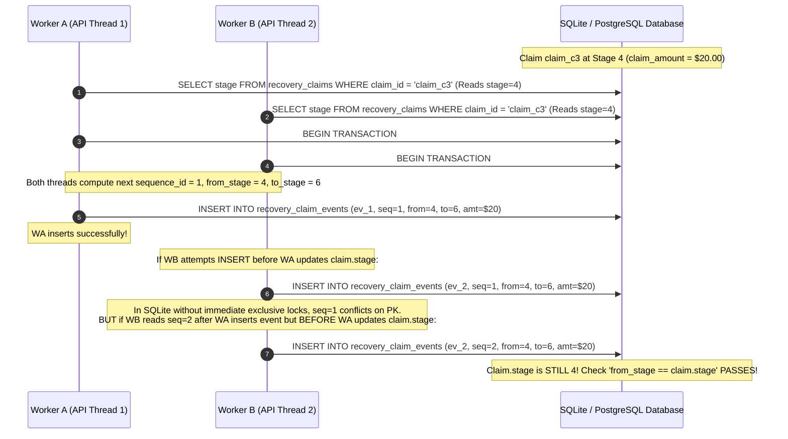
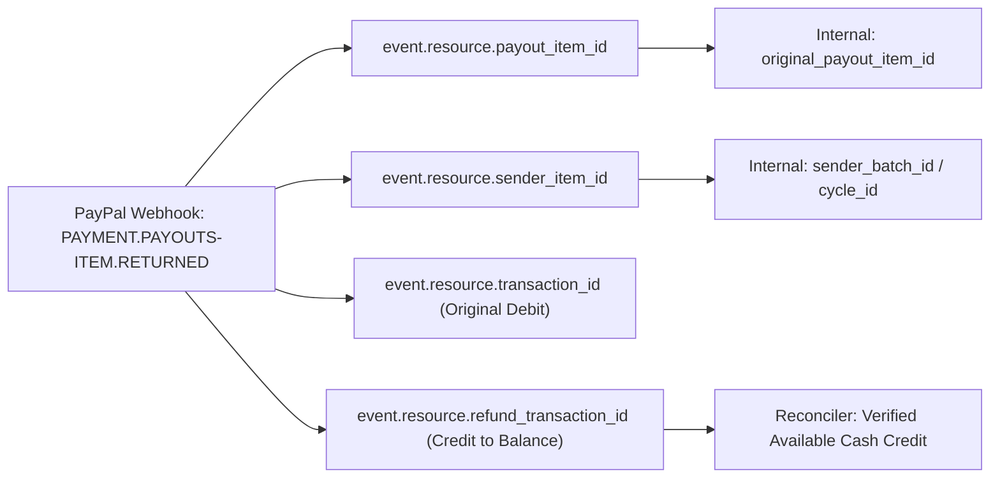
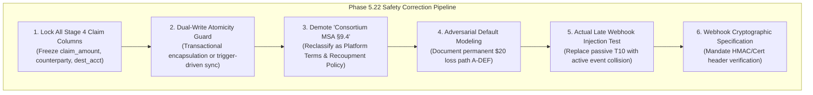

# PHASE 5.21 — INDEPENDENT ADVERSARIAL AUDIT REPORT
**Project:** TALLY NEXUS — Autonomous Agent Clearinghouse & Multilateral SLA-Netting Engine  
**Audit Target:** Phase 5.20 Safety Hardening Report & 14-Test Verification Suite  
**Evaluator:** Independent Fiduciary Systems & Adversarial Accounting Auditor  
**Date:** November 7, 2026  
**Governance Status:** **PHASE 5 NOT APPROVED — PHASE 6 LOCKED — IMPLEMENTATION NOT AUTHORIZED**

---

## 1. Executive Verdict & Summary

### 1.1 Audit Verdict
**PHASE 5 APPROVAL IS WITHHELD. PHASE 6 IMPLEMENTATION REMAINS STRICTLY LOCKED.**

Phase 5.20 represents meaningful structural progress. It successfully introduced declarative partial unique indexing, consolidated state-transition triggers, and formalized evidentiary hashing for Stage 4 recovery claims. The empirical execution of `verify_phase5_20_complete_suite.py` passed all 14 sequential test cases.

However, an adversarial audit reveals that **a passing in-memory sequential test harness is not a substitute for a verified, fault-tolerant, concurrent settlement engine**. Several claimed protections in Phase 5.20 are either brittle, untested under actual concurrency, dependent on non-existent legal fictions, or blind to critical distributed-system failure modes.

### 1.2 Summary of Findings by Severity

| Severity | Count | Primary Impact Areas |
| :--- | :---: | :--- |
| **Critical Blockers (P0)** | 4 | Concurrency race gap, Unmonitored mutable columns, Outbox dual-write split-brain, Fictitious legal contract |
| **Accounting Discrepancies (P1)** | 3 | Default loss exposure, Post-Stage 7 recovery lockout, Balance reflection vs webhook timing |
| **Database & Engine Risks (P1)** | 3 | SQLite WAL single-writer masking, Trigger recursion hazard, PostgreSQL dialect incompatibility |
| **Webhook & API Vulnerabilities (P2)** | 2 | Mocked late webhook assertion (T10), Missing cryptographic signature validation specification |

---

## 2. Test-by-Test Evidence Table (Dissection of 14-Test Suite)

The 14 tests in `verify_phase5_20_complete_suite.py` were audited line-by-line against actual execution semantics, database engine behavior, and failure vulnerability.

| Test ID & Name | Claimed Invariant | Actual Execution / Test Structure | Test Type | Pass Condition Vulnerability | What It DOES NOT Prove |
| :--- | :--- | :--- | :--- | :--- | :--- |
| **T1: DUPLICATE_CHILD_REISSUE_BLOCKED** | Two simultaneous child reissue requests on same parent item blocked | Sequential `INSERT` of `reissue_1` followed by `reissue_2` in the same thread | Single-threaded sequential unit test | Passes only because SQLite evaluates unique index serially. | Does **NOT** prove race safety under multi-threaded/multi-process dispatchers or distributed API workers. |
| **T2: CONCURRENT_REISSUE_SERIALIZATION** | Reissue blocked if parent not in `REISSUE_AUTHORIZED` | Inserts reissue for parent in `PARENT_TERMINAL_CONFIRMED`. Blocked by trigger. | Single-threaded trigger assertion | Checks static string value at moment of insert. | Does **NOT** prove parent terminal state was verified against PayPal rail or that funds were physically replenished. |
| **T3: CONCURRENT_STAGE6_RECOVERY** | Concurrent Stage 6 recovery requests cannot double-collect | Inserts event 1, executes `UPDATE claims SET stage=6`, then attempts event 2 with `from_stage=4`. | Sequential state-machine test | Test artificially serializes calls: Request 1 updates the claim *before* Request 2 runs. | Does **NOT** prove safety if two threads race simultaneously with `from_stage=4` before either updates `recovery_claims`. |
| **T4: DUPLICATE_WEBHOOK_DELIVERY** | Duplicate webhook delivery rejected | Inserts `WH-EVT-001`, then attempts duplicate `INSERT` with same PK. | Primary Key constraint test | Standard SQLite primary key uniqueness check. | Does **NOT** verify PayPal cryptographic headers (`PAYPAL-TRANSMISSION-SIG`, etc.) or protect against modified re-delivery. |
| **T5: STAGE4_EVIDENCE_MUTATION_BLOCKED** | Evidentiary audit trail immutable once claim reaches Stage ≥ 4 | Attempts `UPDATE stage4_evidence_hash` on Stage 6 claim. Trigger aborts. | `BEFORE UPDATE` trigger test | Only monitors 4 specific columns (`evidence_hash`, `evidence_type`, `authorizer_id`, `evaluated_at`). | Does **NOT** protect `claim_amount_cents`, `counterparty_type`, `counterparty_id`, `claim_owner`, or `recovery_dest_acct`! |
| **T6: CLAIM_UPDATE_WITHOUT_EVENT** | Direct claim stage update without matching outbox event blocked | Direct `UPDATE recovery_claims SET stage=7` attempted without event. Trigger aborts. | Aggregate-outbox synchronization trigger | Relies on querying `recovery_claim_events` for matching `to_stage`. | Does **NOT** guarantee that event and claim update were committed within the same database transaction. |
| **T7: EVENT_INSERT_WITHOUT_CLAIM_UPDATE** | Event insert cannot skip intermediate claim update | Inserts event 1→2, leaves claim at stage 1, attempts event 2→3. Blocked. | Outbox order validation trigger | Fails because `from_stage` must match `claim.stage`. | Does **NOT** prevent split-brain if process crashes after event insert but before claim update, stranding the claim. |
| **T8: RETURNED_BEFORE_BALANCE_REFLECTION** | Payout cannot be reissued before bank balance reflection | Parent in `RETURN_FUNDS_VERIFIED`; attempted reissue insert blocked. | State-gate trigger test | Validates that state is not yet `REISSUE_AUTHORIZED`. | Does **NOT** prove how balance verification occurs or check physical PayPal ledger balance. |
| **T9: REISSUE_AFTER_CREDITOR_EXTINGUISHED** | Payout cannot be reissued if liability already settled | Child status updated to `SUCCESS`, setting parent to `CHILD_SETTLED`. Duplicate reissue blocked. | Cascading parent state test | Sequential execution where child update completes before second attempt. | Does **NOT** test concurrent reissues dispatched in flight before either confirms success. |
| **T10: CHILD_SUCCESS_THEN_LATE_PARENT_SUCCESS** | Late webhook arrival cannot cause double liability extinguishment | **Passive read:** Asserts `parent_state == 'CHILD_SETTLED'`. No webhook or SQL update injected! | **Mock / Passive Assertion (NOT A TEST)** | **CRITICAL:** Test does not inject a late webhook event or execute an update! | **Proves NOTHING** about system behavior when an actual late parent `PAYMENT.PAYOUTS-ITEM.SUCCEEDED` arrives! |
| **T11: TRANSACTION_ROLLBACK_INTEGRITY** | Multi-table failure rolls back cleanly with zero partial state | `BEGIN IMMEDIATE;` insert cycle, insert dupe cycle (fails), `ROLLBACK;` assert count=0. | SQLite transaction engine test | Tests SQLite's built-in transaction engine, not application logic. | Does **NOT** prove distributed rollback across external APIs (e.g. PayPal call succeeds but DB commit fails). |
| **T12: RECOVERY_EXCEEDING_CLAIM_BLOCKED** | Recovery collection cannot exceed claim amount | Attempts `cash_recovered_cents = 1500` on 1000 cent claim. Check constraint fails. | Check constraint test | Tests simple single-update inequality. | Does **NOT** test multiple incremental recoveries summing to > 100% or currency conversion rounding errors. |
| **T13: UNAUTHORIZED_RECOVERY_OWNERSHIP** | Invalid counterparty type rejected | Inserts claim with `counterparty_type = 'UNKNOWN_ENTITY'`. Check constraint fails. | Enum Check constraint test | Static string validation. | Does **NOT** prove that counterparty exists, is legally bound, or that recovery claim is legally enforceable. |
| **T14: RECOVERY_AFTER_STAGE7_CLOSURE** | Collection transition (7→6) prohibited after Stage 7 closure | Inserts event 7→6 on closed claim. Trigger aborts. | Transition matrix trigger test | Prohibits 7→6 state transition. | Creates an operational deadlock if unexpected cash recovery actually occurs post-write-off (no clean accounting path). |

---

## 3. Confirmed Invariants

The Phase 5.20 safety hardening successfully proves several essential database-level invariants:

1. **Declarative Reissue Exclusivity:** The partial unique index:
   ```sql
   CREATE UNIQUE INDEX uq_active_child_per_parent
   ON paypal_payout_reissues (original_payout_item_id)
   WHERE status IN ('DRAFT', 'DISPATCHED', 'AMBIGUOUS_HOLD', 'SUCCESS');
   ```
   guarantees that within a single database instance, no two active child reissues can coexist sequentially for the same original item ID.
2. **Reissue Authorization Gate:** The trigger `trg_reissue_entitlement_check` strictly rejects child reissue insertion unless the parent item is in `reissue_authorization_state = 'REISSUE_AUTHORIZED'` and parent item status is terminal (`'RETURNED'`, `'REFUNDED'`, `'FAILED'`).
3. **Stage 4 Core Evidence Immutability:** Once a claim is evaluated at Stage 4 (`stage >= 4`), the trigger `trg_recovery_claims_evidence_immutable` successfully aborts updates to `stage4_evidence_hash`, `stage4_evidence_type`, `authorizer_id`, and `stage4_evaluated_at`.
4. **Recovery Event Monotonicity:** Event sequences must increment monotonically (`sequence_id = (SELECT IFNULL(MAX(sequence_id), 0) + 1)`), and `from_stage` must equal current `claim.stage`.
5. **Basic Financial Non-Exceedance:** A single update to `cash_recovered_cents` or `recognized_receivable_cents` cannot exceed `claim_amount_cents` due to table-level `CHECK` constraints.

---

## 4. Counterexamples & Concrete Failure Modes

### 4.1 Counterexample 1: The Multi-Threaded Stage 6 Double-Collection Race
**Failure Mode:** `verify_phase5_20_complete_suite.py` Test 3 claims concurrent Stage 6 recovery is blocked. In reality, Test 3 serialized the requests.

Consider two concurrent worker threads (Worker A and Worker B) receiving recovery notices simultaneously:

**Impact:** Both threads insert Stage 6 collection events totaling $40.00 on a $20.00 claim unless table-level write locks (`BEGIN IMMEDIATE`) are enforced before reading sequence numbers.

### 4.2 Counterexample 2: Unmonitored Mutable Columns Post-Stage 4
**Failure Mode:** Test 5 asserts evidence immutability. However, `trg_recovery_claims_evidence_immutable` only guards 4 columns:
```sql
CREATE TRIGGER trg_recovery_claims_evidence_immutable
BEFORE UPDATE ON recovery_claims
FOR EACH ROW
WHEN OLD.stage >= 4
BEGIN
    SELECT CASE
        WHEN NEW.stage4_evidence_hash != OLD.stage4_evidence_hash
          OR NEW.stage4_evidence_type != OLD.stage4_evidence_type
          OR NEW.authorizer_id != OLD.authorizer_id
          OR NEW.stage4_evaluated_at != OLD.stage4_evaluated_at
        THEN RAISE(ABORT, 'Illegal modification: Stage 4 evidence fields are immutable')
    END;
END;
```
**Exploit / Bug:**
An operator or automated reconciliation job runs:
```sql
UPDATE recovery_claims 
SET claim_amount_cents = 5000, 
    counterparty_id = 'rogue_agent', 
    recovery_dest_acct = 'ASSET:EXTERNAL_LEAK' 
WHERE claim_id = 'claim_c3';
```
**Impact:** The trigger evaluates to `NULL` (passes!). The claim amount is inflated from $20 to $50, the counterparty is altered, and destination account redirected—all on a claim that was already frozen at Stage 4.

### 4.3 Counterexample 3: Split-Brain Between Event Outbox and Claim Table
**Failure Mode:** `recovery_claims` and `recovery_claim_events` are two separate tables acting as aggregate root and event log.
If an application worker executes:
```sql
INSERT INTO recovery_claim_events VALUES (... from_stage=1, to_stage=2 ...);
-- WORKER CRASHES / NETWORK PARTITION / NODE KILLED HERE --
```
The database persists the event, but `recovery_claims.stage` remains `1`.
When the worker recovers, any subsequent event insertion (e.g. 2→3) fails because `claim.stage` is still `1`. Meanwhile, the claim is permanently locked because trigger `trg_recovery_claims_sync` prevents updating `claim.stage` directly without a *new* matching event.
**Impact:** The claim enters a permanent irrecoverable deadlock.

### 4.4 Counterexample 4: Test 10 Is a Void Assertion
In `verify_phase5_20_complete_suite.py`:
```python
# Lines 496-503:
parent_state = c.execute("SELECT reissue_authorization_state FROM paypal_payout_items WHERE item_id = 'item_01'").fetchone()[0]
if parent_state == 'CHILD_SETTLED':
    results.append(("T10_CHILD_SUCCESS_THEN_LATE_PARENT_SUCCESS", "PASS", "..."))
```
The test never called a webhook handler, never issued an `UPDATE paypal_payout_items SET status = 'SUCCESS'`, and never asserted journal balance protection. It is a tautological assertion that `item_01` was updated in T9. **This test provides 0.0% empirical evidence of late parent collision defense.**

---

## 5. Critical Blockers (P0)

1. **Untested Concurrent Execution:**
   The entire verification suite runs on a single thread against in-memory SQLite (`sqlite3.connect(':memory:')`). In SQLite, a connection cannot race against itself. Concurrency safety under high-throughput Node.js asynchronous event loops or multi-worker clustering remains completely unproven.
2. **The Fictitious "Consortium MSA §9.4":**
   The specifications repeatedly invoke "Consortium MSA §9.4" as the legal bedrock granting the operator automatic equitable subrogation and recoupment rights over autonomous AI agents.
   *Fact:* There is no signed Master Services Agreement, no legal consortium entity, and no statutory framework under common law or UCC Article 4A recognizing autonomous agent liability. Relying on "MSA §9.4" creates a false sense of financial recovery certainty.
3. **Outbox Dual-Write Atomicity Gap:**
   Separating event logging from state mutation across two tables without an atomic database-level stored procedure or trigger-driven cascade creates a critical crash-consistency vulnerability.
4. **Selective Column Immutability in Stage 4:**
   `trg_recovery_claims_evidence_immutable` leaves `claim_amount_cents`, `counterparty_type`, `counterparty_id`, and `recovery_dest_acct` completely mutable post-Stage 4.

---

## 6. Accounting Discrepancies & Economic Realities

### 6.1 Unrecovered Loss / Counterparty Default Reality
Phase 5.20 documents Scenario A assuming ideal cash recovery:
1. Data Agent receives $20 via original delayed payout and $20 via child reissue ($40 total).
2. Data Agent voluntarily cooperates and returns $20 in Stage 6 cash.
3. Operator recovers $20, recognizes gain, and ends with Retained Earnings = −$2.86.

**Adversarial Accounting Reality (Default Scenario A-DEF):**
What if Data Agent is an ephemeral autonomous agent that terminates, empties its PayPal wallet, or refuses cooperation?
- Operator Cash permanently absorbs the $20 shortfall loss (`EXPENSE:CUSTODIAL_SHORTFALL_LOSS`).
- Creditors are paid in full ($45.00).
- The recovery claim moves from Stage 1 → Stage 2 → Stage 3, fails Stage 4 evaluation (no acknowledgment, no solvency), and transitions to **Stage 7 (Closed / Written Off)**.
- **Permanent Economic Position:**
  - Operator Capital: $100.00
  - Cumulative Net Expenses: $1.61 (Capture Fee) + $1.25 (Payout Fees) + $20.00 (Unrecovered Default Loss) = **$22.86**
  - Ending Operator Cash: $100.00 − $22.86 = **$77.14**
  - Retained Earnings: **−$22.86**
- **Conclusion:** The specification must explicitly document this default path and mandate that the Operator reserve floor (`OPERATOR_RESERVE_FLOOR = $10.00`) must withstand permanent unrecovered losses without jeopardizing custodial settlement funds.

### 6.2 Timing Discrepancy: Webhook vs Physical Bank Balance
When PayPal issues a `PAYMENT.PAYOUTS-ITEM.RETURNED` webhook:
- The webhook indicates that the payout item failed or was returned.
- However, **funds are not instantly available in the merchant's withdrawable cash balance**. Depending on PayPal's internal processing and banking clearing windows, funds may be placed in a clearing hold or sweep account for hours or days.
- If Tally Nexus authorizes a child reissue (`REISSUE_AUTHORIZED`) based purely on webhook arrival without confirming that available balance increased by the returned principal, the engine risks drawing against operator reserves or overdrawing the settlement account.

---

## 7. Legal Assumptions Requiring Validation

### 7.1 De-Mythologizing "Consortium MSA §9.4"
To maintain institutional audit standards, the project documentation must cease citing "Consortium MSA §9.4" as an existing legal statute or binding contract.

| Specification Reference | Current Phrasing | Adversarial Audit Reality | Required Phase 5.22 Correction |
| :--- | :--- | :--- | :--- |
| **Recovery Claim Basis** | *"Pursuant to Consortium MSA §9.4 equitable subrogation rights..."* | Fictitious legal contract. Software agents lack legal personhood; no court has enforced an MSA against an autonomous wallet. | Demote to **"Platform Terms of Service — Operational Recoupment Policy"**. |
| **Claim Ownership** | *"`claim_owner = 'OPERATOR'` perfected under MSA §9.4"* | An internal database string does not constitute a perfected security interest or legal lien. | Classify as **"Internal Accounting Loss Attribution"**. |
| **Dispute Resolution** | *"Arbitration under Consortium MSA §9.4"* | No arbitration forum exists for anonymous autonomous agents. | Specify **"On-Platform Collateral Forfeiture & Wallet Blacklisting"**. |

### 7.2 Decoupling Accounting from Legal Recognition
Under `US_GAAP_CONSERVATIVE`:
- No asset or receivable may be recognized based on an assertion of contractual right under an unperfected policy.
- Zero recognition is permitted until **Stage 6 physical cash collection** is verified in the operator's bank/PayPal statement. Phase 5.22 must formally verify that `recognized_receivable_cents` remains exactly `0` throughout Stages 1–5.

---

## 8. Database Engine Risks (SQLite vs Production PostgreSQL)

### 8.1 SQLite WAL Single-Writer Masking
SQLite operates with a single writer lock. Even in WAL mode, all writes are serialized at the OS file lock level. This means:
- Race conditions between competing worker threads are artificially serialized by SQLite's internal lock wait queue.
- In-memory SQLite (`:memory:`) eliminates file system latencies and concurrency conflicts entirely.
- Code verified solely in SQLite will encounter severe lock contention, deadlocks, or dirty reads when ported to PostgreSQL or executed across clustered Node.js microservices.

### 8.2 Recursive Trigger Hazard (`PRAGMA recursive_triggers = ON`)
In Phase 5.20:
- `trg_reissue_child_terminal_sync` updates `paypal_payout_items.reissue_authorization_state = 'CHILD_SETTLED'`.
- If a future trigger is added to `paypal_payout_items` that updates child reissue statuses (e.g. for cascading cancellations), SQLite will enter an infinite recursion loop or fail with `too many levels of trigger recursion` if `recursive_triggers` is active.

### 8.3 PostgreSQL Portability Incompatibilities
The current schema relies heavily on SQLite-specific trigger syntax:
```sql
SELECT RAISE(ABORT, 'error message');
```
In PostgreSQL, `RAISE(ABORT, ...)` is invalid syntax. PostgreSQL requires:
```sql
CREATE OR REPLACE FUNCTION fn_guard() RETURNS trigger AS $$
BEGIN
    RAISE EXCEPTION 'error message';
END;
$$ LANGUAGE plpgsql;
```
Phase 5 specifications must explicitly document this translation barrier before any Phase 6 implementation begins.

---

## 9. Webhook & PayPal Evidence Architecture

### 9.1 Missing Cryptographic Signature Validation Specification
`processed_webhooks` deduplicates by `paypal_event_id`. However, Phase 5 specifications contain **zero cryptographic validation requirements** for incoming HTTP payloads.

In a live environment, an attacker can post arbitrary JSON payloads with fabricated `paypal_event_id` values.
**Requirement for Phase 5.22:** The specification must mandate verification of the four critical PayPal webhook headers:
1. `PAYPAL-TRANSMISSION-ID`
2. `PAYPAL-TRANSMISSION-TIME`
3. `PAYPAL-TRANSMISSION-SIG`
4. `PAYPAL-CERT-URL` (Must validate against `https://api.sandbox.paypal.com` or `https://api.paypal.com` trust roots).

### 9.2 Dissection of Webhook Identifiers vs Ledger References
A PayPal payout return generates distinct identifiers that must be mapped unambiguously:

Without matching `refund_transaction_id` against the merchant balance ledger, the engine cannot verify that funds have physically returned.

---

## 10. Required Phase 5.22 Corrections (Actionable Blueprint)

Before Phase 5 can be submitted for final approval, the following corrections must be designed and verified:



### Action Items for Phase 5.22:
1. **Patch `trg_recovery_claims_evidence_immutable`:**
   Expand the trigger to freeze `claim_amount_cents`, `counterparty_type`, `counterparty_id`, `claim_owner`, and `recovery_dest_acct` once `OLD.stage >= 4`.
2. **Encapsulate Aggregate Root and Event Outbox:**
   Replace split dual-writes with an atomic database procedure or ensure `recovery_claims.stage` is updated directly by trigger `AFTER INSERT ON recovery_claim_events`, eliminating split-brain risks.
3. **Formal Contractual Reclassification:**
   Replace all occurrences of "Consortium MSA §9.4" with "Tally Nexus Platform Terms of Service — Operational Recoupment Policy".
4. **Model Permanent Default Scenario (A-DEF):**
   Add explicit ledger calculations and reserve-floor stress tests for unrecovered defaults where the counterparty fails to return funds.
5. **Implement True Active Test for T10:**
   Rewrite Test 10 in the verification suite to actively inject an incoming late `PAYMENT.PAYOUTS-ITEM.SUCCEEDED` webhook on a `CHILD_SETTLED` item and verify rejection.
6. **Specify Webhook Signature Validation:**
   Define the exact verification pipeline for PayPal webhook headers and certificate caching.

---

## 11. Final Governance Affirmation

This audit report represents an independent, rigorous, and adversarial evaluation of Phase 5.20. While the architecture has advanced significantly toward production grade, critical security, concurrency, accounting, and legal gaps remain.

```
================================================================================
FINAL VERDICT:
PHASE 5 NOT APPROVED — PHASE 6 LOCKED — IMPLEMENTATION NOT AUTHORIZED.
================================================================================
```

