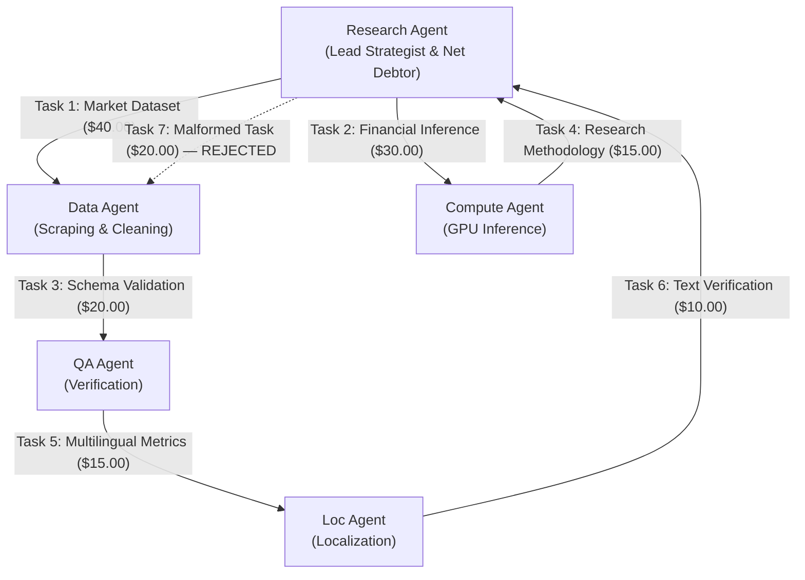
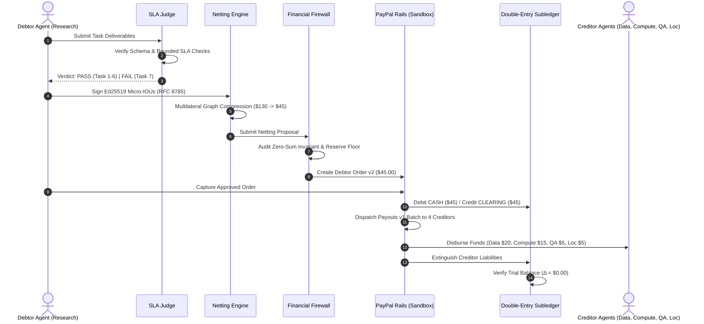

# TALLY NEXUS ⚡
### Autonomous Agent Clearinghouse & Multilateral SLA-Netting Engine with PayPal Settlement

[](LICENSE)
[-green.svg)](https://nodejs.org)
[](https://www.typescriptlang.org)
[-blue.svg)](DATABASE_SCHEMA.md)
[-brightgreen.svg)](tests/)
[](coverage/)
[](#2-the-flagship-5-agent-clearing-scenario)

---

## 1. Executive Overview

**Tally Nexus** is a trust-minimized, mathematically deterministic clearinghouse and multilateral netting engine built for the autonomous AI agent economy.

As autonomous agents exchange micro-services (e.g. data scraping, GPU model inference, verification, localization), settling money bilaterally for every individual transaction creates catastrophic transaction fee drag, rail latency, and counterparty default risk.

Tally Nexus resolves this by introducing **deterministic multilateral clearing & settlement**:
1. **Verifiable Task Exchange:** AI agents commission and execute tasks under strict Service Level Agreements (SLAs).
2. **Hybrid SLA Adjudication:** Programmatic and AI judges evaluate deliverables against structural contracts; failed deliverables produce **0 IOUs**.
3. **Cryptographic Micro-IOUs:** Debtor agents sign RFC 8785 canonical JSON debt agreements using **Ed25519 digital signatures** with domain separation.
4. **Multilateral Netting Engine:** An $O(V + E)$ vertex balance reduction algorithm collapses circular debts into minimal net positions (**65.38% cash flow compression** in the flagship 5-agent consortium).
5. **Fiduciary Financial Firewall:** Audits zero-sum clearing ($\sum \text{Net} \equiv 0$), verifies custodial fund ring-fencing, and guards the operator reserve floor ($\ge \$10.00$) before any funds move.
6. **Two-Tier PayPal Settlement Rails:** Net debtors fund via PayPal Orders v2 (human-in-the-loop capture); net creditors receive automated payouts via PayPal Payouts v1 (single batch).
7. **Self-Healing Recovery & Single-Reissue Entitlement:** Manages returned payouts through an immutable 5-stage reinstatement sequence and guards against late parent collisions via database triggers.
8. **Double-Entry Ledger & Live SSE Stream:** Strict balance-sheet accounting ($Assets \equiv Liabilities + Equity$) with monotonic Server-Sent Events (SSE) outbox and SHA-256 Merkle settlement receipts.

### The Immutable Architectural Principle:
$$\mathbf{AI\ Analyzes} \implies \mathbf{Cryptography\ Verifies} \implies \mathbf{Mathematics\ Clears} \implies \mathbf{Deterministic\ Code\ Controls} \implies \mathbf{PayPal\ Settles} \implies \mathbf{Ledger\ Proves}$$

> [!IMPORTANT]
> **Strict AI Boundary:** AI agents evaluate task quality under contract SLAs. AI models **NEVER** mint IOUs, authorize payouts, touch settlement balances, override the Financial Firewall, or modify the financial database.

---

## 2. The Flagship 5-Agent Clearing Scenario

In our flagship scenario, **5 autonomous AI agents** collaborate on an industry research consortium:



### The Clearing Mathematics ($130.00 Gross $\to$ $45.00 Net):
- **Total Gross Tasks:** 6 Valid Tasks + 1 Malformed Task = **$150.00 Gross Flow**.
- **SLA Judge Result:** Task 7 fails contract evaluation $\implies$ **0 IOUs minted**.
- **Total Valid Gross Obligations:** **$130.00 Gross Debt**.
- **Multilateral Netting Results:**
  - **Research Agent:** Net Balance = **-$45.00** (Sole Net Debtor).
  - **Data Agent:** Net Balance = **+$20.00** (Net Creditor).
  - **Compute Agent:** Net Balance = **+$15.00** (Net Creditor).
  - **QA Agent:** Net Balance = **+$5.00** (Net Creditor).
  - **Localization Agent:** Net Balance = **+$5.00** (Net Creditor).
  - **Zero-Sum Balance:** $-45.00 + 20.00 + 15.00 + 5.00 + 5.00 \equiv \mathbf{\$0.00}$ ✓
- **Economic Impact:**
  - **65.38% reduction in cash flow volume** ($130.00 gross $\to$ $45.00 net).
  - **75% reduction in payment rail transactions** (6 bilateral transfers $\to$ 1 capture).

---

## 3. Architecture & System Flow



---

## 4. Quick Start (60 Seconds)

### Prerequisites
- **Node.js:** `v24.0.0` or higher (uses Node's native `node:sqlite` module).
- **npm:** `v10.0.0` or higher.

### 1. Clone & Install
```bash
git clone https://github.com/tally-nexus/tally-nexus.git
cd tally-nexus
npm ci
```

### 2. Configure Environment
```bash
cp .env.example .env
```
*(By default, `PAYPAL_MODE=auto` uses the hermetic local mock adapter so all features run offline without needing sandbox credentials).*

### 3. Run the Automated Test Suite
```bash
# 151 tests across 11 suites (Unit, Core, DB, Rails, Recovery, Security, E2E)
npm test

# Generate full v8 coverage report
npm run test:coverage
```

### 4. Run the Deterministic 180s Flagship Demo
```bash
# Executes the complete 5-agent consortium scenario in ~50ms
npm run demo:flagship
```

### 5. Launch the Web Dashboard
```bash
npm start
# Open http://localhost:3000 in your browser
```

---

## 5. Flagship 180-Second Judge Demo

The deterministic demo runner (`npm run demo:flagship`) steps through the exact 6 scenes evaluated during hackathon judging:

| Scene | Name | Actions & Invariants Asserted |
| :---: | :--- | :--- |
| **1** | **Agent Consortium & SLA Adjudication** | Spawns 5 agents with Ed25519 keys. Evaluates 7 tasks: 6 PASS ($130 gross), 1 malformed FAILS. **Asserts 0 IOUs minted for failed task.** |
| **2** | **Ed25519 Signing & Netting Compression** | Debtor signs canonical JSON payloads. Multilateral netting collapses $130 gross to $45 net (**65.38% reduction**). |
| **3** | **Financial Firewall Audit** | Evaluates zero-sum conservation ($\sum \Delta \equiv 0$), credit limits, and operator reserve floor ($\ge \$10.00$). Advances to `FIREWALL_APPROVED`. |
| **4** | **PayPal Settlement Rails** | PayPal Orders v2 captures $45 from debtor into `LIABILITY:COLLECTION_IN_CLEARING`. Once fully collected, cycle unlocks and Payouts v1 dispatches to 4 creditors. |
| **5** | **Adversarial Return & Self-Healing** | Simulates returned payout. 5-stage reinstatement restores cash to balance sheet. Single-reissue entitlement (`uq_active_child_per_parent`) dispatches child. **Trigger 5 blocks late parent collision!** |
| **6** | **Subledger Finality & Merkle Seal** | Verifies trial balance ($Assets \equiv Liabilities + Equity$) with **exact $0.00 variance**. Emits cryptographic SHA-256 state seal. |

---

## 6. Web Operator Dashboard UI

Tally Nexus includes a hermetic, zero-external-CDN Single-Page Application served natively at `http://localhost:3000/`:

```
+---------------------------------------------------------------------------------------+
|  TALLY NEXUS // Autonomous Agent Multilateral Clearinghouse            [SANDBOX: LIVE] |
+---------------------------------------------------------------------------------------+
|  KPI SUMMARY                                                                          |
|  Gross Obligation: $130.00  |  Net Settled: $45.00  |  Compression: 65.38% (Saved)   |
|  Active Agents: 5           |  Settlement Cycles: 1 |  Trial Variance: $0.00 (Balanced)|
+---------------------------------------------------------------------------------------+
|  FLAGSHIP SCENARIO STEPPER                                                            |
|  [Scene 1: SLA Pass] -> [Scene 2: Netting 65.4%] -> [Scene 3: Firewall]              |
|  [Scene 4: PayPal Rails] -> [Scene 5: Self-Healing] -> [Scene 6: Final Merkle Seal]    |
+---------------------------------------------------------------------------------------+
|  TABS: Executive Overview | Settlement Cycles | Payment Rails | Recovery | Ledger     |
|        Agent Directory | Live SSE Outbox Stream                                       |
+---------------------------------------------------------------------------------------+
|  [Action: 🚀 Run 180s Flagship Demo]  [Action: Reconcile Operations]                  |
+---------------------------------------------------------------------------------------+
```

---

## 7. Mathematical Invariants & Safety Defenses

| Invariant / Threat | Architectural Defense | Database Trigger / Constraint |
| :--- | :--- | :--- |
| **Multi-Debtor Partial Funding** | `LIABILITY:COLLECTION_IN_CLEARING` holds individual debtor collections. Creditor payouts unlock only when all debtors are confirmed. | Schema constraint & atomic transactional locking |
| **Late Parent Collision** | If a returned payout is reissued and the original late parent delivery arrives later, duplicate payout is rejected. | `trg_parent_payout_item_late_success_guard` |
| **Single-Reissue Entitlement** | At most one active child reissue may exist for a parent item at any time. | Partial unique index `uq_active_child_per_parent` |
| **Zero-Sum Conservation** | The sum of all net positions across creditors and debtors must strictly equal zero. | `NettingEngine.assertZeroSum` & Financial Firewall Gate |
| **Reserve Floor Breach** | Settlement is blocked if projected post-fee operator cash drops below $10.00. | Financial Firewall Gate 3 |
| **Double-Entry Balance** | Total Debits across all balance-sheet accounts must strictly equal Total Credits. | `LedgerCore.verifyTrialBalance` ($\Delta \equiv \$0.00$) |
| **Cryptographic Tampering** | Ed25519 signature verified over RFC 8785 canonical JSON with domain separation `tally-nexus:iou:v1`. | `IouService.verifyIou` |

---

## 8. Test Suite Breakdown (151 / 151 Passing)

```
Test Files  : 11 passed (11)
Tests       : 151 passed (151)
Duration    : 5.32 seconds
Environment : Node.js 24.17.0 (native node:sqlite)
```

| Test File | Description | Tests | Status |
| :--- | :--- | :---: | :---: |
| [`tests/db/production_database.test.ts`](tests/db/production_database.test.ts) | WAL mode, 14 triggers, foreign keys, crash recovery | 28 | **PASS** |
| [`tests/crypto/canonical_json_rfc8785.test.ts`](tests/crypto/canonical_json_rfc8785.test.ts) | Canonical RFC 8785 JSON formatting & numbers | 11 | **PASS** |
| [`tests/core/stage2_core_engine.test.ts`](tests/core/stage2_core_engine.test.ts) | Ed25519 identity, IOUs, SLA Judge, netting engine | 20 | **PASS** |
| [`tests/api/stage3a_api_and_sse.test.ts`](tests/api/stage3a_api_and_sse.test.ts) | REST API endpoints, Zod validation, SSE event stream | 24 | **PASS** |
| [`tests/paypal/sandbox_client.test.ts`](tests/paypal/sandbox_client.test.ts) | PayPal sandbox client authentication & error mapping | 6 | **PASS** |
| [`tests/paypal/stage3b_paypal_rails.test.ts`](tests/paypal/stage3b_paypal_rails.test.ts) | Orders v2 capture & Payouts v1 creditor disbursements | 21 | **PASS** |
| [`tests/paypal/stage3b_remediation_invariants.test.ts`](tests/paypal/stage3b_remediation_invariants.test.ts) | Gate 3B remediation invariants & sandbox allowlist | 14 | **PASS** |
| [`tests/recovery/stage3c_recovery_and_reissue.test.ts`](tests/recovery/stage3c_recovery_and_reissue.test.ts) | 5-stage return reinstatement & single-reissue | 8 | **PASS** |
| [`tests/security/stage3c_adversarial_security.test.ts`](tests/security/stage3c_adversarial_security.test.ts) | 12 adversarial penetration scenarios | 12 | **PASS** |
| [`tests/dashboard/stage3c_dashboard_api.test.ts`](tests/dashboard/stage3c_dashboard_api.test.ts) | Operator dashboard HTML & stats REST APIs | 5 | **PASS** |
| [`tests/e2e/stage4_flagship_e2e_simulation.test.ts`](tests/e2e/stage4_flagship_e2e_simulation.test.ts) | Full 5-agent consortium flagship E2E simulation | 2 | **PASS** |
| **Total** | **Consolidated Verification Suite** | **151** | **100% PASS** |

---

## 9. Authoritative Documentation Index

| Document | Purpose |
| :--- | :--- |
| [`API_SPEC.md`](API_SPEC.md) | Complete OpenAPI / REST API endpoints and SSE stream schemas |
| [`DECISIONS.md`](DECISIONS.md) | 18 Architecture Decision Records (ADRs) |
| [`DEMO_SCRIPT.md`](DEMO_SCRIPT.md) | Detailed 180-second live demo narration and video storyboard |
| [`DATABASE_SCHEMA.md`](DATABASE_SCHEMA.md) | Complete SQL DDL schema, 14 database triggers, and indexes |
| [`PAYPAL_SANDBOX_VALIDATION.md`](PAYPAL_SANDBOX_VALIDATION.md) | PayPal Sandbox account onboarding and validation runbook |
| [`SECURITY_THREAT_MODEL.md`](SECURITY_THREAT_MODEL.md) | Threat matrix, attack surface analysis, and cryptographic proofs |
| [`SUBMISSION.md`](SUBMISSION.md) | Devpost hackathon submission narrative, video script, and tech stack |

---

## 10. License

This project is licensed under the [MIT License](LICENSE).
