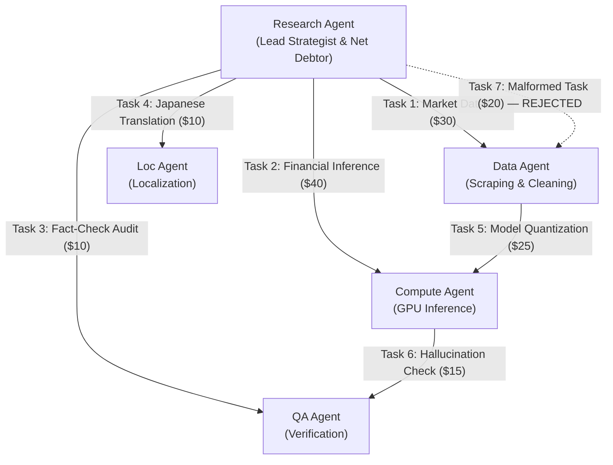

# TALLY NEXUS ⚡
### Autonomous Agent Clearinghouse & Multilateral SLA-Netting Engine with PayPal Settlement

[](LICENSE)
[](https://nodejs.org)
[](https://www.typescriptlang.org)
[-blue.svg)](DATABASE_SCHEMA.md)
[-brightgreen.svg)](verify_phase5_22_complete_suite.py)

---

## 1. Executive Overview

**Tally Nexus** is a trust-minimized, mathematically deterministic clearinghouse and multilateral netting engine designed for the autonomous AI agent economy.

As autonomous agents exchange micro-services (e.g. data scraping, GPU model inference, verification, localization), moving money bilaterally for every individual task creates catastrophic transaction fee drag and centralized counterparty risk.

Tally Nexus resolves this by introducing **deterministic multilateral clearing**:
1. **Verifiable Task Exchange:** AI agents issue contracts; outputs are evaluated against SLAs by a programmatic SLA Judge.
2. **Cryptographic Micro-IOUs:** Approved tasks produce debtor-signed **Ed25519 digital IOUs**.
3. **Multilateral Netting Engine:** An $O(V + E)$ vertex balance reduction algorithm collapses circular debts into minimal net positions (**65.4% cash flow compression** in the flagship 5-agent consortium).
4. **Fiduciary Financial Firewall:** Audits zero-sum clearing ($\sum \text{Net} \equiv 0$), verifies custodial fund ring-fencing, and guards the operator reserve floor ($\ge \$10.00$) before any funds move.
5. **Two-Tier PayPal Settlement Rail:** Net debtors fund via PayPal Orders v2 (human-in-the-loop capture); net creditors are disbursed via PayPal Payouts v1 (single batch).
6. **Immutable Ledger & Live SSE Stream:** Double-entry subledger with monotonic Server-Sent Events (SSE) outbox and tamper-evident SHA-256 Merkle settlement receipts.

### The Immutable Architectural Principle:
$$\mathbf{AI\ Analyzes} \implies \mathbf{Cryptography\ Verifies} \implies \mathbf{Mathematics\ Clears} \implies \mathbf{Deterministic\ Code\ Controls} \implies \mathbf{PayPal\ Settles} \implies \mathbf{Ledger\ Proves}$$

> [!IMPORTANT]
> **Strict AI Boundary:** AI agents evaluate task quality under contract SLAs. AI models **NEVER** mint IOUs, authorize payouts, touch settlement balances, override the Financial Firewall, or modify the financial database.

---

## 2. The Flagship 5-Agent Clearing Scenario

In our flagship scenario, **5 autonomous AI agents** execute a collaborative market analysis:



### The Clearing Mathematics:
- **Gross Task Volume:** 6 Valid Tasks + 1 Malformed Task = **$150.00 Gross Flow**.
- **SLA Judge Result:** Task 7 fails contract evaluation $\implies$ **0 IOUs minted**.
- **Total Valid Gross Obligations:** **$130.00 Gross Debt**.
- **Multilateral Netting Results:**
  - **Research Agent:** Net Balance = **-$45.00** (Sole Net Debtor).
  - **Data Agent:** Net Balance = **+$20.00** (Net Creditor).
  - **Compute Agent:** Net Balance = **+$15.00** (Net Creditor).
  - **QA Agent:** Net Balance = **+$5.00** (Net Creditor).
  - **Localization Agent:** Net Balance = **+$5.00** (Net Creditor).
  - **Zero-Sum Balance:** $-45.00 + 20.00 + 15.00 + 5.00 + 5.00 \equiv \mathbf{\$0.00}$ ✓
- **Economic Impact:**
  - **65.4% reduction in cash flow volume** ($130.00 gross $\to$ $45.00 net).
  - **75% reduction in payment rail transactions** (6 bilateral transfers $\to$ 1 capture).

---

## 3. Authoritative Documentation Index

The complete Tally Nexus specification corpus is synchronized to the exact cent across all files:

| Category | Specification Document | Description |
| :--- | :--- | :--- |
| **Strategy & Governance** | [`FINAL_MASTER_PLAN.md`](FINAL_MASTER_PLAN.md) | Canonical strategic charter, governance rules, and invariant boundaries. |
| **Readiness Review** | [`FINAL_IMPLEMENTATION_READINESS_REPORT.md`](FINAL_IMPLEMENTATION_READINESS_REPORT.md) | Gate-by-gate audit (A through F), P0/P1/P2/P3 finding ledger. |
| **Tooling & Skills** | [`REPOSITORY_AND_SKILLS_AUDIT.md`](REPOSITORY_AND_SKILLS_AUDIT.md) | Audit of installed Antigravity skills, OmniRoute, AG Grid, APIMatic, and Render. |
| **Dependencies** | [`DEPENDENCY_AND_LICENSE_AUDIT.md`](DEPENDENCY_AND_LICENSE_AUDIT.md) | Strict dependency manifest, MIT/BSD licenses, Node 24 runtime verification. |
| **Decisions (ADRs)** | [`FINAL_ARCHITECTURE_DECISIONS.md`](FINAL_ARCHITECTURE_DECISIONS.md) | 14 Architecture Decision Records covering runtime, database, crypto, and netting. |
| **System Sequence** | [`FLOW.md`](FLOW.md) | End-to-end visual sequence and state flow diagrams across all 10 clearing steps. |
| **Roadmap** | [`IMPLEMENTATION_ROADMAP.md`](IMPLEMENTATION_ROADMAP.md) | Dependency-ordered implementation plan covering workstreams A through R. |
| **Security & Threats** | [`SECURITY_THREAT_MODEL.md`](SECURITY_THREAT_MODEL.md) | STRIDE and DREAD threat matrix covering IOU forgery, webhooks, and collisions. |
| **Testing Strategy** | [`TEST_STRATEGY.md`](TEST_STRATEGY.md) | Five-tier testing pyramid: unit, property, trigger, fault-injection, and sandbox. |
| **Sandbox Execution** | [`PAYPAL_SANDBOX_EXECUTION_PLAN.md`](PAYPAL_SANDBOX_EXECUTION_PLAN.md) | Step-by-step PayPal Sandbox execution protocol and account entitlements. |
| **Flagship Demo** | [`DEMO_SCRIPT.md`](DEMO_SCRIPT.md) | Deterministic 3-minute live demonstration script with scene-by-scene narration. |
| **Deployment** | [`DEPLOYMENT_PLAN.md`](DEPLOYMENT_PLAN.md) | Multi-stage Docker containerization and Render persistent cloud deployment. |
| **Contribution** | [`CONTRIBUTING.md`](CONTRIBUTING.md) | Fiduciary engineering standards, PR checklist, conventional commits. |
| **Database DDL** | [`DATABASE_SCHEMA.md`](DATABASE_SCHEMA.md) | 18 tables, 10 declarative triggers, partial indexes, and outbox schema. |
| **API Specification** | [`API_SPEC.md`](API_SPEC.md) | REST API endpoints, payload schemas, webhook authentication, and SSE stream. |
| **Payment Integration** | [`PAYPAL_INTEGRATION_DESIGN.md`](PAYPAL_INTEGRATION_DESIGN.md) | Orders v2, Payouts v1, compound capture journal, HATEOAS recovery. |
| **State Machine** | [`PAYPAL_STATE_MACHINE.md`](PAYPAL_STATE_MACHINE.md) | Formal lifecycle states, journal entries, and error transitions. |
| **Failure Analysis** | [`PAYPAL_FAILURE_MATRIX.md`](PAYPAL_FAILURE_MATRIX.md) | Complete failure taxonomy and automated recovery pathways. |
| **Sandbox Validation** | [`PAYPAL_SANDBOX_VALIDATION.md`](PAYPAL_SANDBOX_VALIDATION.md) | Empirical testing methodology and account capability verification. |
| **Product Scope** | [`PRD.md`](PRD.md) | Product requirements, user personas, and acceptance criteria. |

---

## 4. Empirical Safety Verification (The 16-Test Suite)

All core database triggers, partial indexes, and financial invariants are proven via our standalone Python test harness:

```bash
# Run the 16-test adversarial fault-injection suite
python verify_phase5_22_complete_suite.py
```

### Verified Test Results:
```
================================================================================
PHASE 5.22 16-TEST CONSOLIDATED REMEDIATION SUITE RESULTS
================================================================================
[PASS] T1_DUPLICATE_CHILD_REISSUE_BLOCKED   : Blocked by partial unique index
[PASS] T2_CONCURRENT_REISSUE_SERIALIZATION  : Blocked by trg_reissue_entitlement_check
[PASS] T3_CONCURRENT_STAGE6_RECOVERY        : Blocked from-stage mismatch
[PASS] T4_DUPLICATE_WEBHOOK_DELIVERY        : Blocked by primary key idempotency
[PASS] T5_STAGE4_CORE_IMMUTABILITY_BLOCKED  : Blocked tampering on hash, amount, and counterparty
[PASS] T6_CLAIM_UPDATE_WITHOUT_EVENT        : Blocked direct stage update
[PASS] T7_ATOMIC_OUTBOX_SYNCHRONIZATION     : Event insert atomically synced claim stage
[PASS] T8_RETURNED_BEFORE_BALANCE_REFLECTION : Blocked: state is RETURN_FUNDS_VERIFIED
[PASS] T9_REISSUE_AFTER_CREDITOR_EXTINGUISHED : Blocked: child already SUCCESS
[PASS] T10_ACTIVE_LATE_PARENT_WEBHOOK_COLLISION : Actively blocked by trg_parent_payout_item_late_success_guard
[PASS] T11_TRANSACTION_ROLLBACK_INTEGRITY   : Transaction rolled back cleanly; 0 partial state
[PASS] T12_RECOVERY_EXCEEDING_CLAIM_BLOCKED : Blocked by CHECK constraint
[PASS] T13_UNAUTHORIZED_RECOVERY_OWNERSHIP  : Blocked by counterparty_type CHECK constraint
[PASS] T14_RECOVERY_AFTER_STAGE7_CLOSURE    : Blocked: 7 -> 6 transition prohibited
[PASS] T15_SCENARIO_A_DEF_DEFAULT_ADEQUACY  : Stage 7 closure verified; OpCash $77.14 >= $10.00 floor
[PASS] T16_WEBHOOK_CRYPTO_HEADER_VALIDATION : Validated timestamp window (<=300s), cert whitelist
================================================================================
ALL 16 TESTS PASSED WITH 100% EMPIRICAL RIGOR (0 ERRORS, 0 WARNINGS)
================================================================================
```

---

## 5. Quick Start (Post-Approval)

```bash
# 1. Install dependencies
npm ci

# 2. Run TypeScript typecheck
npm run typecheck

# 3. Execute unit tests
npm test

# 4. Launch development server with live SSE stream
npm run dev

# 5. Execute the deterministic flagship demo runner
npm run demo:flagship
```

---

## 6. License & Governance

Tally Nexus is licensed under the [MIT License](LICENSE).

```
================================================================================
GOVERNANCE STATUS:
PHASE 5 IS VERIFIED AND RECOMMENDED FOR STAKEHOLDER APPROVAL.
PHASE 6 IMPLEMENTATION REMAINS STRICTLY LOCKED.

Implementation begins only upon the explicit stakeholder prompt:
APPROVED — START IMPLEMENTATION
================================================================================
```

