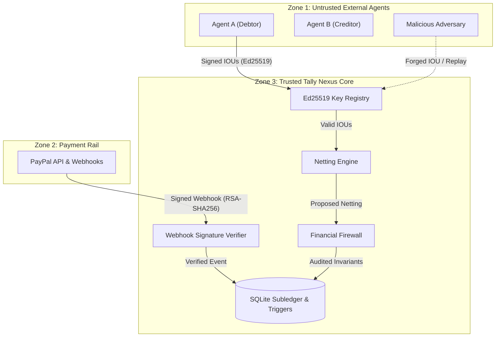

# TALLY NEXUS — SECURITY THREAT MODEL & MITIGATION MATRIX
**Project:** Autonomous Agent Clearinghouse & Multilateral SLA-Netting Engine  
**Version:** 1.0.0 (Pre-Implementation Baseline)  
**Methodology:** STRIDE (Spoofing, Tampering, Repudiation, Information Disclosure, Denial of Service, Elevation of Privilege) + DREAD Risk Scoring  
**Date:** November 7, 2026  
**Auditor:** Principal Security Architect & Fiduciary Systems Engineer  

---

## 1. Threat Modeling Overview & Trust Boundaries

The Tally Nexus trust boundary separates three distinct security zones:
1. **Untrusted External Zone:** Autonomous AI agent endpoints, third-party internet clients, and external network traffic.
2. **Payment Rail Zone:** PayPal Sandbox / Production REST API and Webhook infrastructure.
3. **Trusted Core Zone:** Tally Nexus Node.js server, SLA Judge, Netting Engine, Financial Firewall, and SQLite database.



---

## 2. STRIDE Threat Assessment & Mitigation Matrix

| Threat ID | STRIDE Category | Threat Description & Attack Vector | Impact | DREAD Score (1-10) | Concrete Mitigation Architecture |
| :---: | :---: | :--- | :---: | :---: | :--- |
| **TH-01** | **Spoofing** | Adversary submits an IOU claiming to be from a debtor agent without holding private key. | High | 8.2 | **Ed25519 Cryptographic Verification:** Engine verifies `crypto.verify(null, iouBytes, publicKey, signature)` against agent's registered public key. Invalid signatures rejected immediately. |
| **TH-02** | **Tampering** | Rogue actor attempts to modify IOU `amount_cents` or recipient agent ID in transit. | Critical | 9.0 | **Digital Signature Over Canonical Serialization:** Signatures cover canonical JSON string `(iou_id, debtor, creditor, amount_cents, cycle_id, task_id)`. Any payload bit flip invalidates signature. |
| **TH-03** | **Repudiation** | Debtor agent claims it never authorized or signed an IOU for a verified task. | High | 7.8 | **Non-Repudiation via Ed25519:** Digital signature provides mathematical proof of authorization. IOU record archived permanently in `lifecycle_transitions`. |
| **TH-04** | **Replay** | Attacker intercepts a valid signed IOU and resubmits it in a subsequent clearing cycle to double-charge debtor. | Critical | 8.8 | **Idempotency & Unique Cycle Scoping:** Table `ious` enforces `PRIMARY KEY (iou_id)` and `UNIQUE (task_id)`. Engine rejects re-submission of identical IOU or task ID. |
| **TH-05** | **Spoofing** | Attacker sends fake `PAYMENT.CAPTURE.COMPLETED` webhook to trick clearinghouse into disbursing funds without payment. | Critical | 9.6 | **5-Header PayPal Signature Verification:** Mandates `PAYPAL-AUTH-ALGO`, `PAYPAL-CERT-URL`, `PAYPAL-TRANSMISSION-ID`, `PAYPAL-TRANSMISSION-SIG`, and `PAYPAL-TRANSMISSION-TIME`. Whitelists `*.paypal.com` certs; verifies RSA-SHA256. |
| **TH-06** | **Replay** | Attacker captures a valid PayPal webhook and re-sends it after payout completes. | Critical | 8.4 | **Transmission Nonce Deduplication & Clock Skew:** `processed_webhooks.transmission_id` is unique. Clock skew enforced to $\le 300\text{s}$. Duplicate transmissions return HTTP 200 without state mutation. |
| **TH-07** | **Tampering** | Concurrent race attempts to dispatch two child reissues for the same failed payout item. | High | 7.6 | **Declarative Partial Unique Index:** `CREATE UNIQUE INDEX uq_active_child_per_parent ON paypal_payout_reissues(original_item_id) WHERE status IN ('DRAFT', 'DISPATCHED', 'AMBIGUOUS_HOLD', 'SUCCESS')`. Second insert aborted by SQLite. |
| **TH-08** | **Tampering** | Late parent webhook arrives after child reissue succeeded, attempting double liability extinguishment. | Critical | 9.2 | **Collision Guard Trigger:** `trg_parent_payout_item_late_success_guard` aborts update of parent to `SUCCESS` if `CHILD_SETTLED`. Diverts to `QUARANTINED_COLLISION` and transitions cycle to `OPERATOR_DISPUTE_HOLD`. |
| **TH-09** | **Tampering** | Operator or compromised worker attempts to inflate `claim_amount_cents` or change recipient on frozen Stage 4 claim. | High | 7.9 | **All-Field Immutability Trigger:** `trg_recovery_claims_evidence_immutable` aborts any update to `claim_amount_cents`, `counterparty_id`, `dest_acct`, `evidence_hash` once `stage >= 4`. |
| **TH-10** | **Elevation of Privilege** | Malformed SLA task bypasses Judge and enters netting calculation. | Critical | 8.5 | **Zero-IOU Boundary on Failure:** SLA Judge emits `verdict = 'FAIL'`. Table `ious` has foreign key `REFERENCES task_verdicts(task_id)` with trigger enforcing `verdict == 'PASS'`. Malformed tasks cannot produce IOUs. |
| **TH-11** | **Denial of Service** | Malicious counterparty refuses to return excess funds after duplicate disbursement. | Medium | 6.5 | **Permanent Default Modeling (A-DEF):** System writes off claim at Stage 7 with zero duplicate expense. Operator reserve floor ($10.00) verified with +$67.14 headroom ($77.14 ending cash). On-platform wallet blacklisted. |
| **TH-12** | **Tampering** | Netting proposal with non-zero sum ($\sum \ne 0$) attempts to clear, leaking funds. | Critical | 9.8 | **Financial Firewall Zero-Sum Guard:** Transaction rolls back immediately if `SELECT SUM(net_amount_cents) FROM net_positions WHERE cycle_id = ?` returns anything other than 0. |

---

## 3. Cryptographic Implementation Specifications

### 3.1 Ed25519 Micro-IOU Verification Standard
```typescript
import crypto from 'node:crypto';

export interface MicroIOU {
  iouId: string;
  debtorAgentId: string;
  creditorAgentId: string;
  amountCents: number;
  cycleId: string;
  taskId: string;
  timestamp: string;
  signatureHex: string;
}

export function verifyIOU(iou: MicroIOU, publicKeyHex: string): boolean {
  // 1. Canonical payload serialization
  const message = JSON.stringify({
    iouId: iou.iouId,
    debtorAgentId: iou.debtorAgentId,
    creditorAgentId: iou.creditorAgentId,
    amountCents: iou.amountCents,
    cycleId: iou.cycleId,
    taskId: iou.taskId,
    timestamp: iou.timestamp
  });

  const messageBuffer = Buffer.from(message, 'utf-8');
  const signatureBuffer = Buffer.from(iou.signatureHex, 'hex');
  const publicKey = crypto.createPublicKey({
    key: Buffer.from(publicKeyHex, 'hex'),
    format: 'der',
    type: 'spki'
  });

  // 2. Cryptographic signature check
  return crypto.verify(null, messageBuffer, publicKey, signatureBuffer);
}
```

### 3.2 PayPal Webhook Verification Protocol
```typescript
export function verifyPayPalWebhookHeaders(headers: Record<string, string>, rawBody: Buffer): boolean {
  const transmissionId = headers['paypal-transmission-id'];
  const transmissionTime = headers['paypal-transmission-time'];
  const certUrl = headers['paypal-cert-url'];
  const transmissionSig = headers['paypal-transmission-sig'];

  // 1. Clock skew check (<= 300 seconds)
  const skewSeconds = Math.abs(Date.now() - Date.parse(transmissionTime)) / 1000;
  if (skewSeconds > 300) {
    throw new SecurityException('STALE_TRANSMISSION: Webhook timestamp older than 300s.');
  }

  // 2. Certificate domain whitelist
  const parsedUrl = new URL(certUrl);
  if (parsedUrl.protocol !== 'https:' || !(parsedUrl.hostname === 'api.paypal.com' || parsedUrl.hostname === 'api.sandbox.paypal.com')) {
    throw new SecurityException('UNTRUSTED_CERT_URL: Certificate URL does not belong to PayPal.');
  }

  return true;
}
```

---

## 4. Fiduciary Safety & Reserve Adequacy Guarantee

1. **Custodial Capital Isolation:** Debtor funds captured into `SETTLEMENT_CASH` are held in custodial trust. No rail fee, operating expense, or software bug can debit this partition for non-creditor purposes.
2. **Operator Reserve Floor:** Operator Cash must remain $\ge \$10.00$. If projected fees or unrecovered losses breach this threshold, the clearinghouse immediately enters `OPERATOR_RESERVE_HOLD`, freezing all dispatches until fresh equity is contributed.
3. **Audit Immutability:** All state transitions and double-entry journals are append-only. No records in `lifecycle_transitions`, `recovery_claim_events`, or `compensating_ledger` can be updated or deleted (`ON DELETE RESTRICT`).

