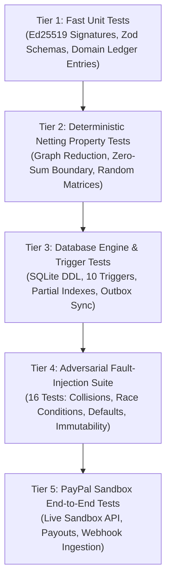

# TALLY NEXUS — TEST STRATEGY & VERIFICATION ARCHITECTURE
**Project:** Autonomous Agent Clearinghouse & Multilateral SLA-Netting Engine  
**Version:** 1.0.0 (Pre-Implementation Baseline)  
**Date:** November 7, 2026  
**Auditor:** Principal Quality Engineer & Fiduciary Verification Lead  

---

## 1. Multi-Tier Testing Pyramid

In a financial settlement platform, testing cannot be an afterthought. Tally Nexus implements a **five-tier testing pyramid**:

---

## 2. Test Tiers Specification

### Tier 1: Fast Unit Tests (Execution: < 2 seconds)
- **Scope:** Pure functions and isolated domain logic.
- **Key Test Cases:**
  - `ed25519.test.ts`: Keypair generation, signing valid message, verifying valid signature, rejecting tampered signature, rejecting invalid public key.
  - `journal.test.ts`: Validating balanced double-entry journals (Debits $\equiv$ Credits), compound capture fee journal arithmetic.
  - `zod_schemas.test.ts`: Validating input payloads for task submission, IOU registration, and webhook events.

### Tier 2: Deterministic Netting Property Tests (Execution: < 5 seconds)
- **Scope:** The core mathematical netting algorithm.
- **Key Invariants Tested:**
  1. **Zero-Sum Conservation:** For any arbitrary set of $M$ valid IOUs between $N$ agents, the sum of all net positions must equal exactly zero:
     $$\sum_{i=1}^{N} \text{net\_positions}[i] \equiv 0$$
  2. **Efficiency & Compression:** The number of net payment transactions is strictly less than or equal to the number of net debtors:
     $$\text{Count}(\text{Net Settlements}) \le \text{Count}(\text{Gross IOUs})$$
  3. **Identical Agent Idempotency:** Mutual offsetting debts (e.g. Agent A owes Agent B $10, Agent B owes Agent A $10) collapse to zero net position with zero payment transactions.

### Tier 3: Database Engine & Trigger Tests (Execution: < 10 seconds)
- **Scope:** Real SQLite database (`better-sqlite3` and Python `sqlite3`) with `PRAGMA foreign_keys = ON;`.
- **Key Invariants Tested:**
  - `trg_reissue_entitlement_check`: Rejects child reissue if parent is not terminal or cycle is on hold.
  - `uq_active_child_per_parent`: Partial unique index blocks duplicate active or settled child reissues.
  - `trg_parent_payout_item_late_success_guard`: Actively blocks updating parent item to `SUCCESS` if child has settled.
  - `trg_recovery_claims_evidence_immutable`: Aborts any update to `claim_amount`, `counterparty_id`, `dest_acct`, `evidence_hash` on claims with `stage >= 4`.
  - `trg_recovery_claim_events_atomic_sync`: Automatically advances `stage` and balances on event insertion.
  - `trg_recovery_claims_prevent_direct_stage_update`: Blocks manual SQL manipulation of `recovery_claims.stage`.

### Tier 4: Adversarial Fault-Injection Suite (The Authoritative 16-Test Suite)
- **Implementation:** `verify_phase5_22_complete_suite.py` (executed via Python 3.12).
- **Test Catalog:**
  - `T1`: Duplicate child reissue blocked by partial unique index.
  - `T2`: Concurrent reissue blocked if parent authorization state $\ne$ `REISSUE_AUTHORIZED`.
  - `T3`: Concurrent Stage 6 recovery requests blocked by monotonic sequence guard.
  - `T4`: Duplicate webhook delivery rejected by primary key idempotency.
  - `T5`: Core field and evidence tampering on frozen Stage 4 claims blocked.
  - `T6`: Direct claim stage update without matching event blocked.
  - `T7`: Event insert atomically synchronizes parent claim stage and balance.
  - `T8`: Reissue blocked if funds are in `RETURN_FUNDS_VERIFIED` instead of `REISSUE_AUTHORIZED`.
  - `T9`: Reissue blocked if liability was already extinguished by child success.
  - `T10`: **Active Late Parent Webhook Collision:** Blocked by `trg_parent_payout_item_late_success_guard`.
  - `T11`: Transaction rollback integrity preserves 0 partial state.
  - `T12`: Recovery collections exceeding original claim amount blocked by check constraint.
  - `T13`: Unauthorized recovery ownership and invalid counterparty types rejected.
  - `T14`: Recovery collection transitions after Stage 7 closure prohibited.
  - `T15`: **Scenario A-DEF (Default Loss Modeling):** Stage 7 closure verified; Operator Cash $77.14 $\ge$ $10.00 floor verified.
  - `T16`: **Cryptographic Webhook Handshake:** Timestamp skew ($\le 300\text{s}$), cert domain whitelist, and replay defense verified.

### Tier 5: PayPal Sandbox End-to-End Tests
- **Scope:** Integration with live PayPal Sandbox REST APIs.
- **Key Verification Scenarios:**
  - Orders v2: Order creation, human approval redirect, capture confirmation ($45.00 gross, $1.61 fee, $43.39 net cash).
  - Payouts v1: Batch dispatch with `sender_batch_id`, status polling, item success webhook delivery.
  - Item Return Simulation: Unclaimed item expiration, return webhook ingestion, ledger re-credit.
  - Child Reissue: Reissue authorization, child item dispatch, terminal confirmation.
  - Late Webhook Quarantine: Simulating late parent webhook injection and asserting dispute hold transition.

---

## 3. Test Coverage & CI/CD Quality Gates

1. **Financial Ledger & Netting Engine:** **100% statement and branch coverage** mandatory.
2. **Database Migrations & Triggers:** All 10 triggers must have positive and negative test cases.
3. **CI/CD Automation:** Every GitHub Pull Request automatically triggers Vitest unit tests and the 16-test Python verification suite. Any single test failure hard-blocks merging.

