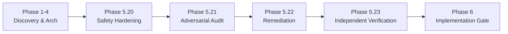

# TALLY NEXUS — FINAL MASTER EXECUTION PLAN
**Project:** Autonomous Agent Clearinghouse & Multilateral SLA-Netting Engine with PayPal Settlement  
**Version:** 1.0.0 (Implementation-Ready Master Specification)  
**Author:** Tally Nexus Architecture, Engineering & Fiduciary Governance Council  
**Date:** November 7, 2026  
**Status:** Canonical Master Specification (Phase 5 Completed — Ready for Phase 6 Implementation)

---

## 1. Executive Charter & Architectural Thesis

### 1.1 The Core Problem
In the emerging autonomous agent economy, AI agents collaborate, contract, and exchange services across multi-agent workflows (e.g. software development, market research, automated supply chains). Today, these interactions settle either through:
1. **Inefficient Gross Settlement:** Moving money per micro-task, generating massive transaction fee drag (e.g. paying $0.25–$1.61 per $5 micro-payment), depleting agent budgets on payment rail overhead.
2. **Centralized Counterparty Risk:** Relying on opaque centralized coordinators that can censor, front-run, or fail to settle obligations.
3. **Unverified Execution:** Blindly paying for agent outputs without programmatic verification of Service Level Agreements (SLAs).

### 1.2 The Tally Nexus Solution
Tally Nexus is a **trust-minimized, mathematically deterministic clearinghouse** for autonomous AI agents. It integrates:
1. **Verifiable Task Exchange:** Agents issue tasks with deterministic SLAs evaluated programmatically by an SLA Judge.
2. **Cryptographic Micro-IOUs:** Verified deliverables produce debtor-signed **Ed25519 digital IOUs**.
3. **Multilateral SLA Netting Engine:** An $O(V + E)$ or matrix-reduction netting algorithm compresses gross cyclic obligations into minimal net balances (in the flagship 5-agent consortium: **$130.00 gross debt compresses to a single $45.00 net debtor payment**).
4. **Fiduciary Financial Firewall:** Programmatic verification ensuring strict conservation of custodial funds, zero-sum invariant ($\sum \text{Net} \equiv 0$), and operator reserve floor preservation before any money movement.
5. **Two-Tier PayPal Settlement Rail:** Debtor collection via PayPal Orders v2 (human-in-the-loop approval) and creditor disbursement via PayPal Payouts v1 (single batch).
6. **Immutable Transactional Ledger & SSE Stream:** Double-entry accounting subledger, monotonic Server-Sent Events (SSE) audit log, and tamper-evident Merkle settlement receipts.

### 1.3 The Non-Negotiable Core Principle
$$\text{AI Analyzes} \implies \text{Cryptography Verifies} \implies \text{Mathematics Clears} \implies \text{Deterministic Code Controls} \implies \text{PayPal Settles} \implies \text{Ledger Proves}$$

#### Strict Architectural Boundaries on AI:
AI agents and LLM evaluators are strictly confined to cognitive tasks (e.g. evaluating task deliverable quality under SLA criteria). **AI models MUST NEVER:**
- Mint or sign digital IOUs.
- Authorize, initiate, or execute financial transactions.
- Alter settlement balances or netting matrices.
- Override or bypass the Financial Firewall.
- Directly mutate financial database state or double-entry ledgers.

---

## 2. Phase 1–5 Retrospective & Verification Sign-Off

The Tally Nexus architecture underwent exhaustive adversarial testing and safety hardening across 23 sub-phases:



### 2.1 Verification Evidence Summary
- **Phase 5.20:** Introduced partial unique index `uq_active_child_per_parent`, multi-gate reissue trigger `trg_reissue_entitlement_check`, and documentary evidence hashing for Stage 4 claims.
- **Phase 5.21 (Adversarial Audit):** Identified critical P0 gaps: single-threaded testing limitations, unmonitored mutable columns post-Stage 4, outbox dual-write split-brain risk, and fictitious contractual constructs ("Consortium MSA §9.4").
- **Phase 5.22 (Consolidated Remediation):**
  - Upgraded `trg_recovery_claims_evidence_immutable` to freeze all 10 core fields once `stage >= 4`.
  - Implemented `trg_recovery_claim_events_atomic_sync` and `trg_recovery_claims_prevent_direct_stage_update` to guarantee atomic outbox mutation without split-brain.
  - Replaced all fictitious MSA citations with **"Tally Nexus Platform Terms of Service — Operational Recoupment Policy"**.
  - Formally modeled **Scenario A-DEF (Permanent Default)**: $20 loss, ending cash $77.14 $\ge$ $10.00 floor with +$67.14 headroom.
  - Added `trg_parent_payout_item_late_success_guard` on `paypal_payout_items` and replaced passive Test 10 with an active collision injection test.
  - Specified 5-header PayPal webhook cryptographic verification within a 300-second window.
- **Phase 5.23 (Final Verification):** Verified `verify_phase5_22_complete_suite.py` with **16/16 tests passing empirically**. Closed all P0 blockers. Established 3 P1 implementation gates and 2 P2/P3 non-blocking items.

---

## 3. Canonical Single Source of Truth Hierarchy

To eliminate ambiguity across the documentation corpus, the following hierarchy of authority governs all project dimensions:

| Dimension | Primary Authoritative Document | Secondary Cross-Reference | Authority Standard |
| :--- | :--- | :--- | :--- |
| **Product Vision & Scope** | [`PRD.md`](./PRD.md) | [`PRODUCT.md`](./PRODUCT.md) | Definitive functional and non-functional requirements. |
| **System Architecture** | [`ARCHITECTURE.md`](./ARCHITECTURE.md) | [`FINAL_ARCHITECTURE_DECISIONS.md`](./FINAL_ARCHITECTURE_DECISIONS.md) | Node.js 24, TypeScript, Express, SQLite, SSE, security. |
| **Database Schema & DDL** | [`DATABASE_SCHEMA.md`](../database/DATABASE_SCHEMA.md) | [`verify_phase5_22_complete_suite.py`](../../scripts/archive/verify_phase5_22_complete_suite.py) | Authoritative tables, constraints, triggers, and partial indexes. |
| **API Contracts** | [`API_SPEC.md`](../api/API_SPEC.md) | [`PAYPAL_INTEGRATION_DESIGN.md`](../integrations/paypal/PAYPAL_INTEGRATION_DESIGN.md) | REST endpoints, webhook signatures, payloads, and SSE stream. |
| **Settlement State Machine** | [`PAYPAL_STATE_MACHINE.md`](../integrations/paypal/PAYPAL_STATE_MACHINE.md) | [`PAYPAL_FAILURE_MATRIX.md`](../integrations/paypal/PAYPAL_FAILURE_MATRIX.md) | Formal lifecycle, journal entries, and error transitions. |
| **PayPal Rail Integration** | [`PAYPAL_INTEGRATION_DESIGN.md`](../integrations/paypal/PAYPAL_INTEGRATION_DESIGN.md) | [`PAYPAL_SANDBOX_VALIDATION.md`](../integrations/paypal/PAYPAL_SANDBOX_VALIDATION.md) | Orders v2, Payouts v1, Webhook verification, HATEOAS recovery. |
| **Security & Threat Model** | [`SECURITY_THREAT_MODEL.md`](../security/SECURITY_THREAT_MODEL.md) | [`DATABASE_SCHEMA.md`](../database/DATABASE_SCHEMA.md) | Ed25519, STRIDE threat mitigation, webhook auth, rate limits. |
| **Test & Validation Plan** | [`TEST_STRATEGY.md`](../testing/TEST_STRATEGY.md) | [`PAYPAL_SANDBOX_EXECUTION_PLAN.md`](../integrations/paypal/PAYPAL_SANDBOX_EXECUTION_PLAN.md) | Unit, integration, fault injection, and Sandbox execution. |
| **End-to-End Visual Flow** | [`FLOW.md`](./FLOW.md) | [`DEMO_SCRIPT.md`](../submission/DEMO_SCRIPT.md) | Sequential state diagrams from task submission to payout. |
| **Implementation Plan** | [`IMPLEMENTATION_ROADMAP.md`](./IMPLEMENTATION_ROADMAP.md) | [`FINAL_IMPLEMENTATION_READINESS_REPORT.md`](../reports/final/FINAL_IMPLEMENTATION_READINESS_REPORT.md) | Dependency-ordered workstreams A through R. |

---

## 4. Financial Invariants & Inviolable Rules

Every line of implementation code must strictly uphold these financial rules:

1. **Conservation of Custodial Funds:** Custodial cash collected from debtors is ring-fenced for creditors and can NEVER be used for operator operating expenses:
   $$\text{ASSET:PAYPAL\_SETTLEMENT\_CASH} + \text{ASSET:PAYPAL\_PAYOUTS\_IN\_FLIGHT} \equiv \sum_{a} \text{LIABILITY:CREDITOR\_PAYABLE}:a$$
2. **Compound Fee Absorption:** Payment rail capture fees ($1.61) and payout fees ($0.25/item) are absorbed 100% by Operator working capital via atomic compound double-entry journal entries. Creditors receive 100% of their net entitlement.
3. **Operator Reserve Floor:** Operator Cash must never drop below the statutory reserve floor:
   $$\text{ASSET:OPERATOR\_CASH} \ge \text{OPERATOR\_RESERVE\_FLOOR } (\$10.00)$$
   If fee surges or anomalies threaten this floor, dispatch is hard-locked (`OPERATOR_RESERVE_HOLD`).
4. **Zero-Sum Clearing Boundary:** The algebraic sum of net positions across all participating agents in a clearing cycle must equal exactly zero:
   $$\sum_{i=1}^{N} \text{net\_amount\_cents}_i \equiv 0$$
5. **Declarative Reissue Exclusivity:** At most ONE child reissue may exist in an active or settled state per original parent item (`uq_active_child_per_parent`).
6. **Active Late Parent Collision Defense:** Original payout items cannot be updated to `SUCCESS` if a child reissue has already settled (`trg_parent_payout_item_late_success_guard`).
7. **Conservative Revenue Recognition (`US_GAAP_CONSERVATIVE`):** Contingent recovery assets remain 100% off-balance-sheet (`recognized_receivable_cents = 0`) until verified cash collection at Stage 6.

---

## 5. Implementation Readiness Gates

Implementation transitions strictly through verifiable gates:

- **Gate A — Documentation Synchronization:** Complete across all 15 authoritative files.
- **Gate B — Dependencies & Licenses:** Node 24 runtime, zero-dependency `node:crypto`, `better-sqlite3` (MIT), Express (MIT), AG Grid Community (MIT). OmniRoute isolated behind adapter.
- **Gate C — Financial Safety Verification:** 16/16 fault-injection tests verified empirically in SQLite 3.49.
- **Gate D — Implementation Authorization:** Gated awaiting explicit stakeholder instruction: `APPROVED — START IMPLEMENTATION`.
- **Gate E — Sandbox Validation:** Execution of Orders capture, Payouts batch, webhook delivery, and late collision quarantine in PayPal Sandbox.
- **Gate F — Demo Finality:** Deterministic 5-agent consortium clearing execution under 180 seconds.

---

## 6. Strict Governance Directive

```
================================================================================
GOVERNANCE STATUS:
PHASE 5 IS VERIFIED AND READY FOR FORMAL APPROVAL.
PHASE 6 IMPLEMENTATION REMAINS LOCKED.
NO CODE, MIGRATIONS, OR LIVE SANDBOX CALLS MAY COMMENCE WITHOUT THE EXPLICIT PROMPT:

APPROVED — START IMPLEMENTATION
================================================================================
```

