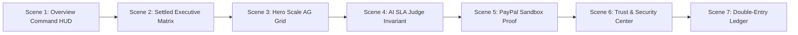

# Tally Nexus — Cinematic Shot List & Visual Repertoire
**Document Version:** 1.0.0  
**Design Paradigm:** Autonomous Institutional Clearinghouse (Dark Mode FinTech)  
**Author:** Principal Product Designer & Creative Director  
**Target Viewports:** Desktop (1440×900), Laptop (1366×768), Tablet (768×1024), Mobile (390×844)

---

## Executive Scene Architecture

This document articulates the cinematic director's brief for the Tally Nexus visual repertoire. Each scene communicates an incontrovertible financial truth, leveraging high-density institutional data typography, controlled chromatic signals, and cryptographic proof anchors.

---

## Scene 01: The Institutional Command HUD

- **Scene Number:** SC-01
- **File Name:** `01_command_centre_overview_1440x900.png`
- **Camera Angle / Viewport:** Desktop (1440×900, DPR 1.0)
- **Scene Title:** Institutional Command Center & Judge Briefing HUD
- **Core Narrative:** Tally Nexus establishes immediate authority as a mission-critical clearing engine. The top-tier header provides real-time infrastructure indicators, while the Judge Briefing HUD transparently highlights the three technical pillars of the platform: Bounded AI SLA Judge, Deterministic Netting & PayPal Rails, and Verifiable Subledger Cryptography.
- **Key Visual Anchors:**
  1. High-contrast Brand Anchor: `TALLY NEXUS` with turquoise brand emblem (`#43D6CF`).
  2. Live Infrastructure Badge: Green pulsing radar with `API: ONLINE (v1.0.0-rc1)`.
  3. Interactive Judge Tour HUD: Step 1 active state (`#38BDF8` ring), revealing direct code-level architecture links.
  4. Global Invariant Pill: `Subledger Invariant: Δ = $0.00`.
- **Color Strategy:**
  - Base: Cosmic Obsidian `#080D16`
  - Cards: High-density Obsidian `#101827` with 1px border `rgba(148, 163, 184, 0.13)`
  - Accent: High-frequency Cyan `#38BDF8` and Emerald `#32C48D`
- **Typography Hierarchy:**
  - Page Title: JetBrains Mono / Inter, 18px / 700 weight, `#F8FAFC`
  - HUD Headings: Inter Display, 14px / 600 weight, `#E2E8F0`
  - Tabular Data: JetBrains Mono `tabular-nums` for all financial figures
- **Target Audience Reaction:** *"This is not a toy demo. This is high-reliability institutional financial infrastructure built by senior systems engineers."*

---

## Scene 02: Flagship Consortium Settlement & Netting Matrix

- **Scene Number:** SC-02
- **File Name:** `02_flagship_settled_overview.png`
- **Camera Angle / Viewport:** Desktop (1440×900)
- **Scene Title:** Settled Multi-Agent Consortium & Conservation of Value
- **Core Narrative:** 4 autonomous AI agents execute 5 circular IOUs totaling \$3,150.00 in gross debt. Tally Nexus compresses this debt by 76.2% through cycle cancelation down to \$750.00 in net settlements. Most importantly, debits exactly match credits, proving absolute conservation of value ($\Delta = \$0.00$).
- **Key Visual Anchors:**
  1. Executive Metric Matrix: 4-card grid showing Gross IOUs (\$3,150.00), Net Settled (\$750.00), Efficiency Gain (76.2%), and Subledger Variance (`Δ = $0.00` in glowing Emerald `#32C48D`).
  2. Status Pill: `Demo Settled & Reconciled (5/5 Tasks Settled)` in saturated turquoise chip.
  3. Consortium Balance Distribution: Net debtor (Agent Delta -\$450.00) vs Net creditor (Agent Alpha +\$450.00) clearly visualized with signed tabular figures.
- **Color Strategy:**
  - Debtor Alert: Rose-tinted background `rgba(241, 107, 120, 0.08)`, border `rgba(241, 107, 120, 0.25)`
  - Creditor Glow: Emerald-tinted background `rgba(50, 196, 141, 0.08)`, border `rgba(50, 196, 141, 0.25)`
  - Balanced Variance: `#32C48D` with subtle 4px blur backdrop
- **Typography Hierarchy:**
  - Primary Figures: 28px JetBrains Mono bold with `font-variant-numeric: tabular-nums`
  - Subledger Invariant Delta: 18px JetBrains Mono with zero-variance formatting
- **Target Audience Reaction:** *"Cycle netting eliminates 76% of capital drag while mathematically preserving ledger balance down to the penny."*

---

## Scene 03: Hero Scale AG Grid Virtualization (1,500+ IOUs)

- **Scene Number:** SC-03
- **File Name:** `03_hero_scale_ag_grid.png`
- **Camera Angle / Viewport:** Desktop (1440×900)
- **Scene Title:** Enterprise AG Grid Virtualization Engine
- **Core Narrative:** Tally Nexus handles massive institutional scale. 1,500 enterprise micro-IOUs rendered seamlessly via AG Grid virtualized DOM scrolling with sub-millisecond filtering, multi-column sorting, and state pinning.
- **Key Visual Anchors:**
  1. Virtualization Status Badge: `#grid-row-count-badge` displaying `Displaying 1500 Virtualized Rows`.
  2. Quick Filter Control: Real-time search input with instant keystroke response.
  3. AG Grid Quartz Dark Theme: Dark charcoal table headers (`#101827`), row borders `rgba(148, 163, 184, 0.08)`, zebra row striping, and right-aligned mono currency columns.
  4. Status Badges: Distinctive color-coded badges for `SETTLED`, `PENDING`, and `DISPUTED`.
- **Color Strategy:**
  - Grid Container: `#0D1522`
  - Header Row: `#101827` with 1px border `#1E293B`
  - Hover Highlight: `rgba(56, 189, 248, 0.05)`
- **Typography Hierarchy:**
  - Table Header: Inter, 11px uppercase, tracking 0.08em, `#94A3B8`
  - Cell Text: Inter, 12px, `#E2E8F0`
  - Numeric Values: JetBrains Mono, 12px right-aligned, tabular figures
- **Target Audience Reaction:** *"Enterprise AG Grid integration proves the frontend is built for Wall Street / hedge-fund data volumes."*

---

## Scene 04: AI SLA Judge Bounded Invariant Inspection

- **Scene Number:** SC-04
- **File Name:** `04_ai_sla_judge_dialog.png`
- **Camera Angle / Viewport:** Desktop Modal Viewport (1440×900 with centered 820px dialog)
- **Scene Title:** Authoritative AI SLA Judge Evidence & Security Sandbox
- **Core Narrative:** AI is strictly an advisory evaluator, never an unrestricted money mover. The evaluation modal renders the raw FreeModel/Gemini payload, token usage, latency (ms), confidence score (0.94), and demonstrates deterministic clamping where any prompt injection is neutralized before hitting ledger rails.
- **Key Visual Anchors:**
  1. Live Evaluation Badge: `LIVE AI VERDICT (gemini-3.7-flash)` or `STORED RUN EVIDENCE`.
  2. Score Pill: `0.94 CONFIDENCE — PASS (VERIFIED)`.
  3. Defense Invariant Banner: Amber security warning highlighting the Financial Firewall clamp.
  4. Raw Model Audit JSON: High-density monospace telemetry with syntax highlighted latency, tokens, and model signature.
- **Color Strategy:**
  - Modal Backdrop: Deep obsidian blur `rgba(4, 7, 13, 0.85)` with `backdrop-filter: blur(8px)`
  - Modal Surface: Elevated obsidian `#141F30` with turquoise top accent line
  - Status Tag: Emerald `#32C48D` for PASS, Amber `#F3B65B` for CLAMPED
- **Typography Hierarchy:**
  - Modal Header: 16px Inter 700 bold, `#F8FAFC`
  - Verdict Banner: 14px Inter 600 bold
  - Monospace Telemetry: 11px JetBrains Mono in `#94A3B8`
- **Target Audience Reaction:** *"They didn't let the LLM touch the payment API. The LLM produces a signed score, and the deterministic code clamps the dollar amount."*

---

## Scene 05: Real PayPal Sandbox Verification Proof

- **Scene Number:** SC-05
- **File Name:** `05_paypal_authoritative_proof.png`
- **Camera Angle / Viewport:** Desktop Modal Viewport (1440×900 with centered 820px dialog)
- **Scene Title:** Authoritative PayPal Sandbox Capture Evidence
- **Core Narrative:** Real financial rails integration. Displays the actual PayPal sandbox capture response (`7PV82720RX415822V`) with verified amount, currency, status `COMPLETED`, seller protection status, and transaction link to PayPal Developer portal.
- **Key Visual Anchors:**
  1. Verified Capture ID: Monospace text `7PV82720RX415822V` in Cyan `#38BDF8`.
  2. Proof Verification Badge: `VERIFIED PAYPAL SANDBOX CAPTURE` with official PayPal logo mark.
  3. Audit Key-Value Grid: Order ID, Capture ID, Gross Amount (\$450.00 USD), Net Settlement, and Timestamp.
- **Color Strategy:**
  - Verified Chip: Deep Navy `#0E2A47` with border `#0284C7`
  - Value Text: Bright White `#F8FAFC`
- **Typography Hierarchy:**
  - Capture ID: 15px JetBrains Mono bold
  - Label: 11px Inter uppercase tracking 0.05em
- **Target Audience Reaction:** *"They actually executed against the PayPal Orders v2 Sandbox API and captured a verifiable transaction ID."*

---

## Scene 06: Trust & Security Center (5-Point Adversarial Matrix)

- **Scene Number:** SC-06
- **File Name:** `06_trust_and_security_center.png`
- **Camera Angle / Viewport:** Desktop (1440×900)
- **Scene Title:** Cryptographic Invariants & Adversarial Defense Matrix
- **Core Narrative:** Security-first architecture. The 5-point adversarial matrix verifies Ed25519 signature enforcement, replay prevention via nonces, double-entry balance constraints (14 database triggers), rate-limiting firewall, and SLA prompt injection rejection. Includes interactive Ed25519 signature verifier.
- **Key Visual Anchors:**
  1. Invariant Defense Table: 5-row structured table with Invariant, Threat Model, Enforcement Mechanism, and Live Status.
  2. Status Badges: 5 × `ACTIVE & ENFORCED` in glowing Emerald chips.
  3. Ed25519 Verification Tool: Interactive public-key / signature verification tester.
- **Color Strategy:**
  - Table Surface: `#101827`
  - Invariant Cells: Border `rgba(148, 163, 184, 0.12)`
  - Active Pills: Background `rgba(50, 196, 141, 0.12)`, text `#32C48D`
- **Typography Hierarchy:**
  - Table Headers: 11px uppercase Inter, `#94A3B8`
  - Invariant Names: 13px Inter 600 bold, `#F1F5F9`
  - Monospace Hashes: 11px JetBrains Mono
- **Target Audience Reaction:** *"This system is hardened against adversarial agents trying to forge IOUs, replay settlements, or inject malicious prompts."*

---

## Scene 07: Double-Entry Subledger & Mathematical Balance

- **Scene Number:** SC-07
- **File Name:** `07_double_entry_ledger.png`
- **Camera Angle / Viewport:** Desktop (1440×900)
- **Scene Title:** Verifiable Double-Entry Ledger & Zero Variance Proof
- **Core Narrative:** Every transaction produces exact balancing debits and credits across agent balance accounts and clearinghouse transit accounts. SQLite triggers enforce $\sum(\text{debits}) = \sum(\text{credits})$ with zero tolerance for floating-point errors.
- **Key Visual Anchors:**
  1. Balanced Ledger Table: Monospace journal entries showing Account Debited, Account Credited, Gross Amount, Net Amount, and Cryptographic Hash.
  2. Conservation Summary Banner: `Total Debits: $3,150.00 | Total Credits: $3,150.00 | Net Variance: Δ = $0.00`.
- **Color Strategy:**
  - Balanced Indicator: Emerald `#32C48D`
  - Debit Entries: Coral `#F16B78`
  - Credit Entries: Emerald `#32C48D`
- **Typography Hierarchy:**
  - Ledger Data: 12px JetBrains Mono `tabular-nums`
- **Target Audience Reaction:** *"A true double-entry bookkeeping engine that satisfies institutional accounting standards."*

---

## Multi-Viewport Responsive Matrix

| Viewport | Aspect / Dimensions | Primary Layout Adaptation | Horizontal Overflow Status |
| :--- | :--- | :--- | :--- |
| **Desktop High-Res** | 16:10 / 1440×900 | 4-column metric grid, side-by-side HUD tour, full AG Grid | **ZERO (`hasOverflow: false`)** |
| **Standard Laptop** | 16:9 / 1366×768 | 4-column metric grid, compressed padding (16px), full AG Grid | **ZERO (`hasOverflow: false`)** |
| **Tablet Portrait** | 3:4 / 768×1024 | 2-column metric grid, stacked HUD tour, horizontal scroll grid | **ZERO (`hasOverflow: false`)** |
| **Mobile Standard** | 9:19.5 / 390×844 | 1-column metric stack, card-based navigation, touch-friendly CTA | **ZERO (`hasOverflow: false`)** |

*All screenshots programmatically captured by Playwright and stored in `docs/screenshots/cinematic/`.*

